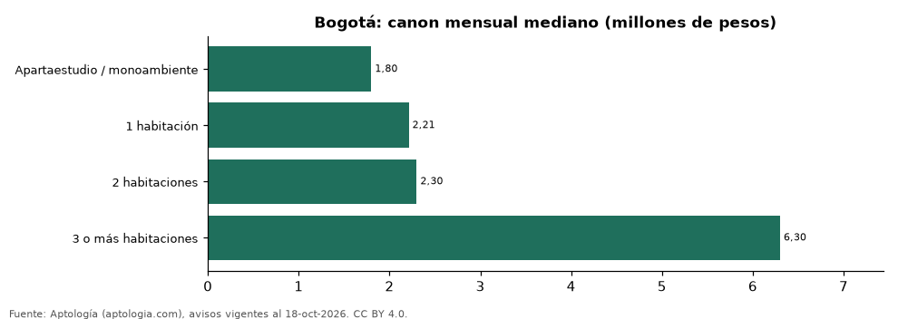

# Arriendo de apartamentos en Bogotá por número de habitaciones: cuánto cuesta cada tamaño (octubre 2026)

**En Bogotá, un apartamento de 1 habitación se arrienda por 2.211.500 pesos al mes en la mediana, uno de 2 habitaciones 2.300.000 pesos (+4,0 %) y uno de 3 o más 6.300.000 pesos (+173,9 %).**

*Resumen: analizamos 13.164 avisos de apartamentos en arriendo en Bogotá con número de habitaciones declarado (sin amoblar).*

**Actualizado:** 18 de octubre de 2026 (datos del 18 de octubre de 2026) · **Próxima actualización:** mensual.

## Resumen

| Indicador | Valor |
|---|---|
| 1 habitación | 2.211.500 pesos |
| 2 habitaciones | 2.300.000 pesos |
| 3 o más habitaciones | 6.300.000 pesos |
| Avisos | 13.164 |

## Canon mensual por número de habitaciones

| Tipo | Canon mensual (mediana) | Rango típico (P25–P75) | Área mediana (m²) | Por m² (mediana) | Avisos |
|---|---|---|---|---|---|
| Apartaestudio / monoambiente | 1.800.000 pesos | 1.444.500 pesos – 2.368.500 pesos | 32 | 56.818 pesos | 2.176 |
| 1 habitación | 2.211.500 pesos | 1.685.456 pesos – 3.205.225 pesos | 42 | 56.373 pesos | 2.500 |
| 2 habitaciones | 2.300.000 pesos | 1.500.000 pesos – 4.200.000 pesos | 60 | 42.000 pesos | 3.832 |
| 3 o más habitaciones | 6.300.000 pesos | 2.900.000 pesos – 12.000.000 pesos | 136 | 42.857 pesos | 4.656 |

Medianas del canon mensual pedido, sin administración ni gastos comunes; el rango típico va del percentil 25 al 75.

## Preguntas frecuentes

**¿Cuánto cuesta arrendar un apartamento de 2 habitaciones en Bogotá?**
2.300.000 pesos al mes en la mediana (octubre de 2026); la mitad central de la oferta está entre 1.500.000 pesos y 4.200.000 pesos.

**¿Y uno de 3 o más habitaciones?**
6.300.000 pesos al mes en la mediana.

## Metodología

- **Fuente:** exportes nocturnos de la base de datos de Aptología (aptologia.com) del 18 de octubre de 2026: avisos vigentes de vivienda en portales inmobiliarios de 13 países, recogidos por Aptología y vistos en línea entre el 11 y el 18 de octubre de 2026. Corte: 18 de octubre de 2026.
- **Depuración:** se eliminan duplicados exactos (misma ciudad, zona, tipo, precio, moneda, área, habitaciones y baños) y los precios fuera del percentil 1–99 de cada país, operación, moneda y tipo; el precio por m² usa solo avisos con área declarada entre 12 y 2.000 m² y también se recorta al P1–P99.
- **Qué se mide:** precios pedidos (publicados), no precios de cierre. En arriendo, el canon mensual sin administración, gastos comunes ni condominio.
- **Muestra mínima:** cada cifra publicada se apoya en al menos 30 avisos; las celdas con menos se omiten.
- **Colombia:** Precios en pesos colombianos, sin conversión de moneda.
- **Sin amoblar:** se excluyen los avisos marcados como amoblados.
- **Cordura:** solo se publica si la mediana crece de 1 a 2 y de 2 a 3 o más habitaciones.
- **Limitaciones:** la cobertura depende de los portales que recorre Aptología en cada país y es mayor en las ciudades grandes y en los segmentos medio-alto y alto; el área es la que declara el aviso, sin verificar; los nombres de zona vienen de los portales.
- **Privacidad:** solo se publican agregados; no se publica ningún dato personal, enlace a avisos ni nombre de anunciante.
- **Datos abiertos:** [datos.csv](datos.csv), licencia CC BY 4.0.

## Cómo citar

Pinzón Pineda, D. M. (2026). *Arriendo de apartamentos en Bogotá por número de habitaciones: cuánto cuesta cada tamaño (octubre 2026)*. Aptología (aptologia.com). https://github.com/elbroker/aptologia-datos/tree/main/estudios/arriendo-por-numero-de-habitaciones-bogota-2026. Datos: datos.csv, licencia CC BY 4.0.
