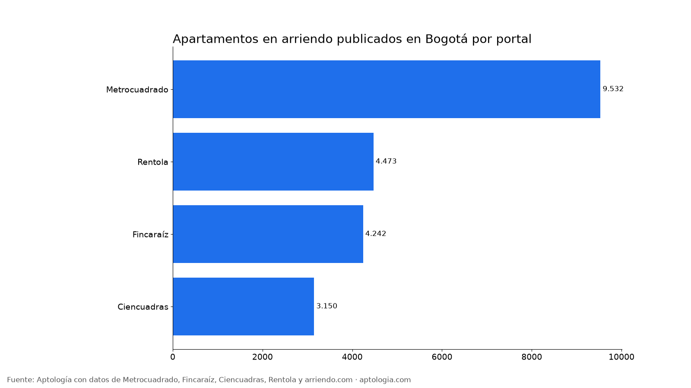
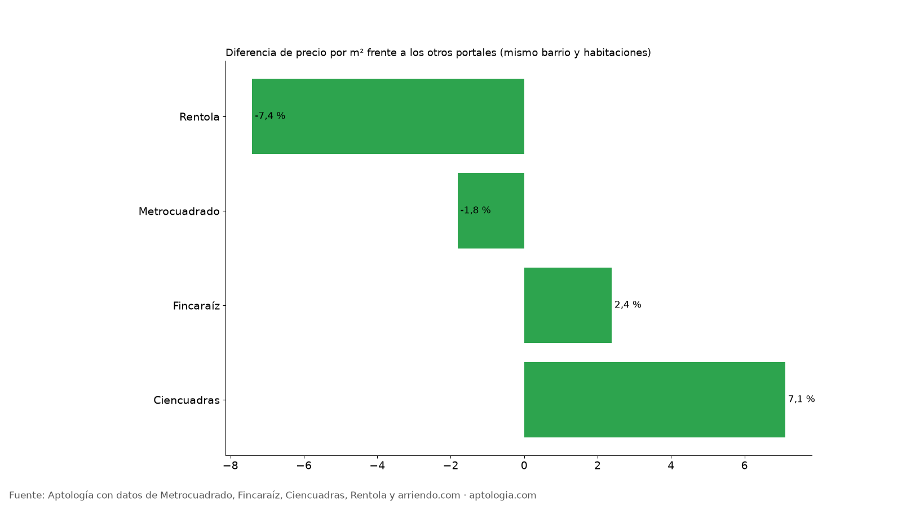

# ¿Qué portal tiene más apartamentos en arriendo y más baratos en Bogotá? Metrocuadrado, Fincaraíz, Ciencuadras y Rentola (2026)

**Metrocuadrado tiene la mayor oferta de apartamentos en arriendo en Bogotá: 9.532 avisos, el 44,5 % de los cuatro grandes portales.** El más barato frente a apartamentos comparables es Rentola, con un precio por m² 7,4 % menor que los otros portales en el mismo barrio y número de habitaciones.

*Resumen: comparamos 21.397 avisos de apartamentos en arriendo en Bogotá en los cuatro portales, sin deduplicar entre portales.*

**Actualizado:** 13 de octubre de 2026 · **Próxima actualización:** mensual.

## Oferta y precio por portal

| Portal | Avisos | % de la oferta | Canon mediano | Por m² | Área mediana | % en estratos 2-3 | Diferencia por m² vs. otros (comparable) |
|---|---|---|---|---|---|---|---|
| Metrocuadrado | 9.532 | 44,5 % | $3.800.000 | $52.190/m² | 74 m² | 21,7 % | -1,8 % |
| Rentola | 4.473 | 20,9 % | $1.565.500 | $35.417/m² | 42 m² | no publica | -7,4 % |
| Fincaraíz | 4.242 | 19,8 % | $3.168.150 | $50.255/m² | 64 m² | 27,7 % | 2,4 % |
| Ciencuadras | 3.150 | 14,7 % | $2.630.500 | $48.000/m² | 56 m² | 38,0 % | 7,1 % |

Rentola tiene la oferta más barata en canon porque concentra apartamentos más pequeños (área mediana 42 m²), y aun comparando dentro del mismo barrio y número de habitaciones sale más barata por m².

**Cómo usarlo para decidir:** busca en más de un portal. El de más oferta te da más opciones, pero cada portal tiene un perfil distinto: Metrocuadrado y Fincaraíz pesan más en estratos altos, Ciencuadras en estratos 2 y 3, y Rentola en apartamentos pequeños.

## Preguntas frecuentes

**¿Qué portal tiene más apartamentos en arriendo en Bogotá?**
Metrocuadrado, con 9.532 avisos de apartamentos (44,5 % de la oferta de los cuatro portales), corte al 13 de octubre de 2026.

**¿En qué portal es más barato el arriendo en Bogotá?**
Frente a apartamentos comparables, Rentola (-7,4 % por m²).

## Metodología

- **Fuente:** base de ingesta diaria de Aptología, con avisos públicos de Metrocuadrado, Fincaraíz, Ciencuadras, Rentola y arriendo.com. Corte al 13 de octubre de 2026.
- **Filtros:** avisos vivos que pasan el control de calidad, en Bogotá, canon entre $400.000 y $30.000.000. Se excluyen TikTok y Facebook Marketplace.
- **Duplicados:** se deja un aviso por grupo de duplicados (el mismo inmueble en varios portales).
- **Prima emparejada:** se compara el precio por m² de avisos de un portal frente a los otros tres dentro de la misma celda de barrio × habitaciones (mínimo 5 avisos por lado), porque Rentola no publica estrato y se reporta la mediana ponderada de las diferencias. Así la prima no se confunde con estrato o tamaño. El atributo se detecta en el texto del aviso, por lo que solo cuentan avisos con descripción. En este estudio no se eliminan los duplicados entre portales, porque se mide la oferta de cada uno; sí se elimina el mismo aviso repetido dentro de un portal.
- **Limitaciones:** son precios pedidos, no cerrados. Los barrios y localidades vienen tal como los escribe cada portal.
- **Datos abiertos:** [datos.csv](data/arriendo_por_portal_bogota_datos.csv), licencia CC BY 4.0.

## Cómo citar

Pinzón Pineda, D. M. (2026). *¿Qué portal tiene más apartamentos en arriendo y más baratos en Bogotá? Metrocuadrado, Fincaraíz, Ciencuadras y Rentola (2026)*. Aptología. https://www.aptologia.com/estudios/arriendo-por-portal-bogota. Datos: datos.csv, licencia CC BY 4.0.
