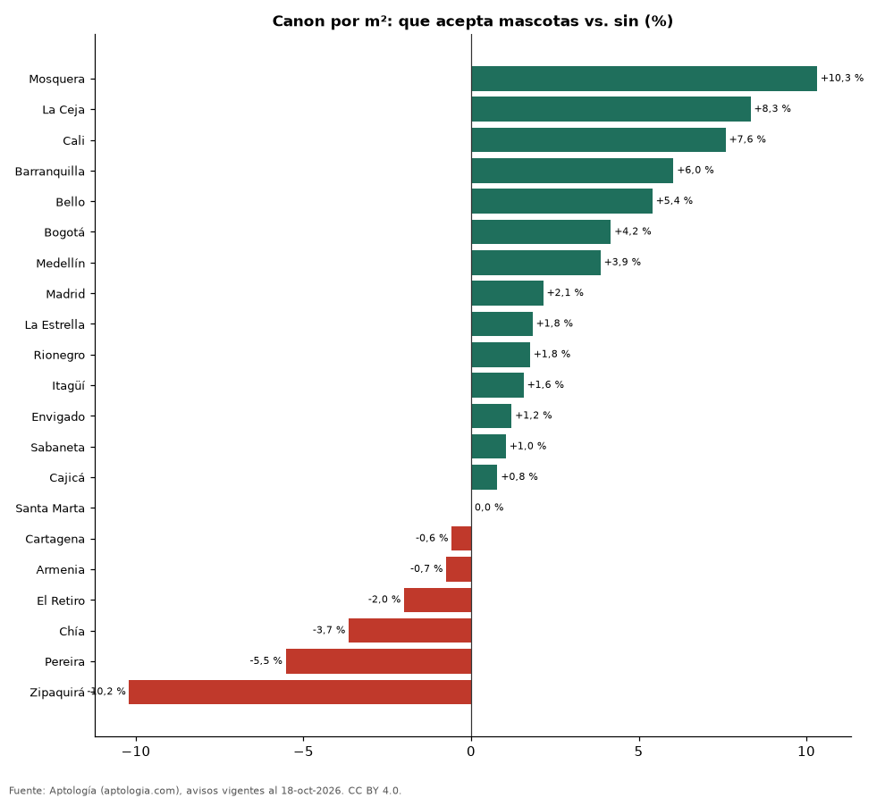

# Arriendos que aceptan mascotas en Colombia: cuántos hay y cuánto cuestan (octubre 2026)

**Un apartamento en arriendo que acepta mascotas se pide en Colombia un 3,1 % más por metro cuadrado que uno comparable sin esa característica (misma ciudad y número de habitaciones).** El 10,6 % de los apartamentos en arriendo lo declara. En Bogotá la diferencia es 4,2 % (12,2 % de la oferta).

*Resumen: comparamos 64.543 apartamentos en arriendo con área declarada, emparejando por ciudad y habitaciones (36 celdas con 30 avisos o más en cada grupo).*

**Actualizado:** 18 de octubre de 2026 (datos del 18 de octubre de 2026) · **Próxima actualización:** mensual.

## Resumen

| Indicador | Valor |
|---|---|
| Diferencia por m² (emparejada) | +3,1 % |
| Parte de la oferta | 10,6 % |
| Ciudades con muestra suficiente | 21 |
| Avisos analizados | 64.543 |

## Diferencia por ciudad

| Ciudad | Diferencia por m² | Con mascotas (pesos/m²) | Sin mascotas (pesos/m²) | Parte de la oferta | Avisos (con / sin) |
|---|---|---|---|---|---|
| Mosquera | +10,3 % | 30.769 | 27.892 | 28,1 % | 47 / 120 |
| La Ceja | +8,3 % | 40.000 | 36.923 | 16,4 % | 58 / 296 |
| Cali | +7,6 % | 32.116 | 29.851 | 12,3 % | 184 / 1.315 |
| Barranquilla | +6,0 % | 35.345 | 33.333 | 10,3 % | 379 / 3.315 |
| Bello | +5,4 % | 35.135 | 33.333 | 16,2 % | 175 / 907 |
| Bogotá | +4,2 % | 50.000 | 48.000 | 12,2 % | 1.586 / 11.368 |
| Medellín | +3,9 % | 50.930 | 49.038 | 6,0 % | 1.204 / 18.864 |
| Madrid | +2,1 % | 21.103 | 20.660 | 30,1 % | 78 / 181 |
| La Estrella | +1,8 % | 38.710 | 38.014 | 27,6 % | 135 / 354 |
| Rionegro | +1,8 % | 38.158 | 37.500 | 14,9 % | 475 / 2.704 |
| Itagüí | +1,6 % | 40.625 | 40.000 | 18,2 % | 165 / 743 |
| Envigado | +1,2 % | 49.412 | 48.824 | 11,0 % | 805 / 6.498 |
| Sabaneta | +1,0 % | 41.333 | 40.909 | 13,8 % | 535 / 3.333 |
| Cajicá | +0,8 % | 34.155 | 33.889 | 16,9 % | 65 / 320 |
| Santa Marta | 0,0 % | 45.000 | 45.000 | 12,2 % | 82 / 592 |
| Cartagena | -0,6 % | 43.860 | 44.118 | 5,3 % | 107 / 1.901 |
| Armenia | -0,7 % | 32.051 | 32.292 | 9,5 % | 32 / 305 |
| El Retiro | -2,0 % | 48.436 | 49.425 | 19,6 % | 106 / 435 |
| Chía | -3,7 % | 32.443 | 33.673 | 16,8 % | 82 / 407 |
| Pereira | -5,5 % | 31.915 | 33.784 | 21,8 % | 333 / 1.197 |
| Zipaquirá | -10,2 % | 20.205 | 22.500 | 17,9 % | 30 / 138 |

Mediana del canon por m² con y sin la característica en cada ciudad (30 avisos o más en cada grupo). La cifra nacional promedia las diferencias dentro de cada combinación de ciudad y número de habitaciones, ponderadas por el número de avisos con la característica.

## Preguntas frecuentes

**¿Cuánto más cuesta arrendar un apartamento que acepta mascotas en Colombia?**
En la oferta de octubre de 2026, un 3,1 % más por metro cuadrado que uno comparable.

**¿Qué porcentaje de los arriendos en Colombia es que acepta mascotas?**
El 10,6 % de los apartamentos en arriendo con el dato informado.

## Metodología

- **Fuente:** exportes nocturnos de la base de datos de Aptología (aptologia.com) del 18 de octubre de 2026: avisos vigentes de vivienda en portales inmobiliarios de 13 países, recogidos por Aptología y vistos en línea entre el 11 y el 18 de octubre de 2026. Corte: 18 de octubre de 2026.
- **Depuración:** se eliminan duplicados exactos (misma ciudad, zona, tipo, precio, moneda, área, habitaciones y baños) y los precios fuera del percentil 1–99 de cada país, operación, moneda y tipo; el precio por m² usa solo avisos con área declarada entre 12 y 2.000 m² y también se recorta al P1–P99.
- **Qué se mide:** precios pedidos (publicados), no precios de cierre. En arriendo, el canon mensual sin administración, gastos comunes ni condominio.
- **Muestra mínima:** cada cifra publicada se apoya en al menos 30 avisos; las celdas con menos se omiten.
- **Colombia:** Precios en pesos colombianos, sin conversión de moneda. Los indicadores de amoblado, mascotas, conjunto cerrado, balcón y aviso directo del dueño solo existen en arriendo y vienen de los portales.
- **Limitaciones:** la cobertura depende de los portales que recorre Aptología en cada país y es mayor en las ciudades grandes y en los segmentos medio-alto y alto; el área es la que declara el aviso, sin verificar; los nombres de zona vienen de los portales.
- **Privacidad:** solo se publican agregados; no se publica ningún dato personal, enlace a avisos ni nombre de anunciante.
- **Datos abiertos:** [datos.csv](datos.csv), licencia CC BY 4.0.

## Cómo citar

Pinzón Pineda, D. M. (2026). *Arriendos que aceptan mascotas en Colombia: cuántos hay y cuánto cuestan (octubre 2026)*. Aptología (aptologia.com). https://github.com/elbroker/aptologia-datos/tree/main/estudios/arriendo-que-acepta-mascotas-colombia-2026. Datos: datos.csv, licencia CC BY 4.0.
