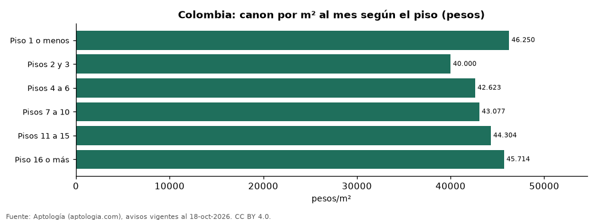

# Arriendo según el piso: canon por m² de pisos bajos y altos en las ciudades de Colombia (octubre 2026)

**En Colombia un apartamento en el piso 16 o más se arrienda en la mediana por 45.714 pesos el m² al mes, frente a 46.250 pesos en el piso 1 (-1,2 %).** Comparando piso 8 o más con pisos 1 a 3 dentro de cada ciudad, la mayor prima del piso alto está en Manizales (+34,4 %).

*Resumen: analizamos 37.906 apartamentos en arriendo con piso y área declarados.*

**Actualizado:** 18 de octubre de 2026 (datos del 18 de octubre de 2026) · **Próxima actualización:** mensual.

## Resumen

| Indicador | Valor |
|---|---|
| Piso 1 o menos | 46.250 pesos |
| Pisos 2 y 3 | 40.000 pesos |
| Pisos 4 a 6 | 42.623 pesos |
| Pisos 7 a 10 | 43.077 pesos |
| Pisos 11 a 15 | 44.304 pesos |
| Piso 16 o más | 45.714 pesos |

## Colombia: canon por m² según el piso

| Piso | Canon por m² al mes | Avisos |
|---|---|---|
| Piso 1 o menos | 46.250 pesos | 9.544 |
| Pisos 2 y 3 | 40.000 pesos | 7.247 |
| Pisos 4 a 6 | 42.623 pesos | 8.096 |
| Pisos 7 a 10 | 43.077 pesos | 5.737 |
| Pisos 11 a 15 | 44.304 pesos | 3.869 |
| Piso 16 o más | 45.714 pesos | 3.413 |

Mediana del canon pedido por m² en cada tramo de piso. Los edificios altos suelen ser más nuevos y estar en zonas más caras, lo que también explica la diferencia.

## Prima del piso alto por ciudad

| Ciudad | Piso 8 o más vs. pisos 1 a 3 | Avisos (alto / bajo) |
|---|---|---|
| Rionegro | -7,6 % | 585 / 534 |
| Armenia | -2,7 % | 178 / 50 |
| Sabaneta | +2,9 % | 1.221 / 457 |
| Bogotá | +4,8 % | 1.687 / 3.495 |
| Envigado | +6,1 % | 1.141 / 1.812 |
| Madrid | +7,5 % | 47 / 40 |
| La Estrella | +8,8 % | 147 / 40 |
| Bello | +11,4 % | 392 / 99 |
| Pereira | +11,7 % | 431 / 522 |
| La Ceja | +14,6 % | 42 / 108 |
| Cúcuta | +15,0 % | 31 / 53 |
| Medellín | +15,1 % | 3.161 / 7.023 |
| Itagüí | +16,1 % | 239 / 118 |
| Santa Marta | +17,6 % | 188 / 171 |
| Cartagena | +18,0 % | 295 / 358 |
| Floridablanca | +20,4 % | 71 / 30 |
| Cali | +21,8 % | 280 / 385 |
| Barranquilla | +23,7 % | 627 / 559 |
| Bucaramanga | +29,1 % | 85 / 63 |
| Manizales | +34,4 % | 73 / 72 |

Mediana del canon por m², piso 8 o más frente a pisos 1 a 3 (30 avisos o más en cada grupo).

## Preguntas frecuentes

**¿Es más caro arrendar en un piso alto?**
En el conjunto del país casi no cambia: el piso 16 o más se arrienda -1,2 % por m² frente al piso 1. Dentro de cada ciudad la prima del piso 8 o más frente a los pisos 1 a 3 va de -7,6 % (Rionegro) a +34,4 % (Manizales).

**¿Cuál es el piso más caro para arrendar?**
El tramo de piso 1 o menos, con 46.250 pesos por m² al mes.

## Metodología

- **Fuente:** exportes nocturnos de la base de datos de Aptología (aptologia.com) del 18 de octubre de 2026: avisos vigentes de vivienda en portales inmobiliarios de 13 países, recogidos por Aptología y vistos en línea entre el 11 y el 18 de octubre de 2026. Corte: 18 de octubre de 2026.
- **Depuración:** se eliminan duplicados exactos (misma ciudad, zona, tipo, precio, moneda, área, habitaciones y baños) y los precios fuera del percentil 1–99 de cada país, operación, moneda y tipo; el precio por m² usa solo avisos con área declarada entre 12 y 2.000 m² y también se recorta al P1–P99.
- **Qué se mide:** precios pedidos (publicados), no precios de cierre. En arriendo, el canon mensual sin administración, gastos comunes ni condominio.
- **Muestra mínima:** cada cifra publicada se apoya en al menos 30 avisos; las celdas con menos se omiten.
- **Colombia:** Precios en pesos colombianos, sin conversión de moneda.
- **Limitaciones:** la cobertura depende de los portales que recorre Aptología en cada país y es mayor en las ciudades grandes y en los segmentos medio-alto y alto; el área es la que declara el aviso, sin verificar; los nombres de zona vienen de los portales.
- **Privacidad:** solo se publican agregados; no se publica ningún dato personal, enlace a avisos ni nombre de anunciante.
- **Datos abiertos:** [datos.csv](datos.csv), licencia CC BY 4.0.

## Cómo citar

Pinzón Pineda, D. M. (2026). *Arriendo según el piso: canon por m² de pisos bajos y altos en las ciudades de Colombia (octubre 2026)*. Aptología (aptologia.com). https://github.com/elbroker/aptologia-datos/tree/main/estudios/arriendo-segun-el-piso-ciudades-colombia-2026. Datos: datos.csv, licencia CC BY 4.0.
