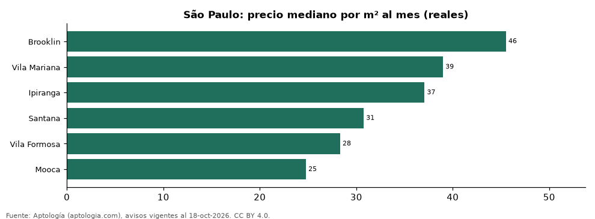

# Bairros más caros y más baratos de São Paulo para alquilar casa: ranking por m² (octubre 2026)

**En São Paulo, el bairro con el m² más caro para alquilar casa es Brooklin (45,5 reales (USD 8,9)/m² al mes) y el más barato Mooca (24,8 reales (USD 4,9)/m² al mes), 1,8 veces menos.** Comparamos 6 bairros con al menos 30 avisos con área.

*Resumen: analizamos 229 casas en alquiler con área declarada en 6 bairros de São Paulo.*

**Actualizado:** 18 de octubre de 2026 (datos del 18 de octubre de 2026) · **Próxima actualización:** mensual.

## Resumen

| Indicador | Valor |
|---|---|
| Más caro por m² | Brooklin: 45,5 reales (USD 8,9) |
| Más barato por m² | Mooca: 24,8 reales (USD 4,9) |
| Diferencia | 1,8 veces |
| Bairros | 6 |

## Ranking de bairros por precio del m²

| Bairro | Por m² (mediana) | Canon (mediana) | Área mediana (m²) | Avisos con área |
|---|---|---|---|---|
| Brooklin | 45,5 reales (USD 8,9) | 10.915 reales (USD 2.145) | 242 | 44 |
| Vila Mariana | 39,0 reales (USD 7,7) | 7.705 reales (USD 1.514) | 206 | 44 |
| Ipiranga | 37,1 reales (USD 7,3) | 5.750 reales (USD 1.130) | 180 | 30 |
| Santana | 30,8 reales (USD 6,0) | 5.290 reales (USD 1.040) | 188 | 30 |
| Vila Formosa | 28,3 reales (USD 5,6) | 4.380 reales (USD 861) | 150 | 41 |
| Mooca | 24,8 reales (USD 4,9) | 4.695 reales (USD 923) | 192 | 40 |

Medianas; solo bairros con 30 avisos o más con área declarada.

## Preguntas frecuentes

**¿Cuál es el bairro más caro de São Paulo para alquilar?**
Brooklin, con 45,5 reales (USD 8,9) por m² al mes en la mediana (octubre de 2026).

**¿Y el más barato?**
Mooca, con 24,8 reales (USD 4,9) por m² al mes.

## Metodología

- **Fuente:** exportes nocturnos de la base de datos de Aptología (aptologia.com) del 18 de octubre de 2026: avisos vigentes de vivienda en portales inmobiliarios de 13 países, recogidos por Aptología y vistos en línea entre el 11 y el 18 de octubre de 2026. Corte: 18 de octubre de 2026.
- **Depuración:** se eliminan duplicados exactos (misma ciudad, zona, tipo, precio, moneda, área, habitaciones y baños) y los precios fuera del percentil 1–99 de cada país, operación, moneda y tipo; el precio por m² usa solo avisos con área declarada entre 12 y 2.000 m² y también se recorta al P1–P99.
- **Qué se mide:** precios pedidos (publicados), no precios de cierre. En arriendo, el canon mensual sin administración, gastos comunes ni condominio.
- **Muestra mínima:** cada cifra publicada se apoya en al menos 30 avisos; las celdas con menos se omiten.
- **Monedas:** nunca se mezclan avisos de monedas distintas sin convertirlos. Conversión a dólares con la tasa de mercado de ExchangeRate-API (open.er-api.com, actualización del 18 Oct 2026): 1 USD = 3.182,80 COP, 1 USD = 18,47 M.N, 1 USD = 5,09 BRL, 1 USD = 3,44 PEN, 1 USD = 982,44 CLP, 1 USD = 1.514,57 ARS, 1 USD = 40,20 UYU, 1 USD = 5.705,37 PYG, 1 USD = 61,27 DOP, 1 USD = 0,89 EUR, 1 USD = 11,72 BOB; la UF chilena a 41.178,64 CLP (mindicador,cl. 18-oct-2026). Los avisos publicados en dólares se usan tal cual.
- **Monedas:** en cada ciudad y operación se usa solo la moneda mayoritaria de los avisos (los avisos en otra moneda se excluyen) y la mediana se convierte a dólares con la tasa citada; nunca se promedian avisos de monedas distintas.
- **Limitaciones:** la cobertura depende de los portales que recorre Aptología en cada país y es mayor en las ciudades grandes y en los segmentos medio-alto y alto; el área es la que declara el aviso, sin verificar; los nombres de zona vienen de los portales.
- **Privacidad:** solo se publican agregados; no se publica ningún dato personal, enlace a avisos ni nombre de anunciante.
- **Datos abiertos:** [datos.csv](datos.csv), licencia CC BY 4.0.

## Cómo citar

Pinzón Pineda, D. M. (2026). *Bairros más caros y más baratos de São Paulo para alquilar casa: ranking por m² (octubre 2026)*. Aptología (aptologia.com). https://github.com/elbroker/aptologia-datos/tree/main/estudios/bairros-con-casas-mas-caras-y-baratas-sao-paulo-alquiler-m2-2026. Datos: datos.csv, licencia CC BY 4.0.
