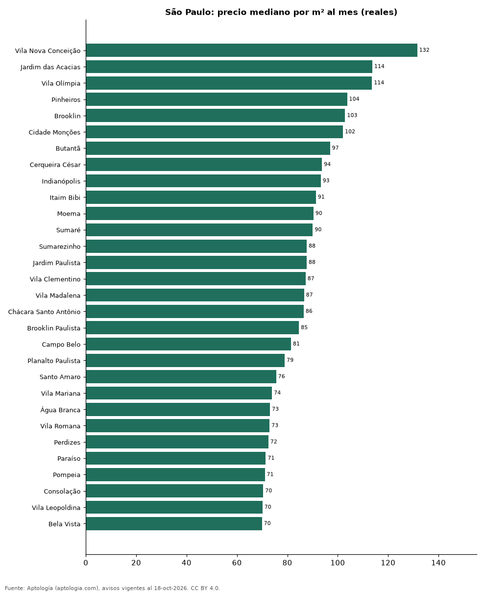

# Bairros más caros y más baratos de São Paulo para alquilar apartamento: ranking por m² (octubre 2026)

**En São Paulo, el bairro con el m² más caro para alquilar apartamento es Vila Nova Conceição (131,6 reales (USD 25,9)/m² al mes) y el más barato Itaquera (39,6 reales (USD 7,8)/m² al mes), 3,3 veces menos.** Comparamos 73 bairros con al menos 30 avisos con área.

*Resumen: analizamos 7.435 apartamentos en alquiler con área declarada en 73 bairros de São Paulo.*

**Actualizado:** 18 de octubre de 2026 (datos del 18 de octubre de 2026) · **Próxima actualización:** mensual.

## Resumen

| Indicador | Valor |
|---|---|
| Más caro por m² | Vila Nova Conceição: 131,6 reales (USD 25,9) |
| Más barato por m² | Itaquera: 39,6 reales (USD 7,8) |
| Diferencia | 3,3 veces |
| Bairros | 73 |

## Ranking de bairros por precio del m²

| Bairro | Por m² (mediana) | Canon (mediana) | Área mediana (m²) | Avisos con área |
|---|---|---|---|---|
| Vila Nova Conceição | 131,6 reales (USD 25,9) | 10.000 reales (USD 1.965) | 80 | 177 |
| Jardim das Acacias | 113,7 reales (USD 22,3) | 8.500 reales (USD 1.670) | 77 | 40 |
| Vila Olímpia | 113,6 reales (USD 22,3) | 6.800 reales (USD 1.336) | 69 | 376 |
| Pinheiros | 103,7 reales (USD 20,4) | 6.245 reales (USD 1.227) | 68 | 496 |
| Brooklin | 102,9 reales (USD 20,2) | 7.450 reales (USD 1.464) | 77 | 315 |
| Cidade Monções | 102,1 reales (USD 20,1) | 9.500 reales (USD 1.867) | 97 | 63 |
| Butantã | 96,9 reales (USD 19,1) | 3.500 reales (USD 688) | 36 | 120 |
| Cerqueira César | 93,8 reales (USD 18,4) | 9.000 reales (USD 1.769) | 100 | 131 |
| Indianópolis | 93,3 reales (USD 18,3) | 6.000 reales (USD 1.179) | 76 | 134 |
| Itaim Bibi | 91,3 reales (USD 17,9) | 8.700 reales (USD 1.710) | 100 | 290 |
| Moema | 90,4 reales (USD 17,8) | 6.500 reales (USD 1.277) | 80 | 301 |
| Sumaré | 90,1 reales (USD 17,7) | 5.500 reales (USD 1.081) | 69 | 45 |
| Sumarezinho | 87,7 reales (USD 17,2) | 4.434 reales (USD 871) | 63 | 52 |
| Jardim Paulista | 87,7 reales (USD 17,2) | 8.016 reales (USD 1.575) | 106 | 282 |
| Vila Clementino | 87,2 reales (USD 17,1) | 3.970 reales (USD 780) | 52 | 114 |
| Vila Madalena | 86,6 reales (USD 17,0) | 5.970 reales (USD 1.173) | 71 | 99 |
| Chácara Santo Antônio | 86,5 reales (USD 17,0) | 4.960 reales (USD 975) | 70 | 69 |
| Brooklin Paulista | 84,6 reales (USD 16,6) | 8.000 reales (USD 1.572) | 84 | 41 |
| Campo Belo | 81,4 reales (USD 16,0) | 5.775 reales (USD 1.135) | 70 | 174 |
| Planalto Paulista | 79,0 reales (USD 15,5) | 3.945 reales (USD 775) | 74 | 36 |
| Santo Amaro | 75,6 reales (USD 14,8) | 4.284 reales (USD 842) | 63 | 139 |
| Vila Mariana | 73,9 reales (USD 14,5) | 5.035 reales (USD 989) | 75 | 256 |
| Água Branca | 73,1 reales (USD 14,4) | 2.600 reales (USD 511) | 42 | 97 |
| Vila Romana | 72,9 reales (USD 14,3) | 4.845 reales (USD 952) | 74 | 54 |
| Perdizes | 72,5 reales (USD 14,2) | 5.620 reales (USD 1.104) | 98 | 227 |
| Paraíso | 71,4 reales (USD 14,0) | 7.500 reales (USD 1.474) | 105 | 145 |
| Pompeia | 71,1 reales (USD 14,0) | 3.825 reales (USD 752) | 70 | 35 |
| Consolação | 70,4 reales (USD 13,8) | 3.950 reales (USD 776) | 55 | 140 |
| Vila Leopoldina | 70,1 reales (USD 13,8) | 6.000 reales (USD 1.179) | 79 | 71 |
| Bela Vista | 69,9 reales (USD 13,7) | 3.475 reales (USD 683) | 50 | 188 |
| Vila Anastácio | 67,3 reales (USD 13,2) | 3.900 reales (USD 766) | 62 | 33 |
| Barra Funda | 67,0 reales (USD 13,2) | 2.695 reales (USD 530) | 41 | 114 |
| Vila da Saúde | 64,2 reales (USD 12,6) | 3.515 reales (USD 691) | 60 | 36 |
| Vila Regente Feijó | 64,1 reales (USD 12,6) | 4.800 reales (USD 943) | 78 | 34 |
| Vila Buarque | 62,9 reales (USD 12,4) | 2.690 reales (USD 529) | 40 | 35 |
| Ipiranga | 62,5 reales (USD 12,3) | 3.220 reales (USD 633) | 58 | 97 |
| Belém | 61,7 reales (USD 12,1) | 2.700 reales (USD 531) | 44 | 40 |
| Pompéia | 61,4 reales (USD 12,1) | 4.300 reales (USD 845) | 70 | 71 |
| Aclimação | 61,2 reales (USD 12,0) | 3.300 reales (USD 649) | 56 | 52 |
| Mooca | 61,2 reales (USD 12,0) | 2.390 reales (USD 470) | 43 | 188 |
| Belenzinho | 60,2 reales (USD 11,8) | 2.445 reales (USD 480) | 42 | 42 |
| Tucuruvi | 60,0 reales (USD 11,8) | 3.000 reales (USD 590) | 57 | 51 |
| Tatuapé | 58,5 reales (USD 11,5) | 3.390 reales (USD 666) | 63 | 171 |
| Jardim Anália Franco | 57,6 reales (USD 11,3) | 4.235 reales (USD 832) | 69 | 52 |
| Água Fria | 57,5 reales (USD 11,3) | 2.600 reales (USD 511) | 48 | 44 |
| Santa Cecília | 56,6 reales (USD 11,1) | 3.150 reales (USD 619) | 56 | 50 |
| Panamby | 56,2 reales (USD 11,1) | 4.000 reales (USD 786) | 79 | 91 |
| Brás | 56,0 reales (USD 11,0) | 2.332 reales (USD 458) | 45 | 70 |
| Saúde | 55,9 reales (USD 11,0) | 3.300 reales (USD 649) | 62 | 43 |
| Vila Santa Clara | 55,2 reales (USD 10,8) | 1.950 reales (USD 383) | 36 | 33 |
| Vila Gustavo | 55,0 reales (USD 10,8) | 2.200 reales (USD 432) | 42 | 33 |
| Liberdade | 54,9 reales (USD 10,8) | 2.380 reales (USD 468) | 44 | 44 |
| Higienópolis | 54,6 reales (USD 10,7) | 6.325 reales (USD 1.243) | 110 | 62 |
| Vila Gomes Cardim | 54,6 reales (USD 10,7) | 5.735 reales (USD 1.127) | 90 | 38 |
| Cambuci | 54,2 reales (USD 10,7) | 2.250 reales (USD 442) | 42 | 73 |
| Vila Andrade | 53,0 reales (USD 10,4) | 3.500 reales (USD 688) | 70 | 218 |
| Vila Prudente | 52,2 reales (USD 10,3) | 2.525 reales (USD 496) | 45 | 56 |
| Vila Ema | 52,1 reales (USD 10,2) | 2.000 reales (USD 393) | 40 | 37 |
| Vila Mazzei | 52,0 reales (USD 10,2) | 2.135 reales (USD 420) | 42 | 38 |
| Jardim Íris | 51,4 reales (USD 10,1) | 2.498 reales (USD 491) | 44 | 34 |
| Santana | 50,0 reales (USD 9,8) | 3.000 reales (USD 590) | 58 | 150 |
| Jardim Marajoara | 50,0 reales (USD 9,8) | 2.850 reales (USD 560) | 68 | 53 |
| Freguesia do Ó | 49,1 reales (USD 9,7) | 2.030 reales (USD 399) | 40 | 50 |
| Vila Mascote | 48,0 reales (USD 9,4) | 4.140 reales (USD 814) | 77 | 39 |
| Vila Formosa | 47,7 reales (USD 9,4) | 2.250 reales (USD 442) | 45 | 68 |
| Casa Verde | 46,7 reales (USD 9,2) | 2.645 reales (USD 520) | 61 | 36 |
| Vila Guilherme | 46,6 reales (USD 9,2) | 2.200 reales (USD 432) | 42 | 40 |
| Jaguaré | 46,2 reales (USD 9,1) | 2.305 reales (USD 453) | 44 | 42 |
| Jabaquara | 45,9 reales (USD 9,0) | 2.470 reales (USD 485) | 47 | 37 |
| Morumbi | 45,8 reales (USD 9,0) | 3.040 reales (USD 597) | 69 | 75 |
| Vila Carrão | 44,9 reales (USD 8,8) | 2.280 reales (USD 448) | 48 | 48 |
| Vila Suzana | 41,0 reales (USD 8,1) | 5.080 reales (USD 998) | 115 | 53 |
| Itaquera | 39,6 reales (USD 7,8) | 1.500 reales (USD 295) | 40 | 57 |

Medianas; solo bairros con 30 avisos o más con área declarada.

## Preguntas frecuentes

**¿Cuál es el bairro más caro de São Paulo para alquilar?**
Vila Nova Conceição, con 131,6 reales (USD 25,9) por m² al mes en la mediana (octubre de 2026).

**¿Y el más barato?**
Itaquera, con 39,6 reales (USD 7,8) por m² al mes.

## Metodología

- **Fuente:** exportes nocturnos de la base de datos de Aptología (aptologia.com) del 18 de octubre de 2026: avisos vigentes de vivienda en portales inmobiliarios de 13 países, recogidos por Aptología y vistos en línea entre el 11 y el 18 de octubre de 2026. Corte: 18 de octubre de 2026.
- **Depuración:** se eliminan duplicados exactos (misma ciudad, zona, tipo, precio, moneda, área, habitaciones y baños) y los precios fuera del percentil 1–99 de cada país, operación, moneda y tipo; el precio por m² usa solo avisos con área declarada entre 12 y 2.000 m² y también se recorta al P1–P99.
- **Qué se mide:** precios pedidos (publicados), no precios de cierre. En arriendo, el canon mensual sin administración, gastos comunes ni condominio.
- **Muestra mínima:** cada cifra publicada se apoya en al menos 30 avisos; las celdas con menos se omiten.
- **Monedas:** nunca se mezclan avisos de monedas distintas sin convertirlos. Conversión a dólares con la tasa de mercado de ExchangeRate-API (open.er-api.com, actualización del 18 Oct 2026): 1 USD = 3.182,80 COP, 1 USD = 18,47 M.N, 1 USD = 5,09 BRL, 1 USD = 3,44 PEN, 1 USD = 982,44 CLP, 1 USD = 1.514,57 ARS, 1 USD = 40,20 UYU, 1 USD = 5.705,37 PYG, 1 USD = 61,27 DOP, 1 USD = 0,89 EUR, 1 USD = 11,72 BOB; la UF chilena a 41.178,64 CLP (mindicador,cl. 18-oct-2026). Los avisos publicados en dólares se usan tal cual.
- **Monedas:** en cada ciudad y operación se usa solo la moneda mayoritaria de los avisos (los avisos en otra moneda se excluyen) y la mediana se convierte a dólares con la tasa citada; nunca se promedian avisos de monedas distintas.
- **Limitaciones:** la cobertura depende de los portales que recorre Aptología en cada país y es mayor en las ciudades grandes y en los segmentos medio-alto y alto; el área es la que declara el aviso, sin verificar; los nombres de zona vienen de los portales.
- **Privacidad:** solo se publican agregados; no se publica ningún dato personal, enlace a avisos ni nombre de anunciante.
- **Datos abiertos:** [datos.csv](datos.csv), licencia CC BY 4.0.

## Cómo citar

Pinzón Pineda, D. M. (2026). *Bairros más caros y más baratos de São Paulo para alquilar apartamento: ranking por m² (octubre 2026)*. Aptología (aptologia.com). https://github.com/elbroker/aptologia-datos/tree/main/estudios/bairros-mas-caros-y-baratos-sao-paulo-alquiler-m2-2026. Datos: datos.csv, licencia CC BY 4.0.
