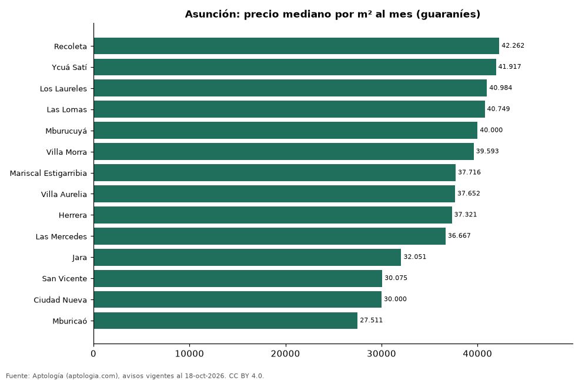

# Barrios más caros y más baratos de Asunción para alquilar casa: ranking por m² (octubre 2026)

**En Asunción, el barrio con el m² más caro para alquilar casa es Recoleta (42.261,9 guaraníes (USD 7,4)/m² al mes) y el más barato Mburicaó (27.511,5 guaraníes (USD 4,8)/m² al mes), 1,5 veces menos.** Comparamos 14 barrios con al menos 30 avisos con área.

*Resumen: analizamos 703 casas en alquiler con área declarada en 14 barrios de Asunción.*

**Actualizado:** 18 de octubre de 2026 (datos del 18 de octubre de 2026) · **Próxima actualización:** mensual.

## Resumen

| Indicador | Valor |
|---|---|
| Más caro por m² | Recoleta: 42.261,9 guaraníes (USD 7,4) |
| Más barato por m² | Mburicaó: 27.511,5 guaraníes (USD 4,8) |
| Diferencia | 1,5 veces |
| Barrios | 14 |

## Ranking de barrios por precio del m²

| Barrio | Por m² (mediana) | Canon (mediana) | Área mediana (m²) | Avisos con área |
|---|---|---|---|---|
| Recoleta | 42.261,9 guaraníes (USD 7,4) | 10.000.000 guaraníes (USD 1.753) | 245 | 58 |
| Ycuá Satí | 41.916,7 guaraníes (USD 7,3) | 10.000.000 guaraníes (USD 1.753) | 245 | 62 |
| Los Laureles | 40.983,6 guaraníes (USD 7,2) | 10.000.000 guaraníes (USD 1.753) | 250 | 51 |
| Las Lomas | 40.749,4 guaraníes (USD 7,1) | 12.750.000 guaraníes (USD 2.235) | 300 | 52 |
| Mburucuyá | 40.000,0 guaraníes (USD 7,0) | 10.000.000 guaraníes (USD 1.753) | 245 | 78 |
| Villa Morra | 39.592,8 guaraníes (USD 6,9) | 10.000.000 guaraníes (USD 1.753) | 270 | 39 |
| Mariscal Estigarribia | 37.715,5 guaraníes (USD 6,6) | 10.900.000 guaraníes (USD 1.910) | 281 | 44 |
| Villa Aurelia | 37.651,8 guaraníes (USD 6,6) | 7.900.000 guaraníes (USD 1.385) | 280 | 54 |
| Herrera | 37.321,4 guaraníes (USD 6,5) | 10.500.000 guaraníes (USD 1.840) | 240 | 52 |
| Las Mercedes | 36.666,7 guaraníes (USD 6,4) | 10.000.000 guaraníes (USD 1.753) | 288 | 51 |
| Jara | 32.051,3 guaraníes (USD 5,6) | 7.000.000 guaraníes (USD 1.227) | 250 | 39 |
| San Vicente | 30.075,0 guaraníes (USD 5,3) | 6.500.000 guaraníes (USD 1.139) | 200 | 40 |
| Ciudad Nueva | 30.000,0 guaraníes (USD 5,3) | 8.000.000 guaraníes (USD 1.402) | 300 | 39 |
| Mburicaó | 27.511,5 guaraníes (USD 4,8) | 8.750.000 guaraníes (USD 1.534) | 300 | 44 |

Medianas; solo barrios con 30 avisos o más con área declarada.

## Preguntas frecuentes

**¿Cuál es el barrio más caro de Asunción para alquilar?**
Recoleta, con 42.261,9 guaraníes (USD 7,4) por m² al mes en la mediana (octubre de 2026).

**¿Y el más barato?**
Mburicaó, con 27.511,5 guaraníes (USD 4,8) por m² al mes.

## Metodología

- **Fuente:** exportes nocturnos de la base de datos de Aptología (aptologia.com) del 18 de octubre de 2026: avisos vigentes de vivienda en portales inmobiliarios de 13 países, recogidos por Aptología y vistos en línea entre el 11 y el 18 de octubre de 2026. Corte: 18 de octubre de 2026.
- **Depuración:** se eliminan duplicados exactos (misma ciudad, zona, tipo, precio, moneda, área, habitaciones y baños) y los precios fuera del percentil 1–99 de cada país, operación, moneda y tipo; el precio por m² usa solo avisos con área declarada entre 12 y 2.000 m² y también se recorta al P1–P99.
- **Qué se mide:** precios pedidos (publicados), no precios de cierre. En arriendo, el canon mensual sin administración, gastos comunes ni condominio.
- **Muestra mínima:** cada cifra publicada se apoya en al menos 30 avisos; las celdas con menos se omiten.
- **Monedas:** nunca se mezclan avisos de monedas distintas sin convertirlos. Conversión a dólares con la tasa de mercado de ExchangeRate-API (open.er-api.com, actualización del 18 Oct 2026): 1 USD = 3.182,80 COP, 1 USD = 18,47 M.N, 1 USD = 5,09 BRL, 1 USD = 3,44 PEN, 1 USD = 982,44 CLP, 1 USD = 1.514,57 ARS, 1 USD = 40,20 UYU, 1 USD = 5.705,37 PYG, 1 USD = 61,27 DOP, 1 USD = 0,89 EUR, 1 USD = 11,72 BOB; la UF chilena a 41.178,64 CLP (mindicador,cl. 18-oct-2026). Los avisos publicados en dólares se usan tal cual.
- **Monedas:** en cada ciudad y operación se usa solo la moneda mayoritaria de los avisos (los avisos en otra moneda se excluyen) y la mediana se convierte a dólares con la tasa citada; nunca se promedian avisos de monedas distintas.
- **Limitaciones:** la cobertura depende de los portales que recorre Aptología en cada país y es mayor en las ciudades grandes y en los segmentos medio-alto y alto; el área es la que declara el aviso, sin verificar; los nombres de zona vienen de los portales.
- **Privacidad:** solo se publican agregados; no se publica ningún dato personal, enlace a avisos ni nombre de anunciante.
- **Datos abiertos:** [datos.csv](datos.csv), licencia CC BY 4.0.

## Cómo citar

Pinzón Pineda, D. M. (2026). *Barrios más caros y más baratos de Asunción para alquilar casa: ranking por m² (octubre 2026)*. Aptología (aptologia.com). https://github.com/elbroker/aptologia-datos/tree/main/estudios/barrios-con-casas-mas-caras-y-baratas-asuncion-alquiler-m2-2026. Datos: datos.csv, licencia CC BY 4.0.
