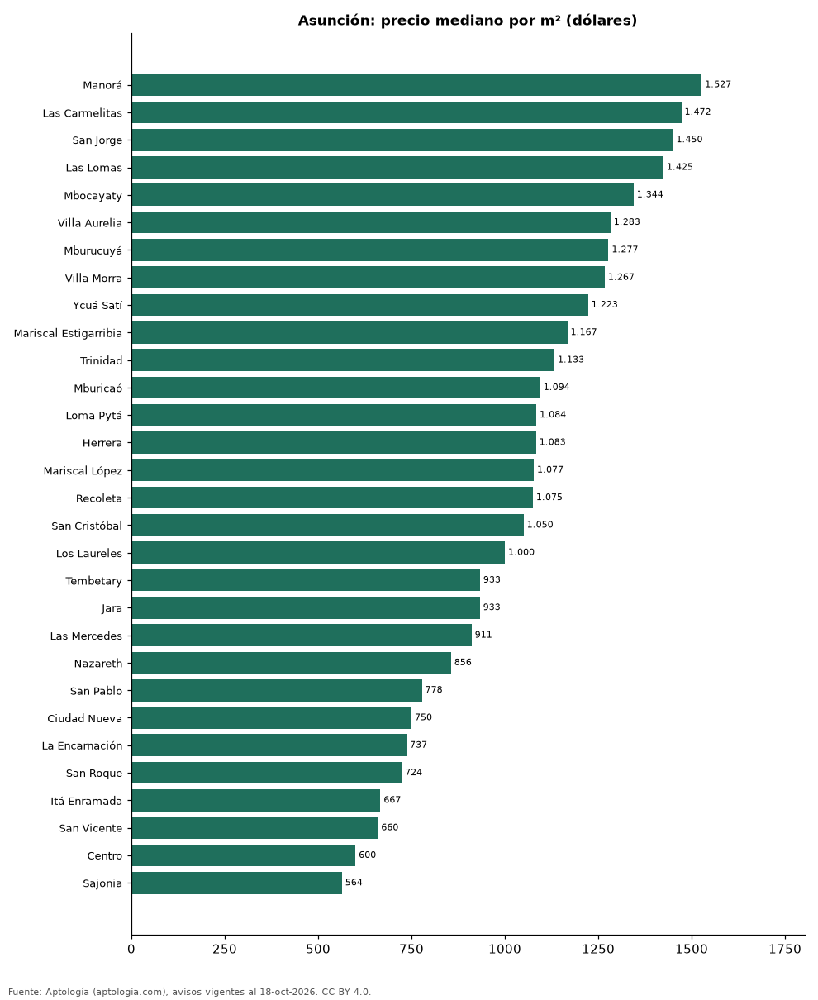

# Barrios más caros y más baratos de Asunción para comprar casa: ranking por m² (octubre 2026)

**En Asunción, el barrio con el m² más caro para comprar casa es Manorá (USD 1.527/m²) y el más barato Sajonia (USD 564/m²), 2,7 veces menos.** Comparamos 30 barrios con al menos 30 avisos con área.

*Resumen: analizamos 2.782 casas en venta con área declarada en 30 barrios de Asunción.*

**Actualizado:** 18 de octubre de 2026 (datos del 18 de octubre de 2026) · **Próxima actualización:** mensual.

## Resumen

| Indicador | Valor |
|---|---|
| Más caro por m² | Manorá: USD 1.527 |
| Más barato por m² | Sajonia: USD 564 |
| Diferencia | 2,7 veces |
| Barrios | 30 |

## Ranking de barrios por precio del m²

| Barrio | Por m² (mediana) | Precio (mediana) | Área mediana (m²) | Avisos con área |
|---|---|---|---|---|
| Manorá | USD 1.527 | USD 470.000 | 407 | 70 |
| Las Carmelitas | USD 1.472 | USD 550.000 | 414 | 65 |
| San Jorge | USD 1.450 | USD 380.000 | 360 | 89 |
| Las Lomas | USD 1.425 | USD 401.250 | 360 | 126 |
| Mbocayaty | USD 1.344 | USD 357.000 | 315 | 62 |
| Villa Aurelia | USD 1.283 | USD 335.000 | 409 | 115 |
| Mburucuyá | USD 1.277 | USD 417.000 | 360 | 286 |
| Villa Morra | USD 1.267 | USD 430.000 | 330 | 90 |
| Ycuá Satí | USD 1.223 | USD 370.000 | 360 | 182 |
| Mariscal Estigarribia | USD 1.167 | USD 550.000 | 480 | 128 |
| Trinidad | USD 1.133 | USD 407.500 | 400 | 68 |
| Mburicaó | USD 1.094 | USD 450.000 | 479 | 87 |
| Loma Pytá | USD 1.084 | USD 215.000 | 220 | 34 |
| Herrera | USD 1.083 | USD 350.000 | 408 | 133 |
| Mariscal López | USD 1.077 | USD 580.000 | 420 | 88 |
| Recoleta | USD 1.075 | USD 350.000 | 385 | 188 |
| San Cristóbal | USD 1.050 | USD 350.000 | 376 | 107 |
| Los Laureles | USD 1.000 | USD 370.000 | 375 | 97 |
| Tembetary | USD 933 | USD 290.000 | 350 | 31 |
| Jara | USD 933 | USD 310.000 | 350 | 122 |
| Las Mercedes | USD 911 | USD 360.000 | 457 | 123 |
| Nazareth | USD 856 | USD 400.000 | 414 | 41 |
| San Pablo | USD 778 | USD 250.000 | 320 | 37 |
| Ciudad Nueva | USD 750 | USD 241.208 | 325 | 61 |
| La Encarnación | USD 737 | USD 250.000 | 485 | 55 |
| San Roque | USD 724 | USD 270.000 | 370 | 65 |
| Itá Enramada | USD 667 | USD 244.000 | 348 | 31 |
| San Vicente | USD 660 | USD 250.000 | 376 | 107 |
| Centro | USD 600 | USD 250.000 | 420 | 49 |
| Sajonia | USD 564 | USD 198.000 | 337 | 45 |

Medianas; solo barrios con 30 avisos o más con área declarada.

## Preguntas frecuentes

**¿Cuál es el barrio más caro de Asunción para comprar?**
Manorá, con USD 1.527 por m² en la mediana (octubre de 2026).

**¿Y el más barato?**
Sajonia, con USD 564 por m².

## Metodología

- **Fuente:** exportes nocturnos de la base de datos de Aptología (aptologia.com) del 18 de octubre de 2026: avisos vigentes de vivienda en portales inmobiliarios de 13 países, recogidos por Aptología y vistos en línea entre el 11 y el 18 de octubre de 2026. Corte: 18 de octubre de 2026.
- **Depuración:** se eliminan duplicados exactos (misma ciudad, zona, tipo, precio, moneda, área, habitaciones y baños) y los precios fuera del percentil 1–99 de cada país, operación, moneda y tipo; el precio por m² usa solo avisos con área declarada entre 12 y 2.000 m² y también se recorta al P1–P99.
- **Qué se mide:** precios pedidos (publicados), no precios de cierre. En arriendo, el canon mensual sin administración, gastos comunes ni condominio.
- **Muestra mínima:** cada cifra publicada se apoya en al menos 30 avisos; las celdas con menos se omiten.
- **Monedas:** nunca se mezclan avisos de monedas distintas sin convertirlos. Conversión a dólares con la tasa de mercado de ExchangeRate-API (open.er-api.com, actualización del 18 Oct 2026): 1 USD = 3.182,80 COP, 1 USD = 18,47 M.N, 1 USD = 5,09 BRL, 1 USD = 3,44 PEN, 1 USD = 982,44 CLP, 1 USD = 1.514,57 ARS, 1 USD = 40,20 UYU, 1 USD = 5.705,37 PYG, 1 USD = 61,27 DOP, 1 USD = 0,89 EUR, 1 USD = 11,72 BOB; la UF chilena a 41.178,64 CLP (mindicador,cl. 18-oct-2026). Los avisos publicados en dólares se usan tal cual.
- **Monedas:** en cada ciudad y operación se usa solo la moneda mayoritaria de los avisos (los avisos en otra moneda se excluyen) y la mediana se convierte a dólares con la tasa citada; nunca se promedian avisos de monedas distintas.
- **Limitaciones:** la cobertura depende de los portales que recorre Aptología en cada país y es mayor en las ciudades grandes y en los segmentos medio-alto y alto; el área es la que declara el aviso, sin verificar; los nombres de zona vienen de los portales.
- **Privacidad:** solo se publican agregados; no se publica ningún dato personal, enlace a avisos ni nombre de anunciante.
- **Datos abiertos:** [datos.csv](datos.csv), licencia CC BY 4.0.

## Cómo citar

Pinzón Pineda, D. M. (2026). *Barrios más caros y más baratos de Asunción para comprar casa: ranking por m² (octubre 2026)*. Aptología (aptologia.com). https://github.com/elbroker/aptologia-datos/tree/main/estudios/barrios-con-casas-mas-caras-y-baratas-asuncion-venta-m2-2026. Datos: datos.csv, licencia CC BY 4.0.
