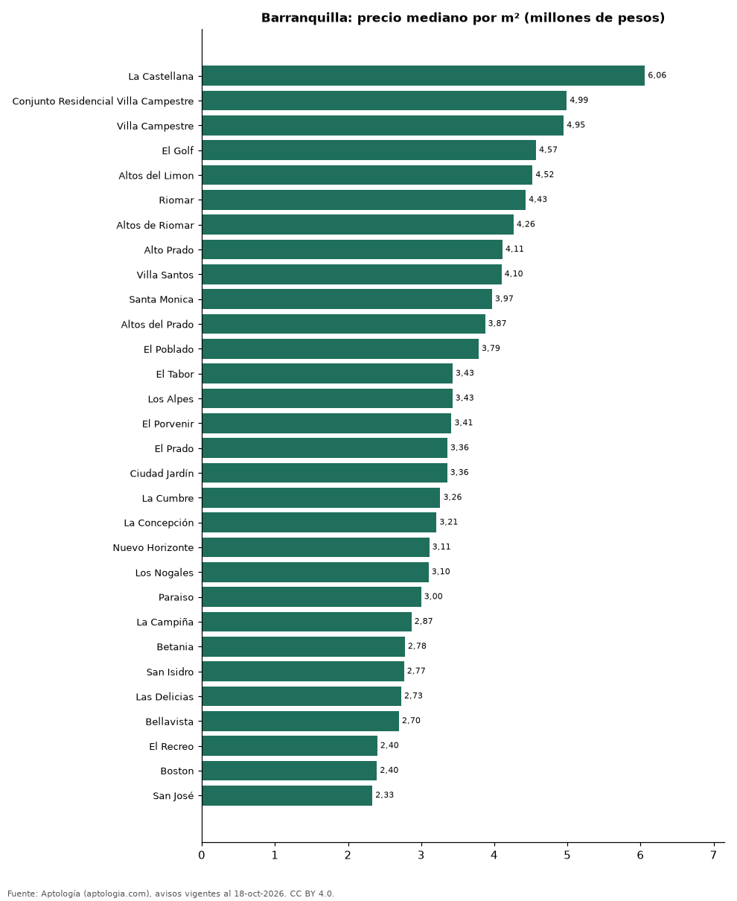

# Barrios más caros y más baratos de Barranquilla para comprar casa: ranking por m² (octubre 2026)

**En Barranquilla, el barrio con el m² más caro para comprar casa es La Castellana (6,06 millones de pesos/m²) y el más barato La Victoria (2,04 millones de pesos/m²), 3,0 veces menos.** Comparamos 33 barrios con al menos 30 avisos con área.

*Resumen: analizamos 2.497 casas en venta con área declarada en 33 barrios de Barranquilla.*

**Actualizado:** 18 de octubre de 2026 (datos del 18 de octubre de 2026) · **Próxima actualización:** mensual.

## Resumen

| Indicador | Valor |
|---|---|
| Más caro por m² | La Castellana: 6,06 millones de pesos |
| Más barato por m² | La Victoria: 2,04 millones de pesos |
| Diferencia | 3,0 veces |
| Barrios | 33 |

## Ranking de barrios por precio del m²

| Barrio | Por m² (mediana) | Precio (mediana) | Área mediana (m²) | Avisos con área |
|---|---|---|---|---|
| La Castellana | 6,06 millones de pesos | 1.400 millones de pesos | 250 | 37 |
| Conjunto Residencial Villa Campestre | 4,99 millones de pesos | 1.525 millones de pesos | 350 | 59 |
| Villa Campestre | 4,95 millones de pesos | 1.600 millones de pesos | 322 | 209 |
| El Golf | 4,57 millones de pesos | 3.200 millones de pesos | 580 | 35 |
| Altos del Limon | 4,52 millones de pesos | 950 millones de pesos | 193 | 45 |
| Riomar | 4,43 millones de pesos | 2.200 millones de pesos | 507 | 107 |
| Altos de Riomar | 4,26 millones de pesos | 1.400 millones de pesos | 371 | 160 |
| Alto Prado | 4,11 millones de pesos | 1.500 millones de pesos | 403 | 37 |
| Villa Santos | 4,10 millones de pesos | 1.000 millones de pesos | 240 | 185 |
| Santa Monica | 3,97 millones de pesos | 1.050 millones de pesos | 304 | 40 |
| Altos del Prado | 3,87 millones de pesos | 1.500 millones de pesos | 400 | 40 |
| El Poblado | 3,79 millones de pesos | 1.300 millones de pesos | 436 | 56 |
| El Tabor | 3,43 millones de pesos | 960 millones de pesos | 300 | 96 |
| Los Alpes | 3,43 millones de pesos | 830 millones de pesos | 248 | 49 |
| El Porvenir | 3,41 millones de pesos | 1.200 millones de pesos | 380 | 80 |
| El Prado | 3,36 millones de pesos | 1.400 millones de pesos | 434 | 183 |
| Ciudad Jardín | 3,36 millones de pesos | 820 millones de pesos | 286 | 231 |
| La Cumbre | 3,26 millones de pesos | 980 millones de pesos | 331 | 82 |
| La Concepción | 3,21 millones de pesos | 850 millones de pesos | 276 | 51 |
| Nuevo Horizonte | 3,11 millones de pesos | 980 millones de pesos | 370 | 51 |
| Los Nogales | 3,10 millones de pesos | 800 millones de pesos | 263 | 39 |
| Paraiso | 3,00 millones de pesos | 700 millones de pesos | 245 | 119 |
| La Campiña | 2,87 millones de pesos | 1.200 millones de pesos | 422 | 43 |
| Betania | 2,78 millones de pesos | 800 millones de pesos | 289 | 35 |
| San Isidro | 2,77 millones de pesos | 365 millones de pesos | 153 | 32 |
| Las Delicias | 2,73 millones de pesos | 750 millones de pesos | 300 | 49 |
| Bellavista | 2,70 millones de pesos | 800 millones de pesos | 300 | 45 |
| El Recreo | 2,40 millones de pesos | 690 millones de pesos | 280 | 85 |
| Boston | 2,40 millones de pesos | 700 millones de pesos | 260 | 79 |
| San José | 2,33 millones de pesos | 460 millones de pesos | 198 | 45 |
| Olaya | 2,32 millones de pesos | 690 millones de pesos | 298 | 32 |
| El Carmen | 2,18 millones de pesos | 600 millones de pesos | 264 | 30 |
| La Victoria | 2,04 millones de pesos | 440 millones de pesos | 216 | 31 |

Medianas; solo barrios con 30 avisos o más con área declarada.

## Preguntas frecuentes

**¿Cuál es el barrio más caro de Barranquilla para comprar?**
La Castellana, con 6,06 millones de pesos por m² en la mediana (octubre de 2026).

**¿Y el más barato?**
La Victoria, con 2,04 millones de pesos por m².

## Metodología

- **Fuente:** exportes nocturnos de la base de datos de Aptología (aptologia.com) del 18 de octubre de 2026: avisos vigentes de vivienda en portales inmobiliarios de 13 países, recogidos por Aptología y vistos en línea entre el 11 y el 18 de octubre de 2026. Corte: 18 de octubre de 2026.
- **Depuración:** se eliminan duplicados exactos (misma ciudad, zona, tipo, precio, moneda, área, habitaciones y baños) y los precios fuera del percentil 1–99 de cada país, operación, moneda y tipo; el precio por m² usa solo avisos con área declarada entre 12 y 2.000 m² y también se recorta al P1–P99.
- **Qué se mide:** precios pedidos (publicados), no precios de cierre. En arriendo, el canon mensual sin administración, gastos comunes ni condominio.
- **Muestra mínima:** cada cifra publicada se apoya en al menos 30 avisos; las celdas con menos se omiten.
- **Colombia:** Precios en pesos colombianos, sin conversión de moneda.
- **Limitaciones:** la cobertura depende de los portales que recorre Aptología en cada país y es mayor en las ciudades grandes y en los segmentos medio-alto y alto; el área es la que declara el aviso, sin verificar; los nombres de zona vienen de los portales.
- **Privacidad:** solo se publican agregados; no se publica ningún dato personal, enlace a avisos ni nombre de anunciante.
- **Datos abiertos:** [datos.csv](datos.csv), licencia CC BY 4.0.

## Cómo citar

Pinzón Pineda, D. M. (2026). *Barrios más caros y más baratos de Barranquilla para comprar casa: ranking por m² (octubre 2026)*. Aptología (aptologia.com). https://github.com/elbroker/aptologia-datos/tree/main/estudios/barrios-con-casas-mas-caras-y-baratas-barranquilla-venta-m2-2026. Datos: datos.csv, licencia CC BY 4.0.
