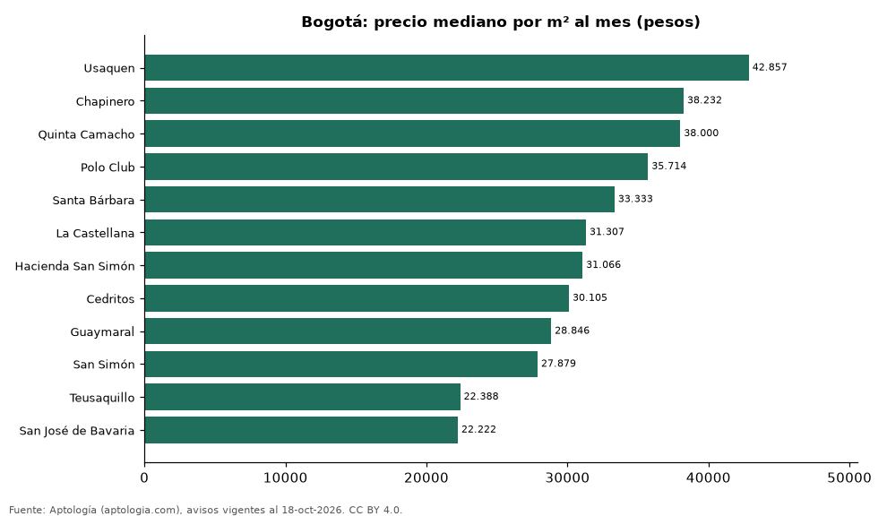

# Barrios más caros y más baratos de Bogotá para arrendar casa: ranking por m² (octubre 2026)

**En Bogotá, el barrio con el m² más caro para arrendar casa es Usaquen (42.857 pesos/m² al mes) y el más barato San José de Bavaria (22.222 pesos/m² al mes), 1,9 veces menos.** Comparamos 12 barrios con al menos 30 avisos con área.

*Resumen: analizamos 730 casas en arriendo con área declarada en 12 barrios de Bogotá.*

**Actualizado:** 18 de octubre de 2026 (datos del 18 de octubre de 2026) · **Próxima actualización:** mensual.

## Resumen

| Indicador | Valor |
|---|---|
| Más caro por m² | Usaquen: 42.857 pesos |
| Más barato por m² | San José de Bavaria: 22.222 pesos |
| Diferencia | 1,9 veces |
| Barrios | 12 |

## Ranking de barrios por precio del m²

| Barrio | Por m² (mediana) | Canon (mediana) | Área mediana (m²) | Avisos con área |
|---|---|---|---|---|
| Usaquen | 42.857 pesos | 9.500.000 pesos | 203 | 37 |
| Chapinero | 38.232 pesos | 14.499.500 pesos | 385 | 50 |
| Quinta Camacho | 38.000 pesos | 18.000.000 pesos | 429 | 51 |
| Polo Club | 35.714 pesos | 10.000.000 pesos | 280 | 31 |
| Santa Bárbara | 33.333 pesos | 12.000.000 pesos | 336 | 47 |
| La Castellana | 31.307 pesos | 10.000.000 pesos | 298 | 50 |
| Hacienda San Simón | 31.066 pesos | 13.500.000 pesos | 450 | 74 |
| Cedritos | 30.105 pesos | 5.207.000 pesos | 184 | 54 |
| Guaymaral | 28.846 pesos | 13.000.000 pesos | 490 | 107 |
| San Simón | 27.879 pesos | 13.900.000 pesos | 420 | 33 |
| Teusaquillo | 22.388 pesos | 13.460.000 pesos | 550 | 39 |
| San José de Bavaria | 22.222 pesos | 10.500.000 pesos | 500 | 157 |

Medianas; solo barrios con 30 avisos o más con área declarada.

## Preguntas frecuentes

**¿Cuál es el barrio más caro de Bogotá para arrendar?**
Usaquen, con 42.857 pesos por m² al mes en la mediana (octubre de 2026).

**¿Y el más barato?**
San José de Bavaria, con 22.222 pesos por m² al mes.

## Metodología

- **Fuente:** exportes nocturnos de la base de datos de Aptología (aptologia.com) del 18 de octubre de 2026: avisos vigentes de vivienda en portales inmobiliarios de 13 países, recogidos por Aptología y vistos en línea entre el 11 y el 18 de octubre de 2026. Corte: 18 de octubre de 2026.
- **Depuración:** se eliminan duplicados exactos (misma ciudad, zona, tipo, precio, moneda, área, habitaciones y baños) y los precios fuera del percentil 1–99 de cada país, operación, moneda y tipo; el precio por m² usa solo avisos con área declarada entre 12 y 2.000 m² y también se recorta al P1–P99.
- **Qué se mide:** precios pedidos (publicados), no precios de cierre. En arriendo, el canon mensual sin administración, gastos comunes ni condominio.
- **Muestra mínima:** cada cifra publicada se apoya en al menos 30 avisos; las celdas con menos se omiten.
- **Colombia:** Precios en pesos colombianos, sin conversión de moneda.
- **Limitaciones:** la cobertura depende de los portales que recorre Aptología en cada país y es mayor en las ciudades grandes y en los segmentos medio-alto y alto; el área es la que declara el aviso, sin verificar; los nombres de zona vienen de los portales.
- **Privacidad:** solo se publican agregados; no se publica ningún dato personal, enlace a avisos ni nombre de anunciante.
- **Datos abiertos:** [datos.csv](datos.csv), licencia CC BY 4.0.

## Cómo citar

Pinzón Pineda, D. M. (2026). *Barrios más caros y más baratos de Bogotá para arrendar casa: ranking por m² (octubre 2026)*. Aptología (aptologia.com). https://github.com/elbroker/aptologia-datos/tree/main/estudios/barrios-con-casas-mas-caras-y-baratas-bogota-arriendo-m2-2026. Datos: datos.csv, licencia CC BY 4.0.
