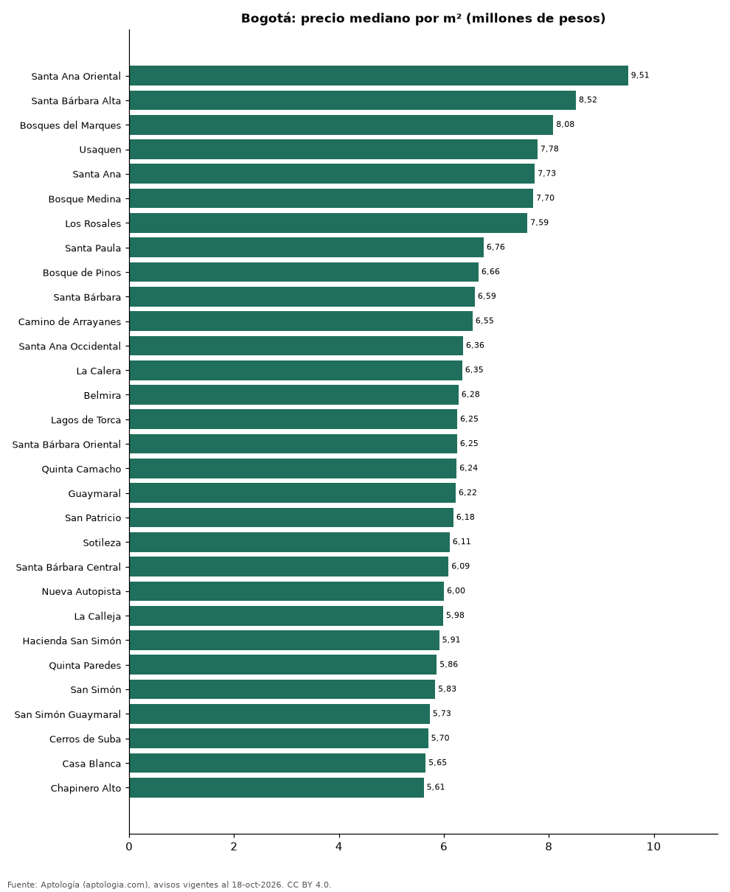

# Barrios más caros y más baratos de Bogotá para comprar casa: ranking por m² (octubre 2026)

**En Bogotá, el barrio con el m² más caro para comprar casa es Santa Ana Oriental (9,51 millones de pesos/m²) y el más barato El Carmen (2,38 millones de pesos/m²), 4,0 veces menos.** Comparamos 107 barrios con al menos 30 avisos con área.

*Resumen: analizamos 9.707 casas en venta con área declarada en 107 barrios de Bogotá.*

**Actualizado:** 18 de octubre de 2026 (datos del 18 de octubre de 2026) · **Próxima actualización:** mensual.

## Resumen

| Indicador | Valor |
|---|---|
| Más caro por m² | Santa Ana Oriental: 9,51 millones de pesos |
| Más barato por m² | El Carmen: 2,38 millones de pesos |
| Diferencia | 4,0 veces |
| Barrios | 107 |

## Ranking de barrios por precio del m²

| Barrio | Por m² (mediana) | Precio (mediana) | Área mediana (m²) | Avisos con área |
|---|---|---|---|---|
| Santa Ana Oriental | 9,51 millones de pesos | 4.004 millones de pesos | 432 | 98 |
| Santa Bárbara Alta | 8,52 millones de pesos | 3.825 millones de pesos | 412 | 110 |
| Bosques del Marques | 8,08 millones de pesos | 2.950 millones de pesos | 380 | 43 |
| Usaquen | 7,78 millones de pesos | 1.995 millones de pesos | 282 | 60 |
| Santa Ana | 7,73 millones de pesos | 3.500 millones de pesos | 431 | 98 |
| Bosque Medina | 7,70 millones de pesos | 3.300 millones de pesos | 465 | 36 |
| Los Rosales | 7,59 millones de pesos | 4.000 millones de pesos | 565 | 32 |
| Santa Paula | 6,76 millones de pesos | 2.125 millones de pesos | 300 | 74 |
| Bosque de Pinos | 6,66 millones de pesos | 2.100 millones de pesos | 295 | 116 |
| Santa Bárbara | 6,59 millones de pesos | 1.995 millones de pesos | 322 | 196 |
| Camino de Arrayanes | 6,55 millones de pesos | 1.200 millones de pesos | 189 | 49 |
| Santa Ana Occidental | 6,36 millones de pesos | 1.795 millones de pesos | 258 | 58 |
| La Calera | 6,35 millones de pesos | 2.600 millones de pesos | 400 | 53 |
| Belmira | 6,28 millones de pesos | 1.200 millones de pesos | 178 | 31 |
| Lagos de Torca | 6,25 millones de pesos | 2.450 millones de pesos | 386 | 62 |
| Santa Bárbara Oriental | 6,25 millones de pesos | 2.000 millones de pesos | 290 | 31 |
| Quinta Camacho | 6,24 millones de pesos | 2.600 millones de pesos | 422 | 155 |
| Guaymaral | 6,22 millones de pesos | 2.610 millones de pesos | 430 | 386 |
| San Patricio | 6,18 millones de pesos | 1.425 millones de pesos | 234 | 48 |
| Sotileza | 6,11 millones de pesos | 1.870 millones de pesos | 318 | 127 |
| Santa Bárbara Central | 6,09 millones de pesos | 1.700 millones de pesos | 292 | 74 |
| Nueva Autopista | 6,00 millones de pesos | 1.800 millones de pesos | 310 | 37 |
| La Calleja | 5,98 millones de pesos | 1.350 millones de pesos | 224 | 100 |
| Hacienda San Simón | 5,91 millones de pesos | 2.650 millones de pesos | 450 | 227 |
| Quinta Paredes | 5,86 millones de pesos | 1.460 millones de pesos | 247 | 60 |
| San Simón | 5,83 millones de pesos | 2.625 millones de pesos | 444 | 158 |
| San Simón Guaymaral | 5,73 millones de pesos | 2.500 millones de pesos | 430 | 39 |
| Cerros de Suba | 5,70 millones de pesos | 1.800 millones de pesos | 311 | 154 |
| Casa Blanca | 5,65 millones de pesos | 2.424 millones de pesos | 332 | 60 |
| Chapinero Alto | 5,61 millones de pesos | 2.000 millones de pesos | 340 | 71 |
| Norte | 5,57 millones de pesos | 1.625 millones de pesos | 309 | 84 |
| Gratamira | 5,51 millones de pesos | 1.250 millones de pesos | 222 | 82 |
| Cerros de Niza | 5,45 millones de pesos | 1.850 millones de pesos | 357 | 45 |
| San Felipe | 5,44 millones de pesos | 1.700 millones de pesos | 360 | 37 |
| El Recuerdo | 5,36 millones de pesos | 1.500 millones de pesos | 245 | 35 |
| Contador | 5,30 millones de pesos | 1.225 millones de pesos | 236 | 38 |
| Colina Campestre | 5,29 millones de pesos | 1.100 millones de pesos | 202 | 160 |
| Cedro Golf | 5,25 millones de pesos | 810 millones de pesos | 175 | 39 |
| Cedritos | 5,17 millones de pesos | 900 millones de pesos | 187 | 354 |
| La Esmeralda | 5,16 millones de pesos | 1.300 millones de pesos | 250 | 49 |
| Nicolas de Federman | 5,16 millones de pesos | 1.800 millones de pesos | 348 | 60 |
| Niza Suba | 5,14 millones de pesos | 1.575 millones de pesos | 312 | 42 |
| El Contador | 5,14 millones de pesos | 1.200 millones de pesos | 236 | 87 |
| Pasadena | 5,11 millones de pesos | 1.550 millones de pesos | 324 | 102 |
| Modelia Occidental | 5,05 millones de pesos | 1.100 millones de pesos | 200 | 31 |
| Chapinero | 5,05 millones de pesos | 1.775 millones de pesos | 380 | 198 |
| La Castellana | 5,03 millones de pesos | 1.625 millones de pesos | 314 | 90 |
| Polo Club | 5,01 millones de pesos | 1.170 millones de pesos | 250 | 87 |
| La Alhambra | 5,00 millones de pesos | 1.450 millones de pesos | 300 | 57 |
| El Batán | 5,00 millones de pesos | 1.200 millones de pesos | 248 | 36 |
| La Candelaria | 4,97 millones de pesos | 2.200 millones de pesos | 400 | 50 |
| La Floresta | 4,97 millones de pesos | 1.100 millones de pesos | 222 | 58 |
| Lisboa | 4,93 millones de pesos | 1.025 millones de pesos | 249 | 34 |
| Puente Largo | 4,92 millones de pesos | 1.200 millones de pesos | 296 | 55 |
| Suba | 4,89 millones de pesos | 1.150 millones de pesos | 243 | 113 |
| Ilarco | 4,88 millones de pesos | 1.390 millones de pesos | 279 | 30 |
| San José de Bavaria | 4,86 millones de pesos | 1.950 millones de pesos | 430 | 1.001 |
| San José Bavaria | 4,85 millones de pesos | 2.140 millones de pesos | 450 | 58 |
| Prado Veraniego | 4,83 millones de pesos | 1.065 millones de pesos | 252 | 58 |
| Altos de Sotileza | 4,79 millones de pesos | 1.850 millones de pesos | 354 | 42 |
| Las Margaritas | 4,76 millones de pesos | 1.000 millones de pesos | 200 | 43 |
| Alhambra | 4,69 millones de pesos | 1.400 millones de pesos | 279 | 130 |
| Galerias | 4,66 millones de pesos | 1.350 millones de pesos | 286 | 67 |
| Castilla | 4,65 millones de pesos | 700 millones de pesos | 163 | 61 |
| San Luis | 4,61 millones de pesos | 1.300 millones de pesos | 300 | 76 |
| Niza | 4,59 millones de pesos | 1.350 millones de pesos | 311 | 250 |
| Modelia | 4,58 millones de pesos | 1.000 millones de pesos | 218 | 170 |
| Las Villas | 4,57 millones de pesos | 1.215 millones de pesos | 261 | 136 |
| Villa del Prado | 4,57 millones de pesos | 680 millones de pesos | 150 | 65 |
| Villa Magdala | 4,56 millones de pesos | 850 millones de pesos | 190 | 57 |
| Teusaquillo | 4,53 millones de pesos | 1.800 millones de pesos | 380 | 162 |
| Normandia | 4,51 millones de pesos | 1.350 millones de pesos | 272 | 96 |
| Los Andes | 4,44 millones de pesos | 954 millones de pesos | 210 | 68 |
| Pontevedra | 4,38 millones de pesos | 1.190 millones de pesos | 273 | 101 |
| La Soledad | 4,36 millones de pesos | 1.400 millones de pesos | 321 | 107 |
| Barrios Unidos | 4,33 millones de pesos | 1.098 millones de pesos | 252 | 154 |
| Mandalay | 4,29 millones de pesos | 850 millones de pesos | 207 | 38 |
| José Joaquin Vargas | 4,26 millones de pesos | 1.100 millones de pesos | 287 | 31 |
| Niza Norte | 4,22 millones de pesos | 1.390 millones de pesos | 327 | 49 |
| Las Americas | 4,14 millones de pesos | 1.162 millones de pesos | 291 | 32 |
| Ciudad Montes | 4,14 millones de pesos | 880 millones de pesos | 250 | 53 |
| Palermo | 3,96 millones de pesos | 1.300 millones de pesos | 340 | 73 |
| Villa Claudia | 3,93 millones de pesos | 830 millones de pesos | 213 | 31 |
| Alamos | 3,86 millones de pesos | 495 millones de pesos | 144 | 35 |
| San Fernando | 3,83 millones de pesos | 750 millones de pesos | 197 | 30 |
| Minuto de Dios | 3,71 millones de pesos | 698 millones de pesos | 181 | 34 |
| La Estrada | 3,70 millones de pesos | 740 millones de pesos | 204 | 40 |
| San Cristóbal Norte | 3,66 millones de pesos | 850 millones de pesos | 250 | 33 |
| Villa Luz | 3,66 millones de pesos | 800 millones de pesos | 256 | 63 |
| Engativá | 3,65 millones de pesos | 700 millones de pesos | 210 | 340 |
| Fontibon | 3,62 millones de pesos | 825 millones de pesos | 230 | 168 |
| Marsella | 3,61 millones de pesos | 900 millones de pesos | 270 | 47 |
| Villas de Granada | 3,54 millones de pesos | 400 millones de pesos | 118 | 59 |
| Carvajal | 3,37 millones de pesos | 850 millones de pesos | 300 | 55 |
| Santa Isabel | 3,32 millones de pesos | 875 millones de pesos | 265 | 66 |
| Restrepo | 3,32 millones de pesos | 1.100 millones de pesos | 350 | 42 |
| Bonanza | 3,29 millones de pesos | 755 millones de pesos | 250 | 54 |
| Garces Navas | 3,24 millones de pesos | 480 millones de pesos | 144 | 43 |
| Las Ferias | 3,20 millones de pesos | 798 millones de pesos | 276 | 60 |
| Engativa | 3,14 millones de pesos | 735 millones de pesos | 230 | 38 |
| Venecia | 3,12 millones de pesos | 800 millones de pesos | 250 | 53 |
| Kennedy Central | 3,11 millones de pesos | 678 millones de pesos | 230 | 132 |
| San Antonio | 3,00 millones de pesos | 800 millones de pesos | 270 | 39 |
| Noroccidente | 2,83 millones de pesos | 688 millones de pesos | 271 | 62 |
| Britalia | 2,67 millones de pesos | 550 millones de pesos | 240 | 33 |
| Bosa | 2,43 millones de pesos | 480 millones de pesos | 216 | 37 |
| El Carmen | 2,38 millones de pesos | 680 millones de pesos | 250 | 39 |

Medianas; solo barrios con 30 avisos o más con área declarada.

## Preguntas frecuentes

**¿Cuál es el barrio más caro de Bogotá para comprar?**
Santa Ana Oriental, con 9,51 millones de pesos por m² en la mediana (octubre de 2026).

**¿Y el más barato?**
El Carmen, con 2,38 millones de pesos por m².

## Metodología

- **Fuente:** exportes nocturnos de la base de datos de Aptología (aptologia.com) del 18 de octubre de 2026: avisos vigentes de vivienda en portales inmobiliarios de 13 países, recogidos por Aptología y vistos en línea entre el 11 y el 18 de octubre de 2026. Corte: 18 de octubre de 2026.
- **Depuración:** se eliminan duplicados exactos (misma ciudad, zona, tipo, precio, moneda, área, habitaciones y baños) y los precios fuera del percentil 1–99 de cada país, operación, moneda y tipo; el precio por m² usa solo avisos con área declarada entre 12 y 2.000 m² y también se recorta al P1–P99.
- **Qué se mide:** precios pedidos (publicados), no precios de cierre. En arriendo, el canon mensual sin administración, gastos comunes ni condominio.
- **Muestra mínima:** cada cifra publicada se apoya en al menos 30 avisos; las celdas con menos se omiten.
- **Colombia:** Precios en pesos colombianos, sin conversión de moneda.
- **Limitaciones:** la cobertura depende de los portales que recorre Aptología en cada país y es mayor en las ciudades grandes y en los segmentos medio-alto y alto; el área es la que declara el aviso, sin verificar; los nombres de zona vienen de los portales.
- **Privacidad:** solo se publican agregados; no se publica ningún dato personal, enlace a avisos ni nombre de anunciante.
- **Datos abiertos:** [datos.csv](datos.csv), licencia CC BY 4.0.

## Cómo citar

Pinzón Pineda, D. M. (2026). *Barrios más caros y más baratos de Bogotá para comprar casa: ranking por m² (octubre 2026)*. Aptología (aptologia.com). https://github.com/elbroker/aptologia-datos/tree/main/estudios/barrios-con-casas-mas-caras-y-baratas-bogota-venta-m2-2026. Datos: datos.csv, licencia CC BY 4.0.
