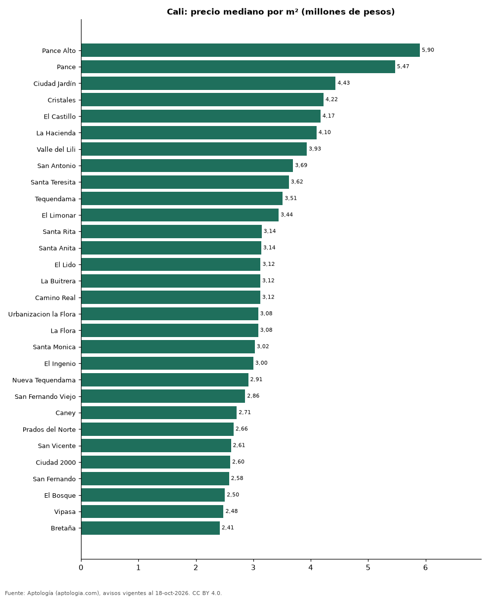

# Barrios más caros y más baratos de Cali para comprar casa: ranking por m² (octubre 2026)

**En Cali, el barrio con el m² más caro para comprar casa es Pance Alto (5,90 millones de pesos/m²) y el más barato Ciudad Cordoba (1,92 millones de pesos/m²), 3,1 veces menos.** Comparamos 31 barrios con al menos 30 avisos con área.

*Resumen: analizamos 3.081 casas en venta con área declarada en 31 barrios de Cali.*

**Actualizado:** 18 de octubre de 2026 (datos del 18 de octubre de 2026) · **Próxima actualización:** mensual.

## Resumen

| Indicador | Valor |
|---|---|
| Más caro por m² | Pance Alto: 5,90 millones de pesos |
| Más barato por m² | Ciudad Cordoba: 1,92 millones de pesos |
| Diferencia | 3,1 veces |
| Barrios | 31 |

## Ranking de barrios por precio del m²

| Barrio | Por m² (mediana) | Precio (mediana) | Área mediana (m²) | Avisos con área |
|---|---|---|---|---|
| Pance Alto | 5,90 millones de pesos | 1.900 millones de pesos | 440 | 47 |
| Pance | 5,47 millones de pesos | 2.200 millones de pesos | 434 | 903 |
| Ciudad Jardín | 4,43 millones de pesos | 1.750 millones de pesos | 400 | 449 |
| Cristales | 4,22 millones de pesos | 1.900 millones de pesos | 475 | 51 |
| El Castillo | 4,17 millones de pesos | 613 millones de pesos | 142 | 30 |
| La Hacienda | 4,10 millones de pesos | 822 millones de pesos | 200 | 50 |
| Valle del Lili | 3,93 millones de pesos | 590 millones de pesos | 158 | 107 |
| San Antonio | 3,69 millones de pesos | 1.245 millones de pesos | 366 | 34 |
| Santa Teresita | 3,62 millones de pesos | 1.500 millones de pesos | 466 | 77 |
| Tequendama | 3,51 millones de pesos | 1.100 millones de pesos | 325 | 72 |
| El Limonar | 3,44 millones de pesos | 780 millones de pesos | 225 | 36 |
| Santa Rita | 3,14 millones de pesos | 1.100 millones de pesos | 425 | 48 |
| Santa Anita | 3,14 millones de pesos | 765 millones de pesos | 250 | 46 |
| El Lido | 3,12 millones de pesos | 900 millones de pesos | 256 | 37 |
| La Buitrera | 3,12 millones de pesos | 1.450 millones de pesos | 380 | 45 |
| Camino Real | 3,12 millones de pesos | 740 millones de pesos | 239 | 36 |
| Urbanizacion la Flora | 3,08 millones de pesos | 900 millones de pesos | 290 | 42 |
| La Flora | 3,08 millones de pesos | 910 millones de pesos | 320 | 112 |
| Santa Monica | 3,02 millones de pesos | 1.300 millones de pesos | 382 | 53 |
| El Ingenio | 3,00 millones de pesos | 980 millones de pesos | 350 | 159 |
| Nueva Tequendama | 2,91 millones de pesos | 700 millones de pesos | 252 | 36 |
| San Fernando Viejo | 2,86 millones de pesos | 900 millones de pesos | 350 | 43 |
| Caney | 2,71 millones de pesos | 592 millones de pesos | 200 | 106 |
| Prados del Norte | 2,66 millones de pesos | 710 millones de pesos | 264 | 100 |
| San Vicente | 2,61 millones de pesos | 880 millones de pesos | 350 | 75 |
| Ciudad 2000 | 2,60 millones de pesos | 600 millones de pesos | 239 | 78 |
| San Fernando | 2,58 millones de pesos | 850 millones de pesos | 306 | 33 |
| El Bosque | 2,50 millones de pesos | 750 millones de pesos | 305 | 38 |
| Vipasa | 2,48 millones de pesos | 653 millones de pesos | 264 | 61 |
| Bretaña | 2,41 millones de pesos | 530 millones de pesos | 215 | 32 |
| Ciudad Cordoba | 1,92 millones de pesos | 330 millones de pesos | 200 | 45 |

Medianas; solo barrios con 30 avisos o más con área declarada.

## Preguntas frecuentes

**¿Cuál es el barrio más caro de Cali para comprar?**
Pance Alto, con 5,90 millones de pesos por m² en la mediana (octubre de 2026).

**¿Y el más barato?**
Ciudad Cordoba, con 1,92 millones de pesos por m².

## Metodología

- **Fuente:** exportes nocturnos de la base de datos de Aptología (aptologia.com) del 18 de octubre de 2026: avisos vigentes de vivienda en portales inmobiliarios de 13 países, recogidos por Aptología y vistos en línea entre el 11 y el 18 de octubre de 2026. Corte: 18 de octubre de 2026.
- **Depuración:** se eliminan duplicados exactos (misma ciudad, zona, tipo, precio, moneda, área, habitaciones y baños) y los precios fuera del percentil 1–99 de cada país, operación, moneda y tipo; el precio por m² usa solo avisos con área declarada entre 12 y 2.000 m² y también se recorta al P1–P99.
- **Qué se mide:** precios pedidos (publicados), no precios de cierre. En arriendo, el canon mensual sin administración, gastos comunes ni condominio.
- **Muestra mínima:** cada cifra publicada se apoya en al menos 30 avisos; las celdas con menos se omiten.
- **Colombia:** Precios en pesos colombianos, sin conversión de moneda.
- **Limitaciones:** la cobertura depende de los portales que recorre Aptología en cada país y es mayor en las ciudades grandes y en los segmentos medio-alto y alto; el área es la que declara el aviso, sin verificar; los nombres de zona vienen de los portales.
- **Privacidad:** solo se publican agregados; no se publica ningún dato personal, enlace a avisos ni nombre de anunciante.
- **Datos abiertos:** [datos.csv](datos.csv), licencia CC BY 4.0.

## Cómo citar

Pinzón Pineda, D. M. (2026). *Barrios más caros y más baratos de Cali para comprar casa: ranking por m² (octubre 2026)*. Aptología (aptologia.com). https://github.com/elbroker/aptologia-datos/tree/main/estudios/barrios-con-casas-mas-caras-y-baratas-cali-venta-m2-2026. Datos: datos.csv, licencia CC BY 4.0.
