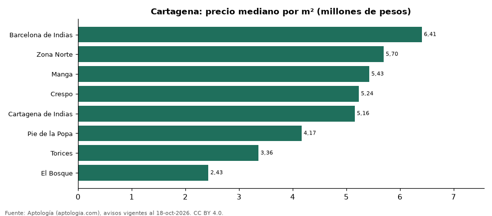

# Barrios más caros y más baratos de Cartagena para comprar casa: ranking por m² (octubre 2026)

**En Cartagena, el barrio con el m² más caro para comprar casa es Barcelona de Indias (6,41 millones de pesos/m²) y el más barato El Bosque (2,43 millones de pesos/m²), 2,6 veces menos.** Comparamos 8 barrios con al menos 30 avisos con área.

*Resumen: analizamos 543 casas en venta con área declarada en 8 barrios de Cartagena.*

**Actualizado:** 18 de octubre de 2026 (datos del 18 de octubre de 2026) · **Próxima actualización:** mensual.

## Resumen

| Indicador | Valor |
|---|---|
| Más caro por m² | Barcelona de Indias: 6,41 millones de pesos |
| Más barato por m² | El Bosque: 2,43 millones de pesos |
| Diferencia | 2,6 veces |
| Barrios | 8 |

## Ranking de barrios por precio del m²

| Barrio | Por m² (mediana) | Precio (mediana) | Área mediana (m²) | Avisos con área |
|---|---|---|---|---|
| Barcelona de Indias | 6,41 millones de pesos | 3.250 millones de pesos | 450 | 46 |
| Zona Norte | 5,70 millones de pesos | 2.500 millones de pesos | 455 | 36 |
| Manga | 5,43 millones de pesos | 1.250 millones de pesos | 258 | 165 |
| Crespo | 5,24 millones de pesos | 1.900 millones de pesos | 350 | 60 |
| Cartagena de Indias | 5,16 millones de pesos | 1.500 millones de pesos | 300 | 84 |
| Pie de la Popa | 4,17 millones de pesos | 950 millones de pesos | 250 | 81 |
| Torices | 3,36 millones de pesos | 882 millones de pesos | 280 | 34 |
| El Bosque | 2,43 millones de pesos | 800 millones de pesos | 320 | 37 |

Medianas; solo barrios con 30 avisos o más con área declarada.

## Preguntas frecuentes

**¿Cuál es el barrio más caro de Cartagena para comprar?**
Barcelona de Indias, con 6,41 millones de pesos por m² en la mediana (octubre de 2026).

**¿Y el más barato?**
El Bosque, con 2,43 millones de pesos por m².

## Metodología

- **Fuente:** exportes nocturnos de la base de datos de Aptología (aptologia.com) del 18 de octubre de 2026: avisos vigentes de vivienda en portales inmobiliarios de 13 países, recogidos por Aptología y vistos en línea entre el 11 y el 18 de octubre de 2026. Corte: 18 de octubre de 2026.
- **Depuración:** se eliminan duplicados exactos (misma ciudad, zona, tipo, precio, moneda, área, habitaciones y baños) y los precios fuera del percentil 1–99 de cada país, operación, moneda y tipo; el precio por m² usa solo avisos con área declarada entre 12 y 2.000 m² y también se recorta al P1–P99.
- **Qué se mide:** precios pedidos (publicados), no precios de cierre. En arriendo, el canon mensual sin administración, gastos comunes ni condominio.
- **Muestra mínima:** cada cifra publicada se apoya en al menos 30 avisos; las celdas con menos se omiten.
- **Colombia:** Precios en pesos colombianos, sin conversión de moneda.
- **Limitaciones:** la cobertura depende de los portales que recorre Aptología en cada país y es mayor en las ciudades grandes y en los segmentos medio-alto y alto; el área es la que declara el aviso, sin verificar; los nombres de zona vienen de los portales.
- **Privacidad:** solo se publican agregados; no se publica ningún dato personal, enlace a avisos ni nombre de anunciante.
- **Datos abiertos:** [datos.csv](datos.csv), licencia CC BY 4.0.

## Cómo citar

Pinzón Pineda, D. M. (2026). *Barrios más caros y más baratos de Cartagena para comprar casa: ranking por m² (octubre 2026)*. Aptología (aptologia.com). https://github.com/elbroker/aptologia-datos/tree/main/estudios/barrios-con-casas-mas-caras-y-baratas-cartagena-venta-m2-2026. Datos: datos.csv, licencia CC BY 4.0.
