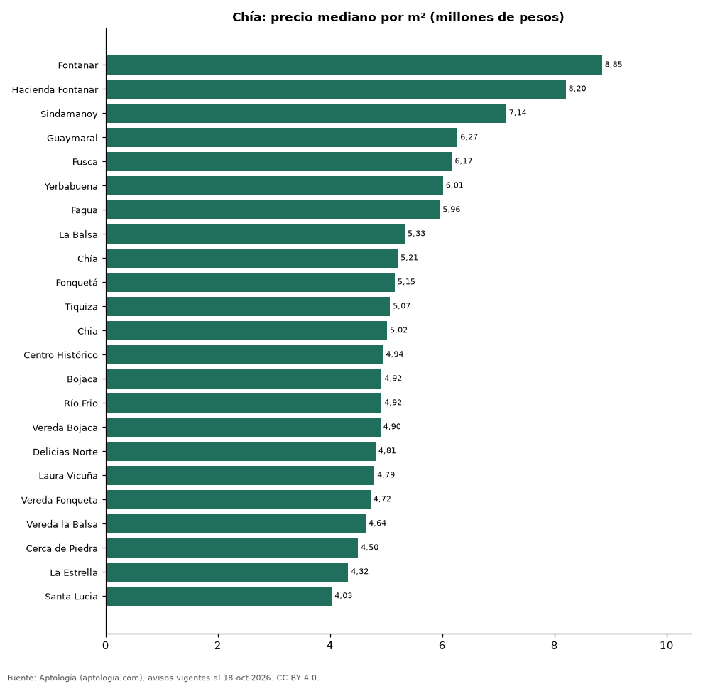

# Barrios más caros y más baratos de Chía para comprar casa: ranking por m² (octubre 2026)

**En Chía, el barrio con el m² más caro para comprar casa es Fontanar (8,85 millones de pesos/m²) y el más barato Santa Lucia (4,03 millones de pesos/m²), 2,2 veces menos.** Comparamos 23 barrios con al menos 30 avisos con área.

*Resumen: analizamos 2.369 casas en venta con área declarada en 23 barrios de Chía.*

**Actualizado:** 18 de octubre de 2026 (datos del 18 de octubre de 2026) · **Próxima actualización:** mensual.

## Resumen

| Indicador | Valor |
|---|---|
| Más caro por m² | Fontanar: 8,85 millones de pesos |
| Más barato por m² | Santa Lucia: 4,03 millones de pesos |
| Diferencia | 2,2 veces |
| Barrios | 23 |

## Ranking de barrios por precio del m²

| Barrio | Por m² (mediana) | Precio (mediana) | Área mediana (m²) | Avisos con área |
|---|---|---|---|---|
| Fontanar | 8,85 millones de pesos | 1.850 millones de pesos | 226 | 35 |
| Hacienda Fontanar | 8,20 millones de pesos | 1.965 millones de pesos | 242 | 127 |
| Sindamanoy | 7,14 millones de pesos | 2.500 millones de pesos | 510 | 54 |
| Guaymaral | 6,27 millones de pesos | 2.500 millones de pesos | 407 | 98 |
| Fusca | 6,17 millones de pesos | 2.700 millones de pesos | 450 | 67 |
| Yerbabuena | 6,01 millones de pesos | 2.500 millones de pesos | 425 | 181 |
| Fagua | 5,96 millones de pesos | 980 millones de pesos | 161 | 75 |
| La Balsa | 5,33 millones de pesos | 1.200 millones de pesos | 255 | 93 |
| Chía | 5,21 millones de pesos | 974 millones de pesos | 232 | 38 |
| Fonquetá | 5,15 millones de pesos | 910 millones de pesos | 176 | 176 |
| Tiquiza | 5,07 millones de pesos | 730 millones de pesos | 148 | 62 |
| Chia | 5,02 millones de pesos | 1.050 millones de pesos | 239 | 584 |
| Centro Histórico | 4,94 millones de pesos | 998 millones de pesos | 213 | 57 |
| Bojaca | 4,92 millones de pesos | 960 millones de pesos | 178 | 112 |
| Río Frio | 4,92 millones de pesos | 680 millones de pesos | 130 | 40 |
| Vereda Bojaca | 4,90 millones de pesos | 1.175 millones de pesos | 253 | 50 |
| Delicias Norte | 4,81 millones de pesos | 820 millones de pesos | 168 | 58 |
| Laura Vicuña | 4,79 millones de pesos | 828 millones de pesos | 182 | 60 |
| Vereda Fonqueta | 4,72 millones de pesos | 875 millones de pesos | 180 | 35 |
| Vereda la Balsa | 4,64 millones de pesos | 1.100 millones de pesos | 241 | 208 |
| Cerca de Piedra | 4,50 millones de pesos | 1.150 millones de pesos | 296 | 37 |
| La Estrella | 4,32 millones de pesos | 880 millones de pesos | 210 | 81 |
| Santa Lucia | 4,03 millones de pesos | 750 millones de pesos | 197 | 41 |

Medianas; solo barrios con 30 avisos o más con área declarada.

## Preguntas frecuentes

**¿Cuál es el barrio más caro de Chía para comprar?**
Fontanar, con 8,85 millones de pesos por m² en la mediana (octubre de 2026).

**¿Y el más barato?**
Santa Lucia, con 4,03 millones de pesos por m².

## Metodología

- **Fuente:** exportes nocturnos de la base de datos de Aptología (aptologia.com) del 18 de octubre de 2026: avisos vigentes de vivienda en portales inmobiliarios de 13 países, recogidos por Aptología y vistos en línea entre el 11 y el 18 de octubre de 2026. Corte: 18 de octubre de 2026.
- **Depuración:** se eliminan duplicados exactos (misma ciudad, zona, tipo, precio, moneda, área, habitaciones y baños) y los precios fuera del percentil 1–99 de cada país, operación, moneda y tipo; el precio por m² usa solo avisos con área declarada entre 12 y 2.000 m² y también se recorta al P1–P99.
- **Qué se mide:** precios pedidos (publicados), no precios de cierre. En arriendo, el canon mensual sin administración, gastos comunes ni condominio.
- **Muestra mínima:** cada cifra publicada se apoya en al menos 30 avisos; las celdas con menos se omiten.
- **Colombia:** Precios en pesos colombianos, sin conversión de moneda.
- **Limitaciones:** la cobertura depende de los portales que recorre Aptología en cada país y es mayor en las ciudades grandes y en los segmentos medio-alto y alto; el área es la que declara el aviso, sin verificar; los nombres de zona vienen de los portales.
- **Privacidad:** solo se publican agregados; no se publica ningún dato personal, enlace a avisos ni nombre de anunciante.
- **Datos abiertos:** [datos.csv](datos.csv), licencia CC BY 4.0.

## Cómo citar

Pinzón Pineda, D. M. (2026). *Barrios más caros y más baratos de Chía para comprar casa: ranking por m² (octubre 2026)*. Aptología (aptologia.com). https://github.com/elbroker/aptologia-datos/tree/main/estudios/barrios-con-casas-mas-caras-y-baratas-chia-venta-m2-2026. Datos: datos.csv, licencia CC BY 4.0.
