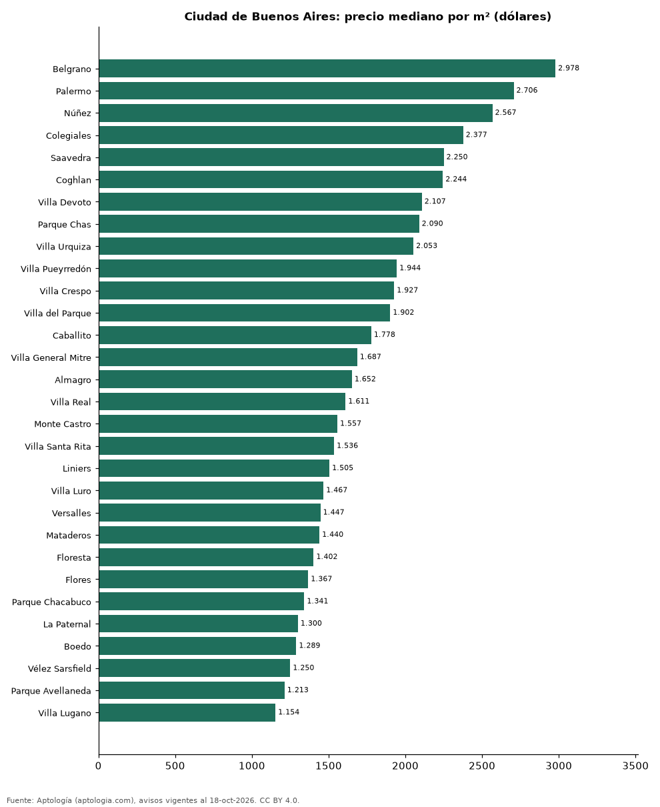

# Barrios más caros y más baratos de Ciudad de Buenos Aires para comprar casa: ranking por m² (octubre 2026)

**En Ciudad de Buenos Aires, el barrio con el m² más caro para comprar casa es Belgrano (USD 2.978/m²) y el más barato Nueva Pompeya (USD 827/m²), 3,6 veces menos.** Comparamos 37 barrios con al menos 30 avisos con área.

*Resumen: analizamos 3.115 casas en venta con área declarada en 37 barrios de Ciudad de Buenos Aires.*

**Actualizado:** 18 de octubre de 2026 (datos del 18 de octubre de 2026) · **Próxima actualización:** mensual.

## Resumen

| Indicador | Valor |
|---|---|
| Más caro por m² | Belgrano: USD 2.978 |
| Más barato por m² | Nueva Pompeya: USD 827 |
| Diferencia | 3,6 veces |
| Barrios | 37 |

## Ranking de barrios por precio del m²

| Barrio | Por m² (mediana) | Precio (mediana) | Área mediana (m²) | Avisos con área |
|---|---|---|---|---|
| Belgrano | USD 2.978 | USD 900.000 | 342 | 136 |
| Palermo | USD 2.706 | USD 740.000 | 270 | 91 |
| Núñez | USD 2.567 | USD 587.500 | 228 | 76 |
| Colegiales | USD 2.377 | USD 540.000 | 240 | 49 |
| Saavedra | USD 2.250 | USD 340.000 | 168 | 101 |
| Coghlan | USD 2.244 | USD 482.500 | 230 | 46 |
| Villa Devoto | USD 2.107 | USD 385.000 | 188 | 139 |
| Parque Chas | USD 2.090 | USD 340.000 | 156 | 31 |
| Villa Urquiza | USD 2.053 | USD 350.000 | 180 | 123 |
| Villa Pueyrredón | USD 1.944 | USD 340.000 | 171 | 123 |
| Villa Crespo | USD 1.927 | USD 409.500 | 261 | 46 |
| Villa del Parque | USD 1.902 | USD 359.450 | 199 | 112 |
| Caballito | USD 1.778 | USD 360.000 | 210 | 83 |
| Villa General Mitre | USD 1.687 | USD 260.000 | 183 | 36 |
| Almagro | USD 1.652 | USD 395.000 | 280 | 63 |
| Villa Real | USD 1.611 | USD 280.000 | 192 | 47 |
| Monte Castro | USD 1.557 | USD 235.000 | 164 | 82 |
| Villa Santa Rita | USD 1.536 | USD 245.000 | 145 | 41 |
| Liniers | USD 1.505 | USD 220.000 | 160 | 118 |
| Villa Luro | USD 1.467 | USD 255.000 | 162 | 111 |
| Versalles | USD 1.447 | USD 279.000 | 196 | 67 |
| Mataderos | USD 1.440 | USD 220.000 | 157 | 141 |
| Floresta | USD 1.402 | USD 249.000 | 183 | 113 |
| Flores | USD 1.367 | USD 257.500 | 190 | 132 |
| Parque Chacabuco | USD 1.341 | USD 260.000 | 189 | 97 |
| La Paternal | USD 1.300 | USD 250.000 | 180 | 63 |
| Boedo | USD 1.289 | USD 262.000 | 208 | 78 |
| Vélez Sarsfield | USD 1.250 | USD 235.000 | 194 | 47 |
| Parque Avellaneda | USD 1.213 | USD 190.000 | 152 | 124 |
| Villa Lugano | USD 1.154 | USD 175.000 | 159 | 147 |
| Barracas | USD 1.061 | USD 190.000 | 195 | 97 |
| Parque Patricios | USD 1.028 | USD 200.000 | 208 | 59 |
| Balvanera | USD 1.016 | USD 330.000 | 299 | 35 |
| San Cristóbal | USD 969 | USD 259.000 | 295 | 50 |
| La Boca | USD 865 | USD 280.000 | 373 | 37 |
| Villa Soldati | USD 864 | USD 148.450 | 164 | 62 |
| Nueva Pompeya | USD 827 | USD 135.000 | 174 | 112 |

Medianas; solo barrios con 30 avisos o más con área declarada.

## Preguntas frecuentes

**¿Cuál es el barrio más caro de Ciudad de Buenos Aires para comprar?**
Belgrano, con USD 2.978 por m² en la mediana (octubre de 2026).

**¿Y el más barato?**
Nueva Pompeya, con USD 827 por m².

## Metodología

- **Fuente:** exportes nocturnos de la base de datos de Aptología (aptologia.com) del 18 de octubre de 2026: avisos vigentes de vivienda en portales inmobiliarios de 13 países, recogidos por Aptología y vistos en línea entre el 11 y el 18 de octubre de 2026. Corte: 18 de octubre de 2026.
- **Depuración:** se eliminan duplicados exactos (misma ciudad, zona, tipo, precio, moneda, área, habitaciones y baños) y los precios fuera del percentil 1–99 de cada país, operación, moneda y tipo; el precio por m² usa solo avisos con área declarada entre 12 y 2.000 m² y también se recorta al P1–P99.
- **Qué se mide:** precios pedidos (publicados), no precios de cierre. En arriendo, el canon mensual sin administración, gastos comunes ni condominio.
- **Muestra mínima:** cada cifra publicada se apoya en al menos 30 avisos; las celdas con menos se omiten.
- **Monedas:** nunca se mezclan avisos de monedas distintas sin convertirlos. Conversión a dólares con la tasa de mercado de ExchangeRate-API (open.er-api.com, actualización del 18 Oct 2026): 1 USD = 3.182,80 COP, 1 USD = 18,47 M.N, 1 USD = 5,09 BRL, 1 USD = 3,44 PEN, 1 USD = 982,44 CLP, 1 USD = 1.514,57 ARS, 1 USD = 40,20 UYU, 1 USD = 5.705,37 PYG, 1 USD = 61,27 DOP, 1 USD = 0,89 EUR, 1 USD = 11,72 BOB; la UF chilena a 41.178,64 CLP (mindicador,cl. 18-oct-2026). Los avisos publicados en dólares se usan tal cual.
- **Monedas:** en cada ciudad y operación se usa solo la moneda mayoritaria de los avisos (los avisos en otra moneda se excluyen) y la mediana se convierte a dólares con la tasa citada; nunca se promedian avisos de monedas distintas.
- **Limitaciones:** la cobertura depende de los portales que recorre Aptología en cada país y es mayor en las ciudades grandes y en los segmentos medio-alto y alto; el área es la que declara el aviso, sin verificar; los nombres de zona vienen de los portales.
- **Privacidad:** solo se publican agregados; no se publica ningún dato personal, enlace a avisos ni nombre de anunciante.
- **Datos abiertos:** [datos.csv](datos.csv), licencia CC BY 4.0.

## Cómo citar

Pinzón Pineda, D. M. (2026). *Barrios más caros y más baratos de Ciudad de Buenos Aires para comprar casa: ranking por m² (octubre 2026)*. Aptología (aptologia.com). https://github.com/elbroker/aptologia-datos/tree/main/estudios/barrios-con-casas-mas-caras-y-baratas-ciudad-de-buenos-aires-venta-m2-2026. Datos: datos.csv, licencia CC BY 4.0.
