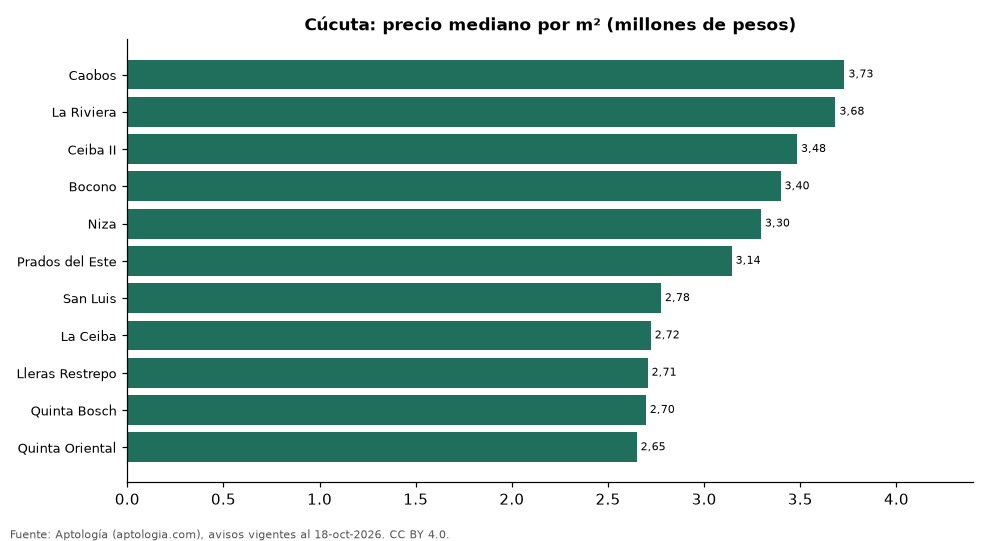

# Barrios más caros y más baratos de Cúcuta para comprar casa: ranking por m² (octubre 2026)

**En Cúcuta, el barrio con el m² más caro para comprar casa es Caobos (3,73 millones de pesos/m²) y el más barato Quinta Oriental (2,65 millones de pesos/m²), 1,4 veces menos.** Comparamos 11 barrios con al menos 30 avisos con área.

*Resumen: analizamos 429 casas en venta con área declarada en 11 barrios de Cúcuta.*

**Actualizado:** 18 de octubre de 2026 (datos del 18 de octubre de 2026) · **Próxima actualización:** mensual.

## Resumen

| Indicador | Valor |
|---|---|
| Más caro por m² | Caobos: 3,73 millones de pesos |
| Más barato por m² | Quinta Oriental: 2,65 millones de pesos |
| Diferencia | 1,4 veces |
| Barrios | 11 |

## Ranking de barrios por precio del m²

| Barrio | Por m² (mediana) | Precio (mediana) | Área mediana (m²) | Avisos con área |
|---|---|---|---|---|
| Caobos | 3,73 millones de pesos | 1.250 millones de pesos | 335 | 45 |
| La Riviera | 3,68 millones de pesos | 950 millones de pesos | 300 | 42 |
| Ceiba II | 3,48 millones de pesos | 490 millones de pesos | 145 | 42 |
| Bocono | 3,40 millones de pesos | 965 millones de pesos | 207 | 46 |
| Niza | 3,30 millones de pesos | 450 millones de pesos | 126 | 36 |
| Prados del Este | 3,14 millones de pesos | 360 millones de pesos | 110 | 35 |
| San Luis | 2,78 millones de pesos | 450 millones de pesos | 169 | 36 |
| La Ceiba | 2,72 millones de pesos | 655 millones de pesos | 276 | 38 |
| Lleras Restrepo | 2,71 millones de pesos | 600 millones de pesos | 240 | 33 |
| Quinta Bosch | 2,70 millones de pesos | 670 millones de pesos | 253 | 31 |
| Quinta Oriental | 2,65 millones de pesos | 600 millones de pesos | 240 | 45 |

Medianas; solo barrios con 30 avisos o más con área declarada.

## Preguntas frecuentes

**¿Cuál es el barrio más caro de Cúcuta para comprar?**
Caobos, con 3,73 millones de pesos por m² en la mediana (octubre de 2026).

**¿Y el más barato?**
Quinta Oriental, con 2,65 millones de pesos por m².

## Metodología

- **Fuente:** exportes nocturnos de la base de datos de Aptología (aptologia.com) del 18 de octubre de 2026: avisos vigentes de vivienda en portales inmobiliarios de 13 países, recogidos por Aptología y vistos en línea entre el 11 y el 18 de octubre de 2026. Corte: 18 de octubre de 2026.
- **Depuración:** se eliminan duplicados exactos (misma ciudad, zona, tipo, precio, moneda, área, habitaciones y baños) y los precios fuera del percentil 1–99 de cada país, operación, moneda y tipo; el precio por m² usa solo avisos con área declarada entre 12 y 2.000 m² y también se recorta al P1–P99.
- **Qué se mide:** precios pedidos (publicados), no precios de cierre. En arriendo, el canon mensual sin administración, gastos comunes ni condominio.
- **Muestra mínima:** cada cifra publicada se apoya en al menos 30 avisos; las celdas con menos se omiten.
- **Colombia:** Precios en pesos colombianos, sin conversión de moneda.
- **Limitaciones:** la cobertura depende de los portales que recorre Aptología en cada país y es mayor en las ciudades grandes y en los segmentos medio-alto y alto; el área es la que declara el aviso, sin verificar; los nombres de zona vienen de los portales.
- **Privacidad:** solo se publican agregados; no se publica ningún dato personal, enlace a avisos ni nombre de anunciante.
- **Datos abiertos:** [datos.csv](datos.csv), licencia CC BY 4.0.

## Cómo citar

Pinzón Pineda, D. M. (2026). *Barrios más caros y más baratos de Cúcuta para comprar casa: ranking por m² (octubre 2026)*. Aptología (aptologia.com). https://github.com/elbroker/aptologia-datos/tree/main/estudios/barrios-con-casas-mas-caras-y-baratas-cucuta-venta-m2-2026. Datos: datos.csv, licencia CC BY 4.0.
