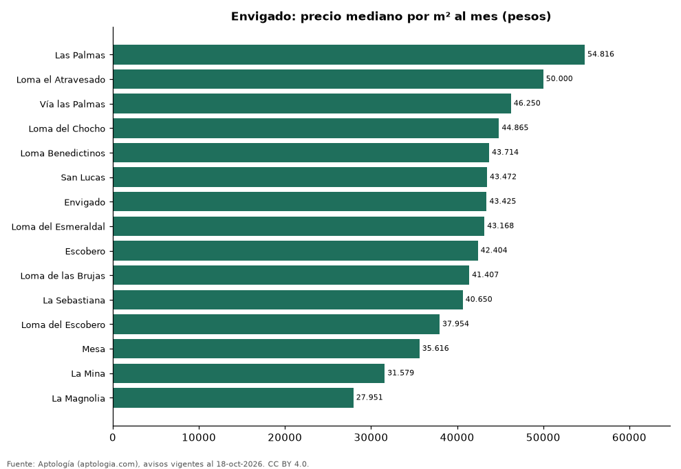

# Barrios más caros y más baratos de Envigado para arrendar casa: ranking por m² (octubre 2026)

**En Envigado, el barrio con el m² más caro para arrendar casa es Las Palmas (54.816 pesos/m² al mes) y el más barato La Magnolia (27.951 pesos/m² al mes), 2,0 veces menos.** Comparamos 15 barrios con al menos 30 avisos con área.

*Resumen: analizamos 1.330 casas en arriendo con área declarada en 15 barrios de Envigado.*

**Actualizado:** 18 de octubre de 2026 (datos del 18 de octubre de 2026) · **Próxima actualización:** mensual.

## Resumen

| Indicador | Valor |
|---|---|
| Más caro por m² | Las Palmas: 54.816 pesos |
| Más barato por m² | La Magnolia: 27.951 pesos |
| Diferencia | 2,0 veces |
| Barrios | 15 |

## Ranking de barrios por precio del m²

| Barrio | Por m² (mediana) | Canon (mediana) | Área mediana (m²) | Avisos con área |
|---|---|---|---|---|
| Las Palmas | 54.816 pesos | 19.000.000 pesos | 375 | 64 |
| Loma el Atravesado | 50.000 pesos | 11.500.000 pesos | 227 | 109 |
| Vía las Palmas | 46.250 pesos | 16.500.000 pesos | 320 | 36 |
| Loma del Chocho | 44.865 pesos | 12.500.000 pesos | 300 | 143 |
| Loma Benedictinos | 43.714 pesos | 11.000.000 pesos | 240 | 51 |
| San Lucas | 43.472 pesos | 12.000.000 pesos | 280 | 32 |
| Envigado | 43.425 pesos | 11.500.000 pesos | 260 | 424 |
| Loma del Esmeraldal | 43.168 pesos | 9.950.000 pesos | 222 | 38 |
| Escobero | 42.404 pesos | 12.800.000 pesos | 296 | 92 |
| Loma de las Brujas | 41.407 pesos | 9.000.000 pesos | 225 | 46 |
| La Sebastiana | 40.650 pesos | 10.300.000 pesos | 250 | 33 |
| Loma del Escobero | 37.954 pesos | 12.500.000 pesos | 325 | 144 |
| Mesa | 35.616 pesos | 8.500.000 pesos | 220 | 49 |
| La Mina | 31.579 pesos | 12.000.000 pesos | 380 | 39 |
| La Magnolia | 27.951 pesos | 4.500.000 pesos | 165 | 30 |

Medianas; solo barrios con 30 avisos o más con área declarada.

## Preguntas frecuentes

**¿Cuál es el barrio más caro de Envigado para arrendar?**
Las Palmas, con 54.816 pesos por m² al mes en la mediana (octubre de 2026).

**¿Y el más barato?**
La Magnolia, con 27.951 pesos por m² al mes.

## Metodología

- **Fuente:** exportes nocturnos de la base de datos de Aptología (aptologia.com) del 18 de octubre de 2026: avisos vigentes de vivienda en portales inmobiliarios de 13 países, recogidos por Aptología y vistos en línea entre el 11 y el 18 de octubre de 2026. Corte: 18 de octubre de 2026.
- **Depuración:** se eliminan duplicados exactos (misma ciudad, zona, tipo, precio, moneda, área, habitaciones y baños) y los precios fuera del percentil 1–99 de cada país, operación, moneda y tipo; el precio por m² usa solo avisos con área declarada entre 12 y 2.000 m² y también se recorta al P1–P99.
- **Qué se mide:** precios pedidos (publicados), no precios de cierre. En arriendo, el canon mensual sin administración, gastos comunes ni condominio.
- **Muestra mínima:** cada cifra publicada se apoya en al menos 30 avisos; las celdas con menos se omiten.
- **Colombia:** Precios en pesos colombianos, sin conversión de moneda.
- **Limitaciones:** la cobertura depende de los portales que recorre Aptología en cada país y es mayor en las ciudades grandes y en los segmentos medio-alto y alto; el área es la que declara el aviso, sin verificar; los nombres de zona vienen de los portales.
- **Privacidad:** solo se publican agregados; no se publica ningún dato personal, enlace a avisos ni nombre de anunciante.
- **Datos abiertos:** [datos.csv](datos.csv), licencia CC BY 4.0.

## Cómo citar

Pinzón Pineda, D. M. (2026). *Barrios más caros y más baratos de Envigado para arrendar casa: ranking por m² (octubre 2026)*. Aptología (aptologia.com). https://github.com/elbroker/aptologia-datos/tree/main/estudios/barrios-con-casas-mas-caras-y-baratas-envigado-arriendo-m2-2026. Datos: datos.csv, licencia CC BY 4.0.
