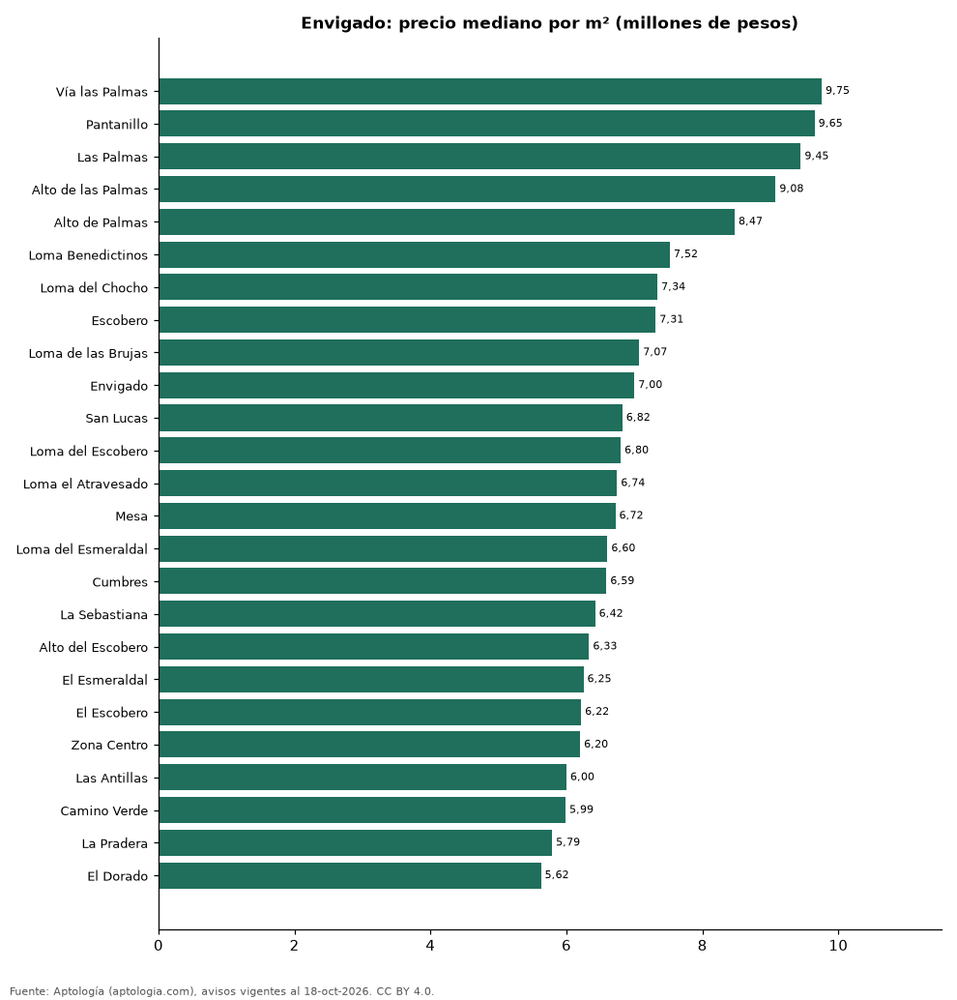

# Barrios más caros y más baratos de Envigado para comprar casa: ranking por m² (octubre 2026)

**En Envigado, el barrio con el m² más caro para comprar casa es Vía las Palmas (9,75 millones de pesos/m²) y el más barato El Dorado (5,62 millones de pesos/m²), 1,7 veces menos.** Comparamos 25 barrios con al menos 30 avisos con área.

*Resumen: analizamos 2.515 casas en venta con área declarada en 25 barrios de Envigado.*

**Actualizado:** 18 de octubre de 2026 (datos del 18 de octubre de 2026) · **Próxima actualización:** mensual.

## Resumen

| Indicador | Valor |
|---|---|
| Más caro por m² | Vía las Palmas: 9,75 millones de pesos |
| Más barato por m² | El Dorado: 5,62 millones de pesos |
| Diferencia | 1,7 veces |
| Barrios | 25 |

## Ranking de barrios por precio del m²

| Barrio | Por m² (mediana) | Precio (mediana) | Área mediana (m²) | Avisos con área |
|---|---|---|---|---|
| Vía las Palmas | 9,75 millones de pesos | 3.950 millones de pesos | 404 | 92 |
| Pantanillo | 9,65 millones de pesos | 3.125 millones de pesos | 356 | 36 |
| Las Palmas | 9,45 millones de pesos | 4.400 millones de pesos | 450 | 214 |
| Alto de las Palmas | 9,08 millones de pesos | 4.050 millones de pesos | 462 | 94 |
| Alto de Palmas | 8,47 millones de pesos | 3.800 millones de pesos | 494 | 46 |
| Loma Benedictinos | 7,52 millones de pesos | 2.150 millones de pesos | 274 | 67 |
| Loma del Chocho | 7,34 millones de pesos | 2.150 millones de pesos | 284 | 199 |
| Escobero | 7,31 millones de pesos | 3.000 millones de pesos | 400 | 135 |
| Loma de las Brujas | 7,07 millones de pesos | 1.780 millones de pesos | 239 | 103 |
| Envigado | 7,00 millones de pesos | 2.215 millones de pesos | 307 | 547 |
| San Lucas | 6,82 millones de pesos | 1.690 millones de pesos | 245 | 36 |
| Loma del Escobero | 6,80 millones de pesos | 2.600 millones de pesos | 384 | 308 |
| Loma el Atravesado | 6,74 millones de pesos | 1.785 millones de pesos | 250 | 82 |
| Mesa | 6,72 millones de pesos | 1.620 millones de pesos | 246 | 65 |
| Loma del Esmeraldal | 6,60 millones de pesos | 1.600 millones de pesos | 240 | 56 |
| Cumbres | 6,59 millones de pesos | 1.290 millones de pesos | 198 | 55 |
| La Sebastiana | 6,42 millones de pesos | 1.600 millones de pesos | 246 | 49 |
| Alto del Escobero | 6,33 millones de pesos | 2.500 millones de pesos | 400 | 41 |
| El Esmeraldal | 6,25 millones de pesos | 1.965 millones de pesos | 288 | 30 |
| El Escobero | 6,22 millones de pesos | 2.380 millones de pesos | 390 | 45 |
| Zona Centro | 6,20 millones de pesos | 2.080 millones de pesos | 286 | 41 |
| Las Antillas | 6,00 millones de pesos | 995 millones de pesos | 179 | 44 |
| Camino Verde | 5,99 millones de pesos | 885 millones de pesos | 156 | 54 |
| La Pradera | 5,79 millones de pesos | 1.350 millones de pesos | 230 | 31 |
| El Dorado | 5,62 millones de pesos | 875 millones de pesos | 174 | 45 |

Medianas; solo barrios con 30 avisos o más con área declarada.

## Preguntas frecuentes

**¿Cuál es el barrio más caro de Envigado para comprar?**
Vía las Palmas, con 9,75 millones de pesos por m² en la mediana (octubre de 2026).

**¿Y el más barato?**
El Dorado, con 5,62 millones de pesos por m².

## Metodología

- **Fuente:** exportes nocturnos de la base de datos de Aptología (aptologia.com) del 18 de octubre de 2026: avisos vigentes de vivienda en portales inmobiliarios de 13 países, recogidos por Aptología y vistos en línea entre el 11 y el 18 de octubre de 2026. Corte: 18 de octubre de 2026.
- **Depuración:** se eliminan duplicados exactos (misma ciudad, zona, tipo, precio, moneda, área, habitaciones y baños) y los precios fuera del percentil 1–99 de cada país, operación, moneda y tipo; el precio por m² usa solo avisos con área declarada entre 12 y 2.000 m² y también se recorta al P1–P99.
- **Qué se mide:** precios pedidos (publicados), no precios de cierre. En arriendo, el canon mensual sin administración, gastos comunes ni condominio.
- **Muestra mínima:** cada cifra publicada se apoya en al menos 30 avisos; las celdas con menos se omiten.
- **Colombia:** Precios en pesos colombianos, sin conversión de moneda.
- **Limitaciones:** la cobertura depende de los portales que recorre Aptología en cada país y es mayor en las ciudades grandes y en los segmentos medio-alto y alto; el área es la que declara el aviso, sin verificar; los nombres de zona vienen de los portales.
- **Privacidad:** solo se publican agregados; no se publica ningún dato personal, enlace a avisos ni nombre de anunciante.
- **Datos abiertos:** [datos.csv](datos.csv), licencia CC BY 4.0.

## Cómo citar

Pinzón Pineda, D. M. (2026). *Barrios más caros y más baratos de Envigado para comprar casa: ranking por m² (octubre 2026)*. Aptología (aptologia.com). https://github.com/elbroker/aptologia-datos/tree/main/estudios/barrios-con-casas-mas-caras-y-baratas-envigado-venta-m2-2026. Datos: datos.csv, licencia CC BY 4.0.
