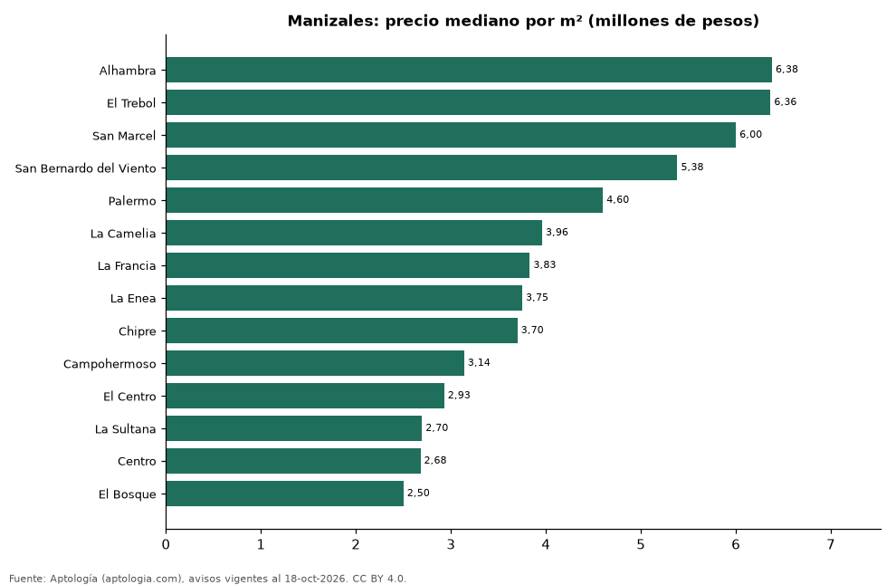

# Barrios más caros y más baratos de Manizales para comprar casa: ranking por m² (octubre 2026)

**En Manizales, el barrio con el m² más caro para comprar casa es Alhambra (6,38 millones de pesos/m²) y el más barato El Bosque (2,50 millones de pesos/m²), 2,6 veces menos.** Comparamos 14 barrios con al menos 30 avisos con área.

*Resumen: analizamos 820 casas en venta con área declarada en 14 barrios de Manizales.*

**Actualizado:** 18 de octubre de 2026 (datos del 18 de octubre de 2026) · **Próxima actualización:** mensual.

## Resumen

| Indicador | Valor |
|---|---|
| Más caro por m² | Alhambra: 6,38 millones de pesos |
| Más barato por m² | El Bosque: 2,50 millones de pesos |
| Diferencia | 2,6 veces |
| Barrios | 14 |

## Ranking de barrios por precio del m²

| Barrio | Por m² (mediana) | Precio (mediana) | Área mediana (m²) | Avisos con área |
|---|---|---|---|---|
| Alhambra | 6,38 millones de pesos | 1.850 millones de pesos | 380 | 39 |
| El Trebol | 6,36 millones de pesos | 2.500 millones de pesos | 350 | 73 |
| San Marcel | 6,00 millones de pesos | 780 millones de pesos | 130 | 51 |
| San Bernardo del Viento | 5,38 millones de pesos | 1.800 millones de pesos | 328 | 50 |
| Palermo | 4,60 millones de pesos | 1.200 millones de pesos | 240 | 127 |
| La Camelia | 3,96 millones de pesos | 1.475 millones de pesos | 420 | 32 |
| La Francia | 3,83 millones de pesos | 1.000 millones de pesos | 304 | 79 |
| La Enea | 3,75 millones de pesos | 470 millones de pesos | 128 | 67 |
| Chipre | 3,70 millones de pesos | 720 millones de pesos | 200 | 106 |
| Campohermoso | 3,14 millones de pesos | 570 millones de pesos | 188 | 32 |
| El Centro | 2,93 millones de pesos | 800 millones de pesos | 312 | 49 |
| La Sultana | 2,70 millones de pesos | 485 millones de pesos | 200 | 46 |
| Centro | 2,68 millones de pesos | 800 millones de pesos | 340 | 30 |
| El Bosque | 2,50 millones de pesos | 600 millones de pesos | 246 | 39 |

Medianas; solo barrios con 30 avisos o más con área declarada.

## Preguntas frecuentes

**¿Cuál es el barrio más caro de Manizales para comprar?**
Alhambra, con 6,38 millones de pesos por m² en la mediana (octubre de 2026).

**¿Y el más barato?**
El Bosque, con 2,50 millones de pesos por m².

## Metodología

- **Fuente:** exportes nocturnos de la base de datos de Aptología (aptologia.com) del 18 de octubre de 2026: avisos vigentes de vivienda en portales inmobiliarios de 13 países, recogidos por Aptología y vistos en línea entre el 11 y el 18 de octubre de 2026. Corte: 18 de octubre de 2026.
- **Depuración:** se eliminan duplicados exactos (misma ciudad, zona, tipo, precio, moneda, área, habitaciones y baños) y los precios fuera del percentil 1–99 de cada país, operación, moneda y tipo; el precio por m² usa solo avisos con área declarada entre 12 y 2.000 m² y también se recorta al P1–P99.
- **Qué se mide:** precios pedidos (publicados), no precios de cierre. En arriendo, el canon mensual sin administración, gastos comunes ni condominio.
- **Muestra mínima:** cada cifra publicada se apoya en al menos 30 avisos; las celdas con menos se omiten.
- **Colombia:** Precios en pesos colombianos, sin conversión de moneda.
- **Limitaciones:** la cobertura depende de los portales que recorre Aptología en cada país y es mayor en las ciudades grandes y en los segmentos medio-alto y alto; el área es la que declara el aviso, sin verificar; los nombres de zona vienen de los portales.
- **Privacidad:** solo se publican agregados; no se publica ningún dato personal, enlace a avisos ni nombre de anunciante.
- **Datos abiertos:** [datos.csv](datos.csv), licencia CC BY 4.0.

## Cómo citar

Pinzón Pineda, D. M. (2026). *Barrios más caros y más baratos de Manizales para comprar casa: ranking por m² (octubre 2026)*. Aptología (aptologia.com). https://github.com/elbroker/aptologia-datos/tree/main/estudios/barrios-con-casas-mas-caras-y-baratas-manizales-venta-m2-2026. Datos: datos.csv, licencia CC BY 4.0.
