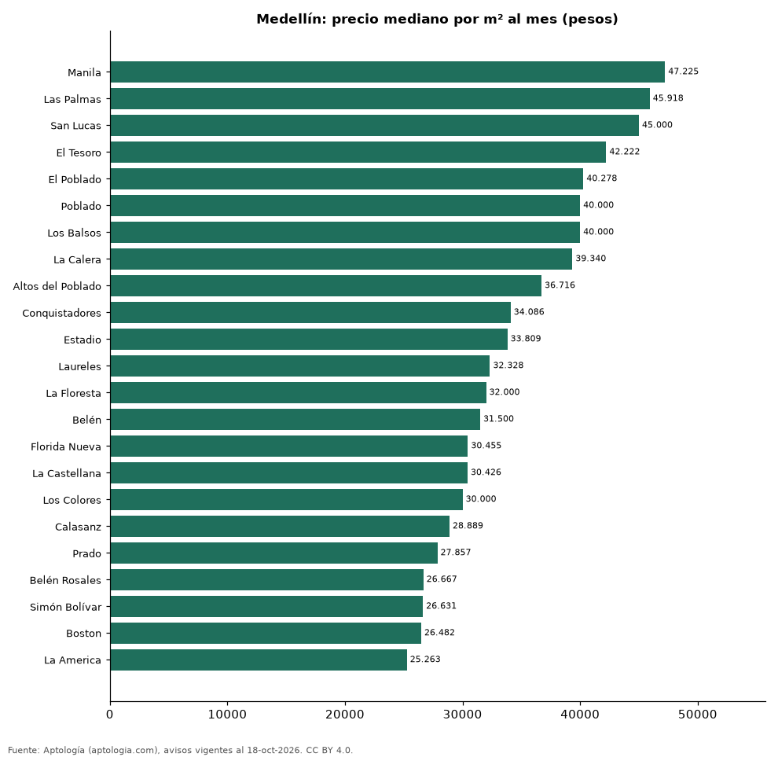

# Barrios más caros y más baratos de Medellín para arrendar casa: ranking por m² (octubre 2026)

**En Medellín, el barrio con el m² más caro para arrendar casa es Manila (47.225 pesos/m² al mes) y el más barato La America (25.263 pesos/m² al mes), 1,9 veces menos.** Comparamos 23 barrios con al menos 30 avisos con área.

*Resumen: analizamos 2.415 casas en arriendo con área declarada en 23 barrios de Medellín.*

**Actualizado:** 18 de octubre de 2026 (datos del 18 de octubre de 2026) · **Próxima actualización:** mensual.

## Resumen

| Indicador | Valor |
|---|---|
| Más caro por m² | Manila: 47.225 pesos |
| Más barato por m² | La America: 25.263 pesos |
| Diferencia | 1,9 veces |
| Barrios | 23 |

## Ranking de barrios por precio del m²

| Barrio | Por m² (mediana) | Canon (mediana) | Área mediana (m²) | Avisos con área |
|---|---|---|---|---|
| Manila | 47.225 pesos | 12.000.000 pesos | 215 | 30 |
| Las Palmas | 45.918 pesos | 19.000.000 pesos | 375 | 57 |
| San Lucas | 45.000 pesos | 12.500.000 pesos | 272 | 93 |
| El Tesoro | 42.222 pesos | 13.350.000 pesos | 345 | 94 |
| El Poblado | 40.278 pesos | 12.000.000 pesos | 300 | 695 |
| Poblado | 40.000 pesos | 14.500.000 pesos | 346 | 96 |
| Los Balsos | 40.000 pesos | 10.500.000 pesos | 280 | 63 |
| La Calera | 39.340 pesos | 16.000.000 pesos | 355 | 38 |
| Altos del Poblado | 36.716 pesos | 11.550.000 pesos | 346 | 46 |
| Conquistadores | 34.086 pesos | 11.000.000 pesos | 304 | 52 |
| Estadio | 33.809 pesos | 5.700.000 pesos | 170 | 44 |
| Laureles | 32.328 pesos | 7.200.000 pesos | 230 | 419 |
| La Floresta | 32.000 pesos | 5.000.000 pesos | 168 | 33 |
| Belén | 31.500 pesos | 4.600.000 pesos | 150 | 189 |
| Florida Nueva | 30.455 pesos | 5.000.000 pesos | 170 | 35 |
| La Castellana | 30.426 pesos | 6.450.000 pesos | 205 | 82 |
| Los Colores | 30.000 pesos | 5.900.000 pesos | 230 | 35 |
| Calasanz | 28.889 pesos | 6.000.000 pesos | 220 | 86 |
| Prado | 27.857 pesos | 9.250.000 pesos | 375 | 46 |
| Belén Rosales | 26.667 pesos | 5.000.000 pesos | 200 | 41 |
| Simón Bolívar | 26.631 pesos | 5.000.000 pesos | 190 | 72 |
| Boston | 26.482 pesos | 4.250.000 pesos | 176 | 34 |
| La America | 25.263 pesos | 4.200.000 pesos | 190 | 35 |

Medianas; solo barrios con 30 avisos o más con área declarada.

## Preguntas frecuentes

**¿Cuál es el barrio más caro de Medellín para arrendar?**
Manila, con 47.225 pesos por m² al mes en la mediana (octubre de 2026).

**¿Y el más barato?**
La America, con 25.263 pesos por m² al mes.

## Metodología

- **Fuente:** exportes nocturnos de la base de datos de Aptología (aptologia.com) del 18 de octubre de 2026: avisos vigentes de vivienda en portales inmobiliarios de 13 países, recogidos por Aptología y vistos en línea entre el 11 y el 18 de octubre de 2026. Corte: 18 de octubre de 2026.
- **Depuración:** se eliminan duplicados exactos (misma ciudad, zona, tipo, precio, moneda, área, habitaciones y baños) y los precios fuera del percentil 1–99 de cada país, operación, moneda y tipo; el precio por m² usa solo avisos con área declarada entre 12 y 2.000 m² y también se recorta al P1–P99.
- **Qué se mide:** precios pedidos (publicados), no precios de cierre. En arriendo, el canon mensual sin administración, gastos comunes ni condominio.
- **Muestra mínima:** cada cifra publicada se apoya en al menos 30 avisos; las celdas con menos se omiten.
- **Colombia:** Precios en pesos colombianos, sin conversión de moneda.
- **Limitaciones:** la cobertura depende de los portales que recorre Aptología en cada país y es mayor en las ciudades grandes y en los segmentos medio-alto y alto; el área es la que declara el aviso, sin verificar; los nombres de zona vienen de los portales.
- **Privacidad:** solo se publican agregados; no se publica ningún dato personal, enlace a avisos ni nombre de anunciante.
- **Datos abiertos:** [datos.csv](datos.csv), licencia CC BY 4.0.

## Cómo citar

Pinzón Pineda, D. M. (2026). *Barrios más caros y más baratos de Medellín para arrendar casa: ranking por m² (octubre 2026)*. Aptología (aptologia.com). https://github.com/elbroker/aptologia-datos/tree/main/estudios/barrios-con-casas-mas-caras-y-baratas-medellin-arriendo-m2-2026. Datos: datos.csv, licencia CC BY 4.0.
