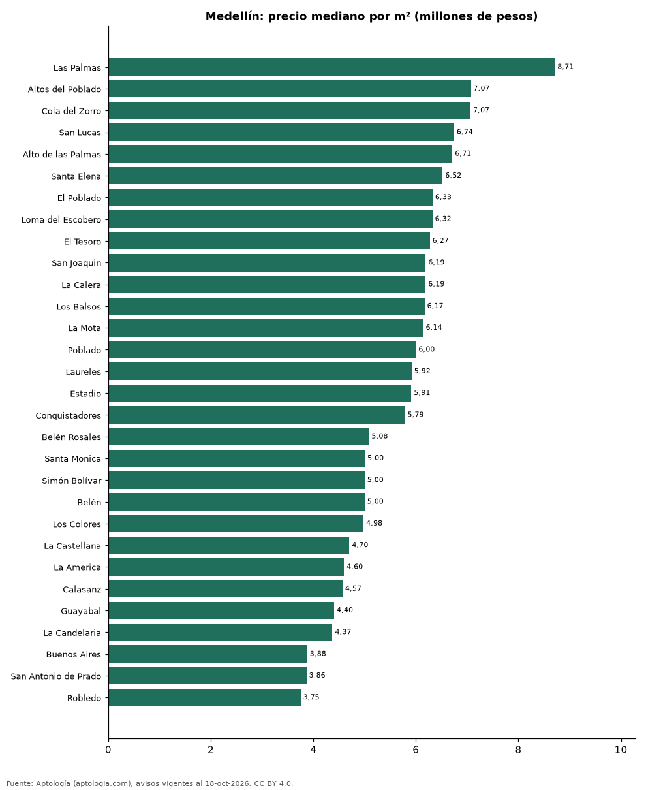

# Barrios más caros y más baratos de Medellín para comprar casa: ranking por m² (octubre 2026)

**En Medellín, el barrio con el m² más caro para comprar casa es Las Palmas (8,71 millones de pesos/m²) y el más barato San Javier (2,98 millones de pesos/m²), 2,9 veces menos.** Comparamos 37 barrios con al menos 30 avisos con área.

*Resumen: analizamos 3.962 casas en venta con área declarada en 37 barrios de Medellín.*

**Actualizado:** 18 de octubre de 2026 (datos del 18 de octubre de 2026) · **Próxima actualización:** mensual.

## Resumen

| Indicador | Valor |
|---|---|
| Más caro por m² | Las Palmas: 8,71 millones de pesos |
| Más barato por m² | San Javier: 2,98 millones de pesos |
| Diferencia | 2,9 veces |
| Barrios | 37 |

## Ranking de barrios por precio del m²

| Barrio | Por m² (mediana) | Precio (mediana) | Área mediana (m²) | Avisos con área |
|---|---|---|---|---|
| Las Palmas | 8,71 millones de pesos | 4.600 millones de pesos | 500 | 235 |
| Altos del Poblado | 7,07 millones de pesos | 2.700 millones de pesos | 350 | 87 |
| Cola del Zorro | 7,07 millones de pesos | 2.150 millones de pesos | 378 | 34 |
| San Lucas | 6,74 millones de pesos | 1.750 millones de pesos | 271 | 101 |
| Alto de las Palmas | 6,71 millones de pesos | 3.950 millones de pesos | 553 | 32 |
| Santa Elena | 6,52 millones de pesos | 1.496 millones de pesos | 250 | 40 |
| El Poblado | 6,33 millones de pesos | 2.000 millones de pesos | 326 | 1.047 |
| Loma del Escobero | 6,32 millones de pesos | 2.775 millones de pesos | 446 | 42 |
| El Tesoro | 6,27 millones de pesos | 2.075 millones de pesos | 345 | 92 |
| San Joaquin | 6,19 millones de pesos | 1.400 millones de pesos | 230 | 31 |
| La Calera | 6,19 millones de pesos | 3.300 millones de pesos | 484 | 61 |
| Los Balsos | 6,17 millones de pesos | 2.450 millones de pesos | 400 | 78 |
| La Mota | 6,14 millones de pesos | 850 millones de pesos | 135 | 79 |
| Poblado | 6,00 millones de pesos | 2.500 millones de pesos | 420 | 139 |
| Laureles | 5,92 millones de pesos | 1.450 millones de pesos | 240 | 409 |
| Estadio | 5,91 millones de pesos | 965 millones de pesos | 187 | 46 |
| Conquistadores | 5,79 millones de pesos | 1.890 millones de pesos | 250 | 39 |
| Belén Rosales | 5,08 millones de pesos | 1.250 millones de pesos | 208 | 37 |
| Santa Monica | 5,00 millones de pesos | 850 millones de pesos | 169 | 32 |
| Simón Bolívar | 5,00 millones de pesos | 1.230 millones de pesos | 225 | 81 |
| Belén | 5,00 millones de pesos | 830 millones de pesos | 159 | 308 |
| Los Colores | 4,98 millones de pesos | 1.400 millones de pesos | 305 | 43 |
| La Castellana | 4,70 millones de pesos | 1.200 millones de pesos | 235 | 61 |
| La America | 4,60 millones de pesos | 800 millones de pesos | 200 | 63 |
| Calasanz | 4,57 millones de pesos | 850 millones de pesos | 197 | 84 |
| Guayabal | 4,40 millones de pesos | 480 millones de pesos | 130 | 30 |
| La Candelaria | 4,37 millones de pesos | 965 millones de pesos | 230 | 44 |
| Buenos Aires | 3,88 millones de pesos | 470 millones de pesos | 150 | 66 |
| San Antonio de Prado | 3,86 millones de pesos | 372 millones de pesos | 102 | 44 |
| Robledo | 3,75 millones de pesos | 332 millones de pesos | 89 | 107 |
| Boston | 3,74 millones de pesos | 690 millones de pesos | 200 | 88 |
| Castilla | 3,45 millones de pesos | 330 millones de pesos | 105 | 30 |
| Prado | 3,40 millones de pesos | 850 millones de pesos | 231 | 99 |
| Prado Centro | 3,27 millones de pesos | 750 millones de pesos | 213 | 48 |
| Aranjuez | 3,18 millones de pesos | 373 millones de pesos | 130 | 31 |
| Villa Hermosa | 3,15 millones de pesos | 490 millones de pesos | 150 | 43 |
| San Javier | 2,98 millones de pesos | 420 millones de pesos | 136 | 31 |

Medianas; solo barrios con 30 avisos o más con área declarada.

## Preguntas frecuentes

**¿Cuál es el barrio más caro de Medellín para comprar?**
Las Palmas, con 8,71 millones de pesos por m² en la mediana (octubre de 2026).

**¿Y el más barato?**
San Javier, con 2,98 millones de pesos por m².

## Metodología

- **Fuente:** exportes nocturnos de la base de datos de Aptología (aptologia.com) del 18 de octubre de 2026: avisos vigentes de vivienda en portales inmobiliarios de 13 países, recogidos por Aptología y vistos en línea entre el 11 y el 18 de octubre de 2026. Corte: 18 de octubre de 2026.
- **Depuración:** se eliminan duplicados exactos (misma ciudad, zona, tipo, precio, moneda, área, habitaciones y baños) y los precios fuera del percentil 1–99 de cada país, operación, moneda y tipo; el precio por m² usa solo avisos con área declarada entre 12 y 2.000 m² y también se recorta al P1–P99.
- **Qué se mide:** precios pedidos (publicados), no precios de cierre. En arriendo, el canon mensual sin administración, gastos comunes ni condominio.
- **Muestra mínima:** cada cifra publicada se apoya en al menos 30 avisos; las celdas con menos se omiten.
- **Colombia:** Precios en pesos colombianos, sin conversión de moneda.
- **Limitaciones:** la cobertura depende de los portales que recorre Aptología en cada país y es mayor en las ciudades grandes y en los segmentos medio-alto y alto; el área es la que declara el aviso, sin verificar; los nombres de zona vienen de los portales.
- **Privacidad:** solo se publican agregados; no se publica ningún dato personal, enlace a avisos ni nombre de anunciante.
- **Datos abiertos:** [datos.csv](datos.csv), licencia CC BY 4.0.

## Cómo citar

Pinzón Pineda, D. M. (2026). *Barrios más caros y más baratos de Medellín para comprar casa: ranking por m² (octubre 2026)*. Aptología (aptologia.com). https://github.com/elbroker/aptologia-datos/tree/main/estudios/barrios-con-casas-mas-caras-y-baratas-medellin-venta-m2-2026. Datos: datos.csv, licencia CC BY 4.0.
