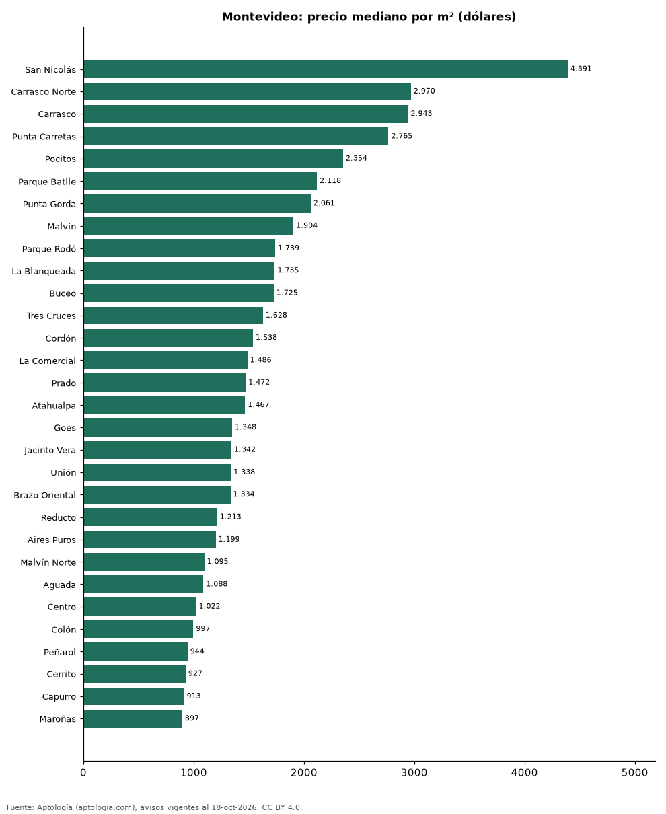

# Barrios más caros y más baratos de Montevideo para comprar casa: ranking por m² (octubre 2026)

**En Montevideo, el barrio con el m² más caro para comprar casa es San Nicolás (USD 4.391/m²) y el más barato Belvedere (USD 735/m²), 6,0 veces menos.** Comparamos 34 barrios con al menos 30 avisos con área.

*Resumen: analizamos 2.637 casas en venta con área declarada en 34 barrios de Montevideo.*

**Actualizado:** 18 de octubre de 2026 (datos del 18 de octubre de 2026) · **Próxima actualización:** mensual.

## Resumen

| Indicador | Valor |
|---|---|
| Más caro por m² | San Nicolás: USD 4.391 |
| Más barato por m² | Belvedere: USD 735 |
| Diferencia | 6,0 veces |
| Barrios | 34 |

## Ranking de barrios por precio del m²

| Barrio | Por m² (mediana) | Precio (mediana) | Área mediana (m²) | Avisos con área |
|---|---|---|---|---|
| San Nicolás | USD 4.391 | USD 890.000 | 248 | 30 |
| Carrasco Norte | USD 2.970 | USD 380.000 | 141 | 171 |
| Carrasco | USD 2.943 | USD 850.000 | 310 | 343 |
| Punta Carretas | USD 2.765 | USD 495.000 | 216 | 94 |
| Pocitos | USD 2.354 | USD 540.000 | 232 | 171 |
| Parque Batlle | USD 2.118 | USD 360.000 | 157 | 95 |
| Punta Gorda | USD 2.061 | USD 620.000 | 330 | 141 |
| Malvín | USD 1.904 | USD 410.000 | 219 | 103 |
| Parque Rodó | USD 1.739 | USD 332.500 | 207 | 32 |
| La Blanqueada | USD 1.735 | USD 270.000 | 168 | 75 |
| Buceo | USD 1.725 | USD 278.500 | 156 | 100 |
| Tres Cruces | USD 1.628 | USD 226.000 | 138 | 51 |
| Cordón | USD 1.538 | USD 251.500 | 182 | 120 |
| La Comercial | USD 1.486 | USD 187.000 | 137 | 44 |
| Prado | USD 1.472 | USD 295.000 | 215 | 128 |
| Atahualpa | USD 1.467 | USD 271.995 | 200 | 38 |
| Goes | USD 1.348 | USD 155.000 | 120 | 36 |
| Jacinto Vera | USD 1.342 | USD 183.000 | 140 | 37 |
| Unión | USD 1.338 | USD 169.900 | 125 | 85 |
| Brazo Oriental | USD 1.334 | USD 217.500 | 150 | 76 |
| Reducto | USD 1.213 | USD 170.000 | 143 | 48 |
| Aires Puros | USD 1.199 | USD 181.500 | 131 | 34 |
| Malvín Norte | USD 1.095 | USD 136.000 | 125 | 47 |
| Aguada | USD 1.088 | USD 169.500 | 150 | 88 |
| Centro | USD 1.022 | USD 215.000 | 225 | 59 |
| Colón | USD 997 | USD 139.000 | 155 | 62 |
| Peñarol | USD 944 | USD 130.000 | 127 | 35 |
| Cerrito | USD 927 | USD 122.000 | 138 | 37 |
| Capurro | USD 913 | USD 198.000 | 187 | 31 |
| Maroñas | USD 897 | USD 125.000 | 134 | 68 |
| Ciudad Vieja | USD 833 | USD 290.000 | 405 | 35 |
| Cerro | USD 789 | USD 131.000 | 152 | 34 |
| Sayago | USD 779 | USD 150.000 | 186 | 51 |
| Belvedere | USD 735 | USD 161.500 | 222 | 38 |

Medianas; solo barrios con 30 avisos o más con área declarada.

## Preguntas frecuentes

**¿Cuál es el barrio más caro de Montevideo para comprar?**
San Nicolás, con USD 4.391 por m² en la mediana (octubre de 2026).

**¿Y el más barato?**
Belvedere, con USD 735 por m².

## Metodología

- **Fuente:** exportes nocturnos de la base de datos de Aptología (aptologia.com) del 18 de octubre de 2026: avisos vigentes de vivienda en portales inmobiliarios de 13 países, recogidos por Aptología y vistos en línea entre el 11 y el 18 de octubre de 2026. Corte: 18 de octubre de 2026.
- **Depuración:** se eliminan duplicados exactos (misma ciudad, zona, tipo, precio, moneda, área, habitaciones y baños) y los precios fuera del percentil 1–99 de cada país, operación, moneda y tipo; el precio por m² usa solo avisos con área declarada entre 12 y 2.000 m² y también se recorta al P1–P99.
- **Qué se mide:** precios pedidos (publicados), no precios de cierre. En arriendo, el canon mensual sin administración, gastos comunes ni condominio.
- **Muestra mínima:** cada cifra publicada se apoya en al menos 30 avisos; las celdas con menos se omiten.
- **Monedas:** nunca se mezclan avisos de monedas distintas sin convertirlos. Conversión a dólares con la tasa de mercado de ExchangeRate-API (open.er-api.com, actualización del 18 Oct 2026): 1 USD = 3.182,80 COP, 1 USD = 18,47 M.N, 1 USD = 5,09 BRL, 1 USD = 3,44 PEN, 1 USD = 982,44 CLP, 1 USD = 1.514,57 ARS, 1 USD = 40,20 UYU, 1 USD = 5.705,37 PYG, 1 USD = 61,27 DOP, 1 USD = 0,89 EUR, 1 USD = 11,72 BOB; la UF chilena a 41.178,64 CLP (mindicador,cl. 18-oct-2026). Los avisos publicados en dólares se usan tal cual.
- **Monedas:** en cada ciudad y operación se usa solo la moneda mayoritaria de los avisos (los avisos en otra moneda se excluyen) y la mediana se convierte a dólares con la tasa citada; nunca se promedian avisos de monedas distintas.
- **Limitaciones:** la cobertura depende de los portales que recorre Aptología en cada país y es mayor en las ciudades grandes y en los segmentos medio-alto y alto; el área es la que declara el aviso, sin verificar; los nombres de zona vienen de los portales.
- **Privacidad:** solo se publican agregados; no se publica ningún dato personal, enlace a avisos ni nombre de anunciante.
- **Datos abiertos:** [datos.csv](datos.csv), licencia CC BY 4.0.

## Cómo citar

Pinzón Pineda, D. M. (2026). *Barrios más caros y más baratos de Montevideo para comprar casa: ranking por m² (octubre 2026)*. Aptología (aptologia.com). https://github.com/elbroker/aptologia-datos/tree/main/estudios/barrios-con-casas-mas-caras-y-baratas-montevideo-venta-m2-2026. Datos: datos.csv, licencia CC BY 4.0.
