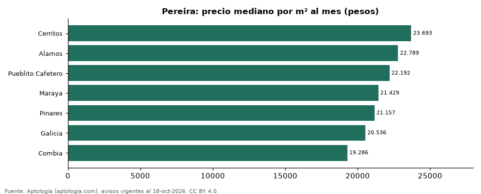

# Barrios más caros y más baratos de Pereira para arrendar casa: ranking por m² (octubre 2026)

**En Pereira, el barrio con el m² más caro para arrendar casa es Cerritos (23.693 pesos/m² al mes) y el más barato Combia (19.286 pesos/m² al mes), 1,2 veces menos.** Comparamos 7 barrios con al menos 30 avisos con área.

*Resumen: analizamos 489 casas en arriendo con área declarada en 7 barrios de Pereira.*

**Actualizado:** 18 de octubre de 2026 (datos del 18 de octubre de 2026) · **Próxima actualización:** mensual.

## Resumen

| Indicador | Valor |
|---|---|
| Más caro por m² | Cerritos: 23.693 pesos |
| Más barato por m² | Combia: 19.286 pesos |
| Diferencia | 1,2 veces |
| Barrios | 7 |

## Ranking de barrios por precio del m²

| Barrio | Por m² (mediana) | Canon (mediana) | Área mediana (m²) | Avisos con área |
|---|---|---|---|---|
| Cerritos | 23.693 pesos | 8.300.000 pesos | 400 | 166 |
| Alamos | 22.789 pesos | 4.650.000 pesos | 240 | 53 |
| Pueblito Cafetero | 22.192 pesos | 6.600.000 pesos | 300 | 70 |
| Maraya | 21.429 pesos | 5.780.000 pesos | 265 | 48 |
| Pinares | 21.157 pesos | 4.850.000 pesos | 240 | 57 |
| Galicia | 20.536 pesos | 2.250.000 pesos | 112 | 55 |
| Combia | 19.286 pesos | 7.900.000 pesos | 420 | 40 |

Medianas; solo barrios con 30 avisos o más con área declarada.

## Preguntas frecuentes

**¿Cuál es el barrio más caro de Pereira para arrendar?**
Cerritos, con 23.693 pesos por m² al mes en la mediana (octubre de 2026).

**¿Y el más barato?**
Combia, con 19.286 pesos por m² al mes.

## Metodología

- **Fuente:** exportes nocturnos de la base de datos de Aptología (aptologia.com) del 18 de octubre de 2026: avisos vigentes de vivienda en portales inmobiliarios de 13 países, recogidos por Aptología y vistos en línea entre el 11 y el 18 de octubre de 2026. Corte: 18 de octubre de 2026.
- **Depuración:** se eliminan duplicados exactos (misma ciudad, zona, tipo, precio, moneda, área, habitaciones y baños) y los precios fuera del percentil 1–99 de cada país, operación, moneda y tipo; el precio por m² usa solo avisos con área declarada entre 12 y 2.000 m² y también se recorta al P1–P99.
- **Qué se mide:** precios pedidos (publicados), no precios de cierre. En arriendo, el canon mensual sin administración, gastos comunes ni condominio.
- **Muestra mínima:** cada cifra publicada se apoya en al menos 30 avisos; las celdas con menos se omiten.
- **Colombia:** Precios en pesos colombianos, sin conversión de moneda.
- **Limitaciones:** la cobertura depende de los portales que recorre Aptología en cada país y es mayor en las ciudades grandes y en los segmentos medio-alto y alto; el área es la que declara el aviso, sin verificar; los nombres de zona vienen de los portales.
- **Privacidad:** solo se publican agregados; no se publica ningún dato personal, enlace a avisos ni nombre de anunciante.
- **Datos abiertos:** [datos.csv](datos.csv), licencia CC BY 4.0.

## Cómo citar

Pinzón Pineda, D. M. (2026). *Barrios más caros y más baratos de Pereira para arrendar casa: ranking por m² (octubre 2026)*. Aptología (aptologia.com). https://github.com/elbroker/aptologia-datos/tree/main/estudios/barrios-con-casas-mas-caras-y-baratas-pereira-arriendo-m2-2026. Datos: datos.csv, licencia CC BY 4.0.
