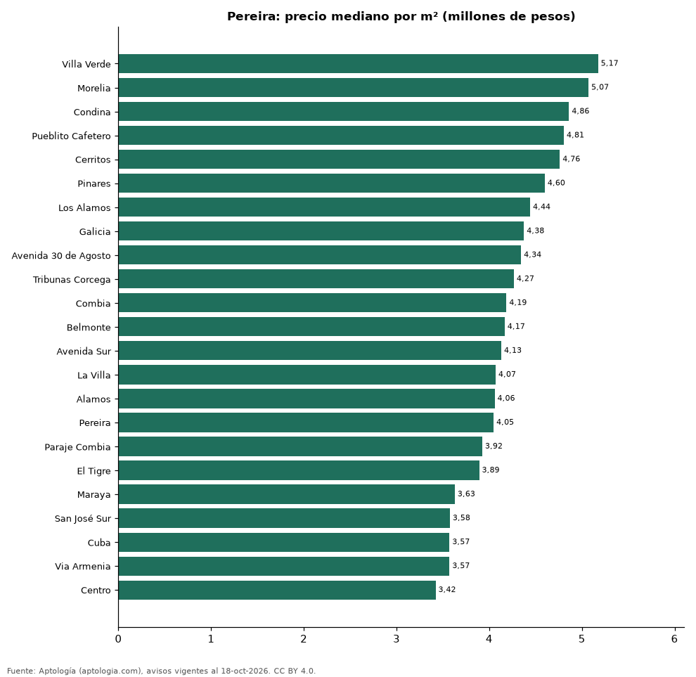

# Barrios más caros y más baratos de Pereira para comprar casa: ranking por m² (octubre 2026)

**En Pereira, el barrio con el m² más caro para comprar casa es Villa Verde (5,17 millones de pesos/m²) y el más barato Centro (3,42 millones de pesos/m²), 1,5 veces menos.** Comparamos 23 barrios con al menos 30 avisos con área.

*Resumen: analizamos 2.483 casas en venta con área declarada en 23 barrios de Pereira.*

**Actualizado:** 18 de octubre de 2026 (datos del 18 de octubre de 2026) · **Próxima actualización:** mensual.

## Resumen

| Indicador | Valor |
|---|---|
| Más caro por m² | Villa Verde: 5,17 millones de pesos |
| Más barato por m² | Centro: 3,42 millones de pesos |
| Diferencia | 1,5 veces |
| Barrios | 23 |

## Ranking de barrios por precio del m²

| Barrio | Por m² (mediana) | Precio (mediana) | Área mediana (m²) | Avisos con área |
|---|---|---|---|---|
| Villa Verde | 5,17 millones de pesos | 460 millones de pesos | 90 | 35 |
| Morelia | 5,07 millones de pesos | 1.575 millones de pesos | 340 | 58 |
| Condina | 4,86 millones de pesos | 1.400 millones de pesos | 284 | 117 |
| Pueblito Cafetero | 4,81 millones de pesos | 1.500 millones de pesos | 322 | 221 |
| Cerritos | 4,76 millones de pesos | 1.900 millones de pesos | 450 | 757 |
| Pinares | 4,60 millones de pesos | 1.200 millones de pesos | 250 | 172 |
| Los Alamos | 4,44 millones de pesos | 885 millones de pesos | 209 | 46 |
| Galicia | 4,38 millones de pesos | 480 millones de pesos | 112 | 175 |
| Avenida 30 de Agosto | 4,34 millones de pesos | 891 millones de pesos | 176 | 32 |
| Tribunas Corcega | 4,27 millones de pesos | 1.475 millones de pesos | 312 | 68 |
| Combia | 4,19 millones de pesos | 1.500 millones de pesos | 400 | 142 |
| Belmonte | 4,17 millones de pesos | 530 millones de pesos | 126 | 47 |
| Avenida Sur | 4,13 millones de pesos | 630 millones de pesos | 154 | 39 |
| La Villa | 4,07 millones de pesos | 460 millones de pesos | 125 | 44 |
| Alamos | 4,06 millones de pesos | 790 millones de pesos | 185 | 82 |
| Pereira | 4,05 millones de pesos | 1.100 millones de pesos | 240 | 43 |
| Paraje Combia | 3,92 millones de pesos | 1.395 millones de pesos | 346 | 30 |
| El Tigre | 3,89 millones de pesos | 1.700 millones de pesos | 488 | 52 |
| Maraya | 3,63 millones de pesos | 845 millones de pesos | 246 | 82 |
| San José Sur | 3,58 millones de pesos | 850 millones de pesos | 246 | 36 |
| Cuba | 3,57 millones de pesos | 350 millones de pesos | 104 | 51 |
| Via Armenia | 3,57 millones de pesos | 1.500 millones de pesos | 403 | 47 |
| Centro | 3,42 millones de pesos | 600 millones de pesos | 190 | 107 |

Medianas; solo barrios con 30 avisos o más con área declarada.

## Preguntas frecuentes

**¿Cuál es el barrio más caro de Pereira para comprar?**
Villa Verde, con 5,17 millones de pesos por m² en la mediana (octubre de 2026).

**¿Y el más barato?**
Centro, con 3,42 millones de pesos por m².

## Metodología

- **Fuente:** exportes nocturnos de la base de datos de Aptología (aptologia.com) del 18 de octubre de 2026: avisos vigentes de vivienda en portales inmobiliarios de 13 países, recogidos por Aptología y vistos en línea entre el 11 y el 18 de octubre de 2026. Corte: 18 de octubre de 2026.
- **Depuración:** se eliminan duplicados exactos (misma ciudad, zona, tipo, precio, moneda, área, habitaciones y baños) y los precios fuera del percentil 1–99 de cada país, operación, moneda y tipo; el precio por m² usa solo avisos con área declarada entre 12 y 2.000 m² y también se recorta al P1–P99.
- **Qué se mide:** precios pedidos (publicados), no precios de cierre. En arriendo, el canon mensual sin administración, gastos comunes ni condominio.
- **Muestra mínima:** cada cifra publicada se apoya en al menos 30 avisos; las celdas con menos se omiten.
- **Colombia:** Precios en pesos colombianos, sin conversión de moneda.
- **Limitaciones:** la cobertura depende de los portales que recorre Aptología en cada país y es mayor en las ciudades grandes y en los segmentos medio-alto y alto; el área es la que declara el aviso, sin verificar; los nombres de zona vienen de los portales.
- **Privacidad:** solo se publican agregados; no se publica ningún dato personal, enlace a avisos ni nombre de anunciante.
- **Datos abiertos:** [datos.csv](datos.csv), licencia CC BY 4.0.

## Cómo citar

Pinzón Pineda, D. M. (2026). *Barrios más caros y más baratos de Pereira para comprar casa: ranking por m² (octubre 2026)*. Aptología (aptologia.com). https://github.com/elbroker/aptologia-datos/tree/main/estudios/barrios-con-casas-mas-caras-y-baratas-pereira-venta-m2-2026. Datos: datos.csv, licencia CC BY 4.0.
