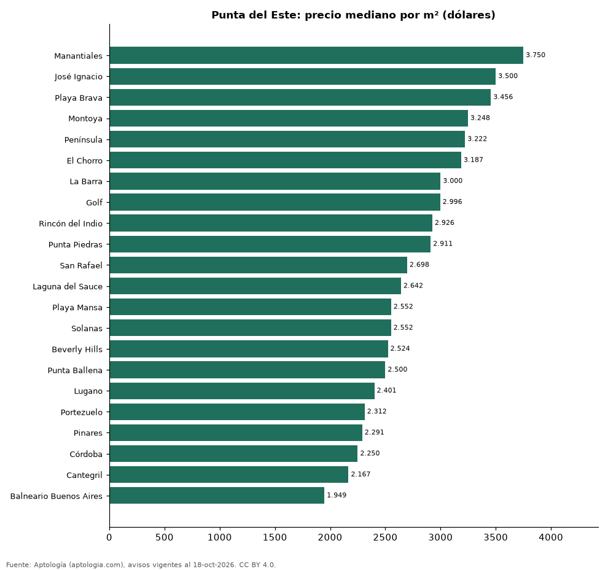

# Barrios más caros y más baratos de Punta del Este para comprar casa: ranking por m² (octubre 2026)

**En Punta del Este, el barrio con el m² más caro para comprar casa es Manantiales (USD 3.750/m²) y el más barato Balneario Buenos Aires (USD 1.949/m²), 1,9 veces menos.** Comparamos 22 barrios con al menos 30 avisos con área.

*Resumen: analizamos 3.928 casas en venta con área declarada en 22 barrios de Punta del Este.*

**Actualizado:** 18 de octubre de 2026 (datos del 18 de octubre de 2026) · **Próxima actualización:** mensual.

## Resumen

| Indicador | Valor |
|---|---|
| Más caro por m² | Manantiales: USD 3.750 |
| Más barato por m² | Balneario Buenos Aires: USD 1.949 |
| Diferencia | 1,9 veces |
| Barrios | 22 |

## Ranking de barrios por precio del m²

| Barrio | Por m² (mediana) | Precio (mediana) | Área mediana (m²) | Avisos con área |
|---|---|---|---|---|
| Manantiales | USD 3.750 | USD 1.050.000 | 300 | 233 |
| José Ignacio | USD 3.500 | USD 850.000 | 250 | 368 |
| Playa Brava | USD 3.456 | USD 1.125.000 | 380 | 44 |
| Montoya | USD 3.248 | USD 850.000 | 250 | 257 |
| Península | USD 3.222 | USD 1.160.000 | 360 | 76 |
| El Chorro | USD 3.187 | USD 840.000 | 223 | 46 |
| La Barra | USD 3.000 | USD 690.000 | 232 | 544 |
| Golf | USD 2.996 | USD 1.650.000 | 557 | 125 |
| Rincón del Indio | USD 2.926 | USD 850.000 | 320 | 103 |
| Punta Piedras | USD 2.911 | USD 890.000 | 327 | 63 |
| San Rafael | USD 2.698 | USD 800.000 | 328 | 136 |
| Laguna del Sauce | USD 2.642 | USD 590.000 | 250 | 33 |
| Playa Mansa | USD 2.552 | USD 850.000 | 366 | 495 |
| Solanas | USD 2.552 | USD 530.000 | 212 | 118 |
| Beverly Hills | USD 2.524 | USD 1.250.000 | 446 | 33 |
| Punta Ballena | USD 2.500 | USD 454.500 | 200 | 430 |
| Lugano | USD 2.401 | USD 870.000 | 360 | 108 |
| Portezuelo | USD 2.312 | USD 395.000 | 200 | 63 |
| Pinares | USD 2.291 | USD 395.000 | 200 | 328 |
| Córdoba | USD 2.250 | USD 479.000 | 250 | 57 |
| Cantegril | USD 2.167 | USD 700.000 | 330 | 121 |
| Balneario Buenos Aires | USD 1.949 | USD 240.000 | 128 | 147 |

Medianas; solo barrios con 30 avisos o más con área declarada.

## Preguntas frecuentes

**¿Cuál es el barrio más caro de Punta del Este para comprar?**
Manantiales, con USD 3.750 por m² en la mediana (octubre de 2026).

**¿Y el más barato?**
Balneario Buenos Aires, con USD 1.949 por m².

## Metodología

- **Fuente:** exportes nocturnos de la base de datos de Aptología (aptologia.com) del 18 de octubre de 2026: avisos vigentes de vivienda en portales inmobiliarios de 13 países, recogidos por Aptología y vistos en línea entre el 11 y el 18 de octubre de 2026. Corte: 18 de octubre de 2026.
- **Depuración:** se eliminan duplicados exactos (misma ciudad, zona, tipo, precio, moneda, área, habitaciones y baños) y los precios fuera del percentil 1–99 de cada país, operación, moneda y tipo; el precio por m² usa solo avisos con área declarada entre 12 y 2.000 m² y también se recorta al P1–P99.
- **Qué se mide:** precios pedidos (publicados), no precios de cierre. En arriendo, el canon mensual sin administración, gastos comunes ni condominio.
- **Muestra mínima:** cada cifra publicada se apoya en al menos 30 avisos; las celdas con menos se omiten.
- **Monedas:** nunca se mezclan avisos de monedas distintas sin convertirlos. Conversión a dólares con la tasa de mercado de ExchangeRate-API (open.er-api.com, actualización del 18 Oct 2026): 1 USD = 3.182,80 COP, 1 USD = 18,47 M.N, 1 USD = 5,09 BRL, 1 USD = 3,44 PEN, 1 USD = 982,44 CLP, 1 USD = 1.514,57 ARS, 1 USD = 40,20 UYU, 1 USD = 5.705,37 PYG, 1 USD = 61,27 DOP, 1 USD = 0,89 EUR, 1 USD = 11,72 BOB; la UF chilena a 41.178,64 CLP (mindicador,cl. 18-oct-2026). Los avisos publicados en dólares se usan tal cual.
- **Monedas:** en cada ciudad y operación se usa solo la moneda mayoritaria de los avisos (los avisos en otra moneda se excluyen) y la mediana se convierte a dólares con la tasa citada; nunca se promedian avisos de monedas distintas.
- **Limitaciones:** la cobertura depende de los portales que recorre Aptología en cada país y es mayor en las ciudades grandes y en los segmentos medio-alto y alto; el área es la que declara el aviso, sin verificar; los nombres de zona vienen de los portales.
- **Privacidad:** solo se publican agregados; no se publica ningún dato personal, enlace a avisos ni nombre de anunciante.
- **Datos abiertos:** [datos.csv](datos.csv), licencia CC BY 4.0.

## Cómo citar

Pinzón Pineda, D. M. (2026). *Barrios más caros y más baratos de Punta del Este para comprar casa: ranking por m² (octubre 2026)*. Aptología (aptologia.com). https://github.com/elbroker/aptologia-datos/tree/main/estudios/barrios-con-casas-mas-caras-y-baratas-punta-del-este-venta-m2-2026. Datos: datos.csv, licencia CC BY 4.0.
