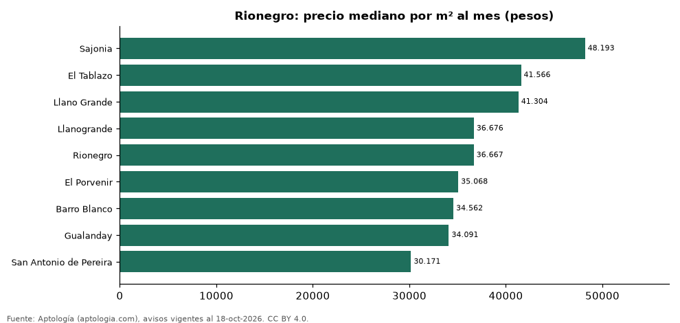

# Barrios más caros y más baratos de Rionegro para arrendar casa: ranking por m² (octubre 2026)

**En Rionegro, el barrio con el m² más caro para arrendar casa es Sajonia (48.193 pesos/m² al mes) y el más barato San Antonio de Pereira (30.171 pesos/m² al mes), 1,6 veces menos.** Comparamos 9 barrios con al menos 30 avisos con área.

*Resumen: analizamos 869 casas en arriendo con área declarada en 9 barrios de Rionegro.*

**Actualizado:** 18 de octubre de 2026 (datos del 18 de octubre de 2026) · **Próxima actualización:** mensual.

## Resumen

| Indicador | Valor |
|---|---|
| Más caro por m² | Sajonia: 48.193 pesos |
| Más barato por m² | San Antonio de Pereira: 30.171 pesos |
| Diferencia | 1,6 veces |
| Barrios | 9 |

## Ranking de barrios por precio del m²

| Barrio | Por m² (mediana) | Canon (mediana) | Área mediana (m²) | Avisos con área |
|---|---|---|---|---|
| Sajonia | 48.193 pesos | 14.500.000 pesos | 328 | 45 |
| El Tablazo | 41.566 pesos | 13.500.000 pesos | 340 | 44 |
| Llano Grande | 41.304 pesos | 15.000.000 pesos | 350 | 275 |
| Llanogrande | 36.676 pesos | 14.550.000 pesos | 450 | 120 |
| Rionegro | 36.667 pesos | 9.000.000 pesos | 300 | 167 |
| El Porvenir | 35.068 pesos | 7.500.000 pesos | 250 | 102 |
| Barro Blanco | 34.562 pesos | 7.000.000 pesos | 200 | 31 |
| Gualanday | 34.091 pesos | 6.800.000 pesos | 180 | 53 |
| San Antonio de Pereira | 30.171 pesos | 7.750.000 pesos | 215 | 32 |

Medianas; solo barrios con 30 avisos o más con área declarada.

## Preguntas frecuentes

**¿Cuál es el barrio más caro de Rionegro para arrendar?**
Sajonia, con 48.193 pesos por m² al mes en la mediana (octubre de 2026).

**¿Y el más barato?**
San Antonio de Pereira, con 30.171 pesos por m² al mes.

## Metodología

- **Fuente:** exportes nocturnos de la base de datos de Aptología (aptologia.com) del 18 de octubre de 2026: avisos vigentes de vivienda en portales inmobiliarios de 13 países, recogidos por Aptología y vistos en línea entre el 11 y el 18 de octubre de 2026. Corte: 18 de octubre de 2026.
- **Depuración:** se eliminan duplicados exactos (misma ciudad, zona, tipo, precio, moneda, área, habitaciones y baños) y los precios fuera del percentil 1–99 de cada país, operación, moneda y tipo; el precio por m² usa solo avisos con área declarada entre 12 y 2.000 m² y también se recorta al P1–P99.
- **Qué se mide:** precios pedidos (publicados), no precios de cierre. En arriendo, el canon mensual sin administración, gastos comunes ni condominio.
- **Muestra mínima:** cada cifra publicada se apoya en al menos 30 avisos; las celdas con menos se omiten.
- **Colombia:** Precios en pesos colombianos, sin conversión de moneda.
- **Limitaciones:** la cobertura depende de los portales que recorre Aptología en cada país y es mayor en las ciudades grandes y en los segmentos medio-alto y alto; el área es la que declara el aviso, sin verificar; los nombres de zona vienen de los portales.
- **Privacidad:** solo se publican agregados; no se publica ningún dato personal, enlace a avisos ni nombre de anunciante.
- **Datos abiertos:** [datos.csv](datos.csv), licencia CC BY 4.0.

## Cómo citar

Pinzón Pineda, D. M. (2026). *Barrios más caros y más baratos de Rionegro para arrendar casa: ranking por m² (octubre 2026)*. Aptología (aptologia.com). https://github.com/elbroker/aptologia-datos/tree/main/estudios/barrios-con-casas-mas-caras-y-baratas-rionegro-arriendo-m2-2026. Datos: datos.csv, licencia CC BY 4.0.
