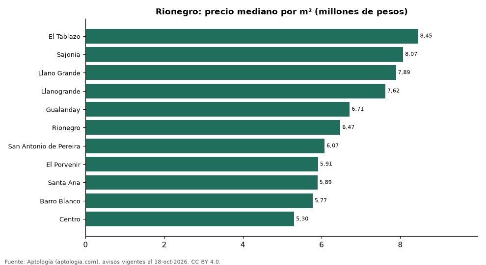

# Barrios más caros y más baratos de Rionegro para comprar casa: ranking por m² (octubre 2026)

**En Rionegro, el barrio con el m² más caro para comprar casa es El Tablazo (8,45 millones de pesos/m²) y el más barato Centro (5,30 millones de pesos/m²), 1,6 veces menos.** Comparamos 11 barrios con al menos 30 avisos con área.

*Resumen: analizamos 1.592 casas en venta con área declarada en 11 barrios de Rionegro.*

**Actualizado:** 18 de octubre de 2026 (datos del 18 de octubre de 2026) · **Próxima actualización:** mensual.

## Resumen

| Indicador | Valor |
|---|---|
| Más caro por m² | El Tablazo: 8,45 millones de pesos |
| Más barato por m² | Centro: 5,30 millones de pesos |
| Diferencia | 1,6 veces |
| Barrios | 11 |

## Ranking de barrios por precio del m²

| Barrio | Por m² (mediana) | Precio (mediana) | Área mediana (m²) | Avisos con área |
|---|---|---|---|---|
| El Tablazo | 8,45 millones de pesos | 3.600 millones de pesos | 450 | 45 |
| Sajonia | 8,07 millones de pesos | 2.650 millones de pesos | 328 | 37 |
| Llano Grande | 7,89 millones de pesos | 3.250 millones de pesos | 400 | 432 |
| Llanogrande | 7,62 millones de pesos | 3.500 millones de pesos | 426 | 196 |
| Gualanday | 6,71 millones de pesos | 1.280 millones de pesos | 175 | 101 |
| Rionegro | 6,47 millones de pesos | 1.690 millones de pesos | 300 | 254 |
| San Antonio de Pereira | 6,07 millones de pesos | 1.150 millones de pesos | 174 | 106 |
| El Porvenir | 5,91 millones de pesos | 1.290 millones de pesos | 230 | 248 |
| Santa Ana | 5,89 millones de pesos | 1.175 millones de pesos | 222 | 30 |
| Barro Blanco | 5,77 millones de pesos | 1.300 millones de pesos | 230 | 83 |
| Centro | 5,30 millones de pesos | 1.270 millones de pesos | 228 | 60 |

Medianas; solo barrios con 30 avisos o más con área declarada.

## Preguntas frecuentes

**¿Cuál es el barrio más caro de Rionegro para comprar?**
El Tablazo, con 8,45 millones de pesos por m² en la mediana (octubre de 2026).

**¿Y el más barato?**
Centro, con 5,30 millones de pesos por m².

## Metodología

- **Fuente:** exportes nocturnos de la base de datos de Aptología (aptologia.com) del 18 de octubre de 2026: avisos vigentes de vivienda en portales inmobiliarios de 13 países, recogidos por Aptología y vistos en línea entre el 11 y el 18 de octubre de 2026. Corte: 18 de octubre de 2026.
- **Depuración:** se eliminan duplicados exactos (misma ciudad, zona, tipo, precio, moneda, área, habitaciones y baños) y los precios fuera del percentil 1–99 de cada país, operación, moneda y tipo; el precio por m² usa solo avisos con área declarada entre 12 y 2.000 m² y también se recorta al P1–P99.
- **Qué se mide:** precios pedidos (publicados), no precios de cierre. En arriendo, el canon mensual sin administración, gastos comunes ni condominio.
- **Muestra mínima:** cada cifra publicada se apoya en al menos 30 avisos; las celdas con menos se omiten.
- **Colombia:** Precios en pesos colombianos, sin conversión de moneda.
- **Limitaciones:** la cobertura depende de los portales que recorre Aptología en cada país y es mayor en las ciudades grandes y en los segmentos medio-alto y alto; el área es la que declara el aviso, sin verificar; los nombres de zona vienen de los portales.
- **Privacidad:** solo se publican agregados; no se publica ningún dato personal, enlace a avisos ni nombre de anunciante.
- **Datos abiertos:** [datos.csv](datos.csv), licencia CC BY 4.0.

## Cómo citar

Pinzón Pineda, D. M. (2026). *Barrios más caros y más baratos de Rionegro para comprar casa: ranking por m² (octubre 2026)*. Aptología (aptologia.com). https://github.com/elbroker/aptologia-datos/tree/main/estudios/barrios-con-casas-mas-caras-y-baratas-rionegro-venta-m2-2026. Datos: datos.csv, licencia CC BY 4.0.
