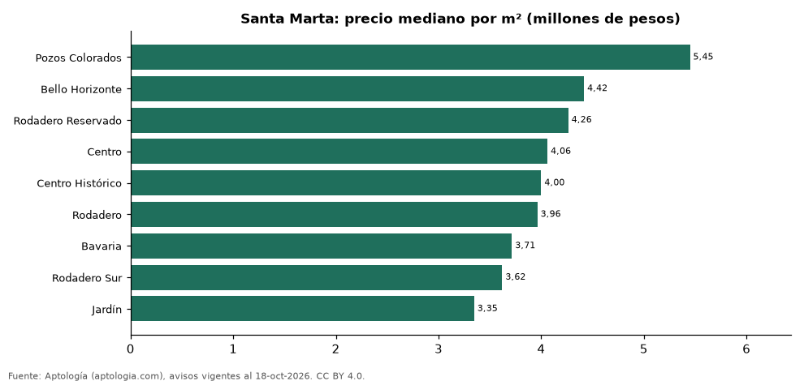

# Barrios más caros y más baratos de Santa Marta para comprar casa: ranking por m² (octubre 2026)

**En Santa Marta, el barrio con el m² más caro para comprar casa es Pozos Colorados (5,45 millones de pesos/m²) y el más barato Jardín (3,35 millones de pesos/m²), 1,6 veces menos.** Comparamos 9 barrios con al menos 30 avisos con área.

*Resumen: analizamos 437 casas en venta con área declarada en 9 barrios de Santa Marta.*

**Actualizado:** 18 de octubre de 2026 (datos del 18 de octubre de 2026) · **Próxima actualización:** mensual.

## Resumen

| Indicador | Valor |
|---|---|
| Más caro por m² | Pozos Colorados: 5,45 millones de pesos |
| Más barato por m² | Jardín: 3,35 millones de pesos |
| Diferencia | 1,6 veces |
| Barrios | 9 |

## Ranking de barrios por precio del m²

| Barrio | Por m² (mediana) | Precio (mediana) | Área mediana (m²) | Avisos con área |
|---|---|---|---|---|
| Pozos Colorados | 5,45 millones de pesos | 1.275 millones de pesos | 234 | 34 |
| Bello Horizonte | 4,42 millones de pesos | 850 millones de pesos | 200 | 49 |
| Rodadero Reservado | 4,26 millones de pesos | 650 millones de pesos | 141 | 30 |
| Centro | 4,06 millones de pesos | 1.000 millones de pesos | 250 | 73 |
| Centro Histórico | 4,00 millones de pesos | 1.100 millones de pesos | 312 | 59 |
| Rodadero | 3,96 millones de pesos | 632 millones de pesos | 157 | 64 |
| Bavaria | 3,71 millones de pesos | 650 millones de pesos | 166 | 43 |
| Rodadero Sur | 3,62 millones de pesos | 585 millones de pesos | 138 | 40 |
| Jardín | 3,35 millones de pesos | 650 millones de pesos | 254 | 45 |

Medianas; solo barrios con 30 avisos o más con área declarada.

## Preguntas frecuentes

**¿Cuál es el barrio más caro de Santa Marta para comprar?**
Pozos Colorados, con 5,45 millones de pesos por m² en la mediana (octubre de 2026).

**¿Y el más barato?**
Jardín, con 3,35 millones de pesos por m².

## Metodología

- **Fuente:** exportes nocturnos de la base de datos de Aptología (aptologia.com) del 18 de octubre de 2026: avisos vigentes de vivienda en portales inmobiliarios de 13 países, recogidos por Aptología y vistos en línea entre el 11 y el 18 de octubre de 2026. Corte: 18 de octubre de 2026.
- **Depuración:** se eliminan duplicados exactos (misma ciudad, zona, tipo, precio, moneda, área, habitaciones y baños) y los precios fuera del percentil 1–99 de cada país, operación, moneda y tipo; el precio por m² usa solo avisos con área declarada entre 12 y 2.000 m² y también se recorta al P1–P99.
- **Qué se mide:** precios pedidos (publicados), no precios de cierre. En arriendo, el canon mensual sin administración, gastos comunes ni condominio.
- **Muestra mínima:** cada cifra publicada se apoya en al menos 30 avisos; las celdas con menos se omiten.
- **Colombia:** Precios en pesos colombianos, sin conversión de moneda.
- **Limitaciones:** la cobertura depende de los portales que recorre Aptología en cada país y es mayor en las ciudades grandes y en los segmentos medio-alto y alto; el área es la que declara el aviso, sin verificar; los nombres de zona vienen de los portales.
- **Privacidad:** solo se publican agregados; no se publica ningún dato personal, enlace a avisos ni nombre de anunciante.
- **Datos abiertos:** [datos.csv](datos.csv), licencia CC BY 4.0.

## Cómo citar

Pinzón Pineda, D. M. (2026). *Barrios más caros y más baratos de Santa Marta para comprar casa: ranking por m² (octubre 2026)*. Aptología (aptologia.com). https://github.com/elbroker/aptologia-datos/tree/main/estudios/barrios-con-casas-mas-caras-y-baratas-santa-marta-venta-m2-2026. Datos: datos.csv, licencia CC BY 4.0.
