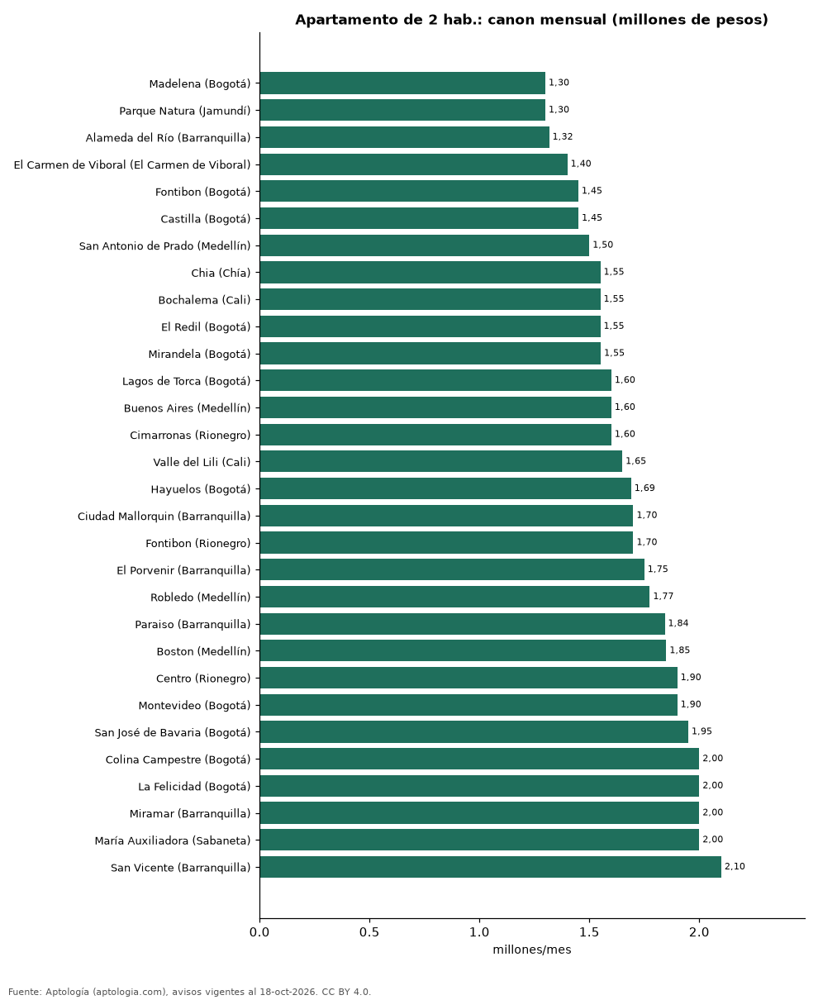

# Los barrios más baratos para arrendar un apartamento de 2 habitaciones en Colombia (octubre 2026)

**El barrio más barato de Colombia para arrendar un apartamento de 2 habitaciones, entre los que tienen 30 avisos o más, es Madelena (Bogotá), con un canon mediano de 1.300.000 pesos al mes.** En Bogotá, el más barato es Madelena (1.300.000 pesos). En Medellín, el más barato es San Antonio de Prado (1.500.000 pesos). En Cali, el más barato es Bochalema (1.550.000 pesos). En Barranquilla, el más barato es Alameda del Río (1.317.000 pesos). En Cartagena, el más barato es Manzanillo (2.540.000 pesos).

*Resumen: comparamos 23.618 apartamentos de 2 habitaciones en arriendo en 145 barrios con 30 avisos o más.*

**Actualizado:** 18 de octubre de 2026 (datos del 18 de octubre de 2026) · **Próxima actualización:** mensual.

## Resumen

| Indicador | Valor |
|---|---|
| Más barato de Colombia | Madelena (Bogotá): 1.300.000 pesos |
| Más barato en Bogotá | Madelena: 1.300.000 pesos |
| Más barato en Medellín | San Antonio de Prado: 1.500.000 pesos |
| Más barato en Cali | Bochalema: 1.550.000 pesos |
| Barrios comparados | 145 |

## Los 40 barrios más baratos (2 habitaciones)

| Barrio | Ciudad | Canon mensual (mediana) | Avisos |
|---|---|---|---|
| Madelena | Bogotá | 1.300.000 pesos | 30 |
| Parque Natura | Jamundí | 1.300.000 pesos | 33 |
| Alameda del Río | Barranquilla | 1.317.000 pesos | 156 |
| El Carmen de Viboral | El Carmen de Viboral | 1.400.000 pesos | 39 |
| Fontibon | Bogotá | 1.450.000 pesos | 81 |
| Castilla | Bogotá | 1.450.600 pesos | 35 |
| San Antonio de Prado | Medellín | 1.500.000 pesos | 53 |
| Chia | Chía | 1.550.000 pesos | 31 |
| Bochalema | Cali | 1.550.000 pesos | 51 |
| El Redil | Bogotá | 1.550.000 pesos | 30 |
| Mirandela | Bogotá | 1.552.000 pesos | 33 |
| Lagos de Torca | Bogotá | 1.600.000 pesos | 87 |
| Buenos Aires | Medellín | 1.600.000 pesos | 38 |
| Cimarronas | Rionegro | 1.600.000 pesos | 43 |
| Valle del Lili | Cali | 1.650.000 pesos | 59 |
| Hayuelos | Bogotá | 1.690.000 pesos | 30 |
| Ciudad Mallorquin | Barranquilla | 1.700.000 pesos | 112 |
| Fontibon | Rionegro | 1.700.000 pesos | 89 |
| El Porvenir | Barranquilla | 1.750.000 pesos | 36 |
| Robledo | Medellín | 1.775.000 pesos | 94 |
| Paraiso | Barranquilla | 1.842.900 pesos | 39 |
| Boston | Medellín | 1.850.000 pesos | 52 |
| Centro | Rionegro | 1.900.000 pesos | 77 |
| Montevideo | Bogotá | 1.900.000 pesos | 37 |
| San José de Bavaria | Bogotá | 1.950.000 pesos | 41 |
| Colina Campestre | Bogotá | 2.000.000 pesos | 44 |
| La Felicidad | Bogotá | 2.000.000 pesos | 37 |
| Miramar | Barranquilla | 2.000.000 pesos | 65 |
| María Auxiliadora | Sabaneta | 2.000.000 pesos | 31 |
| San Vicente | Barranquilla | 2.100.000 pesos | 35 |
| Santa Monica | Medellín | 2.200.000 pesos | 31 |
| Los Colegios | Rionegro | 2.400.000 pesos | 96 |
| La America | Medellín | 2.400.000 pesos | 52 |
| Calasanz | Medellín | 2.425.000 pesos | 126 |
| El Porvenir | Rionegro | 2.450.000 pesos | 249 |
| La Aldea | La Estrella | 2.500.000 pesos | 74 |
| Altos de Riomar | Barranquilla | 2.500.000 pesos | 47 |
| Santa Ana | Rionegro | 2.500.000 pesos | 75 |
| San Antonio | Rionegro | 2.500.000 pesos | 70 |
| Alamos | Pereira | 2.500.000 pesos | 56 |

Canon mensual pedido, sin administración. Solo entran barrios con 30 avisos o más de 2 habitaciones, por lo que las ciudades pequeñas casi no aparecen.

## El barrio más barato de cada gran ciudad

| Ciudad | Barrio más barato | Canon 2 hab. (mediana) |
|---|---|---|
| Bogotá | Madelena | 1.300.000 pesos |
| Medellín | San Antonio de Prado | 1.500.000 pesos |
| Cali | Bochalema | 1.550.000 pesos |
| Barranquilla | Alameda del Río | 1.317.000 pesos |
| Cartagena | Manzanillo | 2.540.000 pesos |

## Preguntas frecuentes

**¿Cuál es el barrio más barato para arrendar en Colombia?**
Madelena (Bogotá), con 1.300.000 pesos al mes por un apartamento de 2 habitaciones.

**¿Cuál es el barrio más barato para arrendar en Bogotá?**
Madelena, con 1.300.000 pesos al mes.

## Metodología

- **Fuente:** exportes nocturnos de la base de datos de Aptología (aptologia.com) del 18 de octubre de 2026: avisos vigentes de vivienda en portales inmobiliarios de 13 países, recogidos por Aptología y vistos en línea entre el 11 y el 18 de octubre de 2026. Corte: 18 de octubre de 2026.
- **Depuración:** se eliminan duplicados exactos (misma ciudad, zona, tipo, precio, moneda, área, habitaciones y baños) y los precios fuera del percentil 1–99 de cada país, operación, moneda y tipo; el precio por m² usa solo avisos con área declarada entre 12 y 2.000 m² y también se recorta al P1–P99.
- **Qué se mide:** precios pedidos (publicados), no precios de cierre. En arriendo, el canon mensual sin administración, gastos comunes ni condominio.
- **Muestra mínima:** cada cifra publicada se apoya en al menos 30 avisos; las celdas con menos se omiten.
- **Colombia:** Precios en pesos colombianos, sin conversión de moneda.
- **Limitaciones:** la cobertura depende de los portales que recorre Aptología en cada país y es mayor en las ciudades grandes y en los segmentos medio-alto y alto; el área es la que declara el aviso, sin verificar; los nombres de zona vienen de los portales.
- **Privacidad:** solo se publican agregados; no se publica ningún dato personal, enlace a avisos ni nombre de anunciante.
- **Datos abiertos:** [datos.csv](datos.csv), licencia CC BY 4.0.

## Cómo citar

Pinzón Pineda, D. M. (2026). *Los barrios más baratos para arrendar un apartamento de 2 habitaciones en Colombia (octubre 2026)*. Aptología (aptologia.com). https://github.com/elbroker/aptologia-datos/tree/main/estudios/barrios-mas-baratos-para-arrendar-colombia-2026. Datos: datos.csv, licencia CC BY 4.0.
