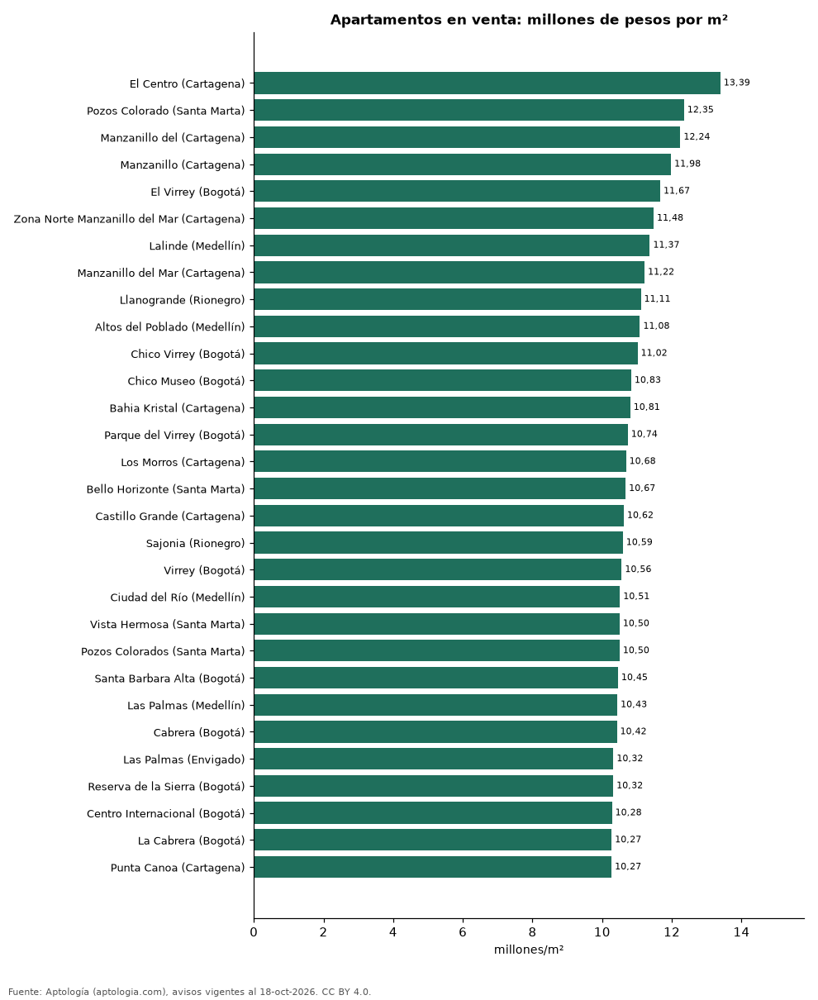

# Los barrios más caros de Colombia: ranking del metro cuadrado de apartamentos en venta (octubre 2026)

**El barrio con el metro cuadrado de apartamento más caro de Colombia es El Centro (Cartagena), con 13,39 millones de pesos en la mediana.** De los 40 barrios más caros, 13 están en Bogotá y 11 en Medellín y su área (Envigado, Sabaneta, Rionegro, El Retiro).

*Resumen: comparamos 120.352 apartamentos en venta con área declarada en 689 barrios con 30 avisos o más.*

**Actualizado:** 18 de octubre de 2026 (datos del 18 de octubre de 2026) · **Próxima actualización:** mensual.

## Resumen

| Indicador | Valor |
|---|---|
| Barrio más caro | El Centro (Cartagena): 13,39 millones de pesos/m² |
| Del top 40 en Bogotá | 13 |
| Del top 40 en el área de Medellín | 11 |
| Barrios comparados | 689 |

## Los 40 barrios más caros por m²

| Barrio | Ciudad | Millones de pesos por m² | Avisos |
|---|---|---|---|
| El Centro | Cartagena | 13,39 | 33 |
| Pozos Colorado | Santa Marta | 12,35 | 39 |
| Manzanillo del | Cartagena | 12,24 | 31 |
| Manzanillo | Cartagena | 11,98 | 124 |
| El Virrey | Bogotá | 11,67 | 91 |
| Zona Norte Manzanillo del Mar | Cartagena | 11,48 | 32 |
| Lalinde | Medellín | 11,37 | 80 |
| Manzanillo del Mar | Cartagena | 11,22 | 69 |
| Llanogrande | Rionegro | 11,11 | 58 |
| Altos del Poblado | Medellín | 11,08 | 191 |
| Chico Virrey | Bogotá | 11,02 | 36 |
| Chico Museo | Bogotá | 10,83 | 63 |
| Bahia Kristal | Cartagena | 10,81 | 34 |
| Parque del Virrey | Bogotá | 10,74 | 38 |
| Los Morros | Cartagena | 10,68 | 31 |
| Bello Horizonte | Santa Marta | 10,67 | 439 |
| Castillo Grande | Cartagena | 10,62 | 44 |
| Sajonia | Rionegro | 10,59 | 63 |
| Virrey | Bogotá | 10,56 | 66 |
| Ciudad del Río | Medellín | 10,51 | 259 |
| Vista Hermosa | Santa Marta | 10,50 | 36 |
| Pozos Colorados | Santa Marta | 10,50 | 498 |
| Santa Barbara Alta | Bogotá | 10,45 | 143 |
| Las Palmas | Medellín | 10,43 | 355 |
| Cabrera | Bogotá | 10,42 | 170 |
| Las Palmas | Envigado | 10,32 | 47 |
| Reserva de la Sierra | Bogotá | 10,32 | 36 |
| Centro Internacional | Bogotá | 10,28 | 93 |
| La Cabrera | Bogotá | 10,27 | 281 |
| Punta Canoa | Cartagena | 10,27 | 30 |
| Las Vegas | Envigado | 10,22 | 126 |
| Zona Norte la Boquilla | Cartagena | 10,22 | 32 |
| Gran America | Bogotá | 10,18 | 33 |
| Loma de los Mesa | Envigado | 10,17 | 65 |
| Santa Ana Oriental | Bogotá | 10,09 | 82 |
| Los Salados | El Retiro | 10,08 | 109 |
| Santa Marta | Santa Marta | 10,06 | 30 |
| Provenza | Medellín | 10,01 | 116 |
| La Boquilla | Cartagena | 10,00 | 384 |
| Salitre | Bogotá | 10,00 | 40 |

Precio pedido mediano por m² de apartamentos en venta.

## Preguntas frecuentes

**¿Cuál es el barrio más caro de Colombia?**
El Centro (Cartagena), con 13,39 millones de pesos por m² en la mediana de apartamentos en venta (octubre de 2026).

## Metodología

- **Fuente:** exportes nocturnos de la base de datos de Aptología (aptologia.com) del 18 de octubre de 2026: avisos vigentes de vivienda en portales inmobiliarios de 13 países, recogidos por Aptología y vistos en línea entre el 11 y el 18 de octubre de 2026. Corte: 18 de octubre de 2026.
- **Depuración:** se eliminan duplicados exactos (misma ciudad, zona, tipo, precio, moneda, área, habitaciones y baños) y los precios fuera del percentil 1–99 de cada país, operación, moneda y tipo; el precio por m² usa solo avisos con área declarada entre 12 y 2.000 m² y también se recorta al P1–P99.
- **Qué se mide:** precios pedidos (publicados), no precios de cierre. En arriendo, el canon mensual sin administración, gastos comunes ni condominio.
- **Muestra mínima:** cada cifra publicada se apoya en al menos 30 avisos; las celdas con menos se omiten.
- **Colombia:** Precios en pesos colombianos, sin conversión de moneda.
- **Limitaciones:** la cobertura depende de los portales que recorre Aptología en cada país y es mayor en las ciudades grandes y en los segmentos medio-alto y alto; el área es la que declara el aviso, sin verificar; los nombres de zona vienen de los portales.
- **Privacidad:** solo se publican agregados; no se publica ningún dato personal, enlace a avisos ni nombre de anunciante.
- **Datos abiertos:** [datos.csv](datos.csv), licencia CC BY 4.0.

## Cómo citar

Pinzón Pineda, D. M. (2026). *Los barrios más caros de Colombia: ranking del metro cuadrado de apartamentos en venta (octubre 2026)*. Aptología (aptologia.com). https://github.com/elbroker/aptologia-datos/tree/main/estudios/barrios-mas-caros-de-colombia-precio-m2-2026. Datos: datos.csv, licencia CC BY 4.0.
