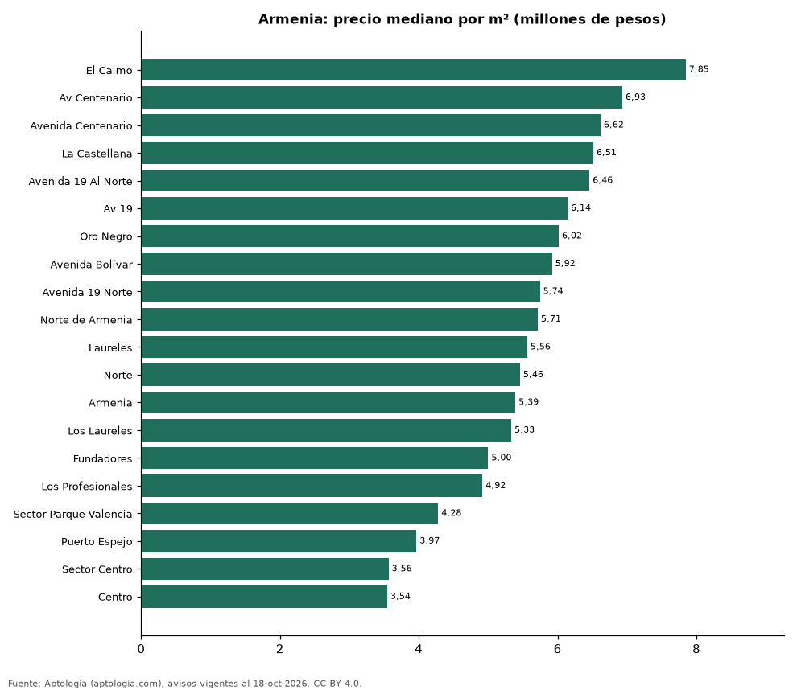

# Barrios más caros y más baratos de Armenia para comprar apartamento: ranking por m² (octubre 2026)

**En Armenia, el barrio con el m² más caro para comprar apartamento es El Caimo (7,85 millones de pesos/m²) y el más barato Centro (3,54 millones de pesos/m²), 2,2 veces menos.** Comparamos 20 barrios con al menos 30 avisos con área.

*Resumen: analizamos 1.308 apartamentos en venta con área declarada en 20 barrios de Armenia.*

**Actualizado:** 18 de octubre de 2026 (datos del 18 de octubre de 2026) · **Próxima actualización:** mensual.

## Resumen

| Indicador | Valor |
|---|---|
| Más caro por m² | El Caimo: 7,85 millones de pesos |
| Más barato por m² | Centro: 3,54 millones de pesos |
| Diferencia | 2,2 veces |
| Barrios | 20 |

## Ranking de barrios por precio del m²

| Barrio | Por m² (mediana) | Precio (mediana) | Área mediana (m²) | Avisos con área |
|---|---|---|---|---|
| El Caimo | 7,85 millones de pesos | 820 millones de pesos | 106 | 34 |
| Av Centenario | 6,93 millones de pesos | 502 millones de pesos | 74 | 48 |
| Avenida Centenario | 6,62 millones de pesos | 548 millones de pesos | 81 | 213 |
| La Castellana | 6,51 millones de pesos | 680 millones de pesos | 111 | 128 |
| Avenida 19 Al Norte | 6,46 millones de pesos | 385 millones de pesos | 69 | 30 |
| Av 19 | 6,14 millones de pesos | 340 millones de pesos | 62 | 30 |
| Oro Negro | 6,02 millones de pesos | 384 millones de pesos | 65 | 87 |
| Avenida Bolívar | 5,92 millones de pesos | 395 millones de pesos | 67 | 42 |
| Avenida 19 Norte | 5,74 millones de pesos | 395 millones de pesos | 67 | 73 |
| Norte de Armenia | 5,71 millones de pesos | 400 millones de pesos | 72 | 73 |
| Laureles | 5,56 millones de pesos | 420 millones de pesos | 88 | 52 |
| Norte | 5,46 millones de pesos | 422 millones de pesos | 72 | 64 |
| Armenia | 5,39 millones de pesos | 400 millones de pesos | 65 | 71 |
| Los Laureles | 5,33 millones de pesos | 470 millones de pesos | 87 | 35 |
| Fundadores | 5,00 millones de pesos | 465 millones de pesos | 92 | 50 |
| Los Profesionales | 4,92 millones de pesos | 400 millones de pesos | 95 | 39 |
| Sector Parque Valencia | 4,28 millones de pesos | 290 millones de pesos | 66 | 36 |
| Puerto Espejo | 3,97 millones de pesos | 236 millones de pesos | 60 | 130 |
| Sector Centro | 3,56 millones de pesos | 360 millones de pesos | 89 | 31 |
| Centro | 3,54 millones de pesos | 312 millones de pesos | 76 | 42 |

Medianas; solo barrios con 30 avisos o más con área declarada.

## Preguntas frecuentes

**¿Cuál es el barrio más caro de Armenia para comprar?**
El Caimo, con 7,85 millones de pesos por m² en la mediana (octubre de 2026).

**¿Y el más barato?**
Centro, con 3,54 millones de pesos por m².

## Metodología

- **Fuente:** exportes nocturnos de la base de datos de Aptología (aptologia.com) del 18 de octubre de 2026: avisos vigentes de vivienda en portales inmobiliarios de 13 países, recogidos por Aptología y vistos en línea entre el 11 y el 18 de octubre de 2026. Corte: 18 de octubre de 2026.
- **Depuración:** se eliminan duplicados exactos (misma ciudad, zona, tipo, precio, moneda, área, habitaciones y baños) y los precios fuera del percentil 1–99 de cada país, operación, moneda y tipo; el precio por m² usa solo avisos con área declarada entre 12 y 2.000 m² y también se recorta al P1–P99.
- **Qué se mide:** precios pedidos (publicados), no precios de cierre. En arriendo, el canon mensual sin administración, gastos comunes ni condominio.
- **Muestra mínima:** cada cifra publicada se apoya en al menos 30 avisos; las celdas con menos se omiten.
- **Colombia:** Precios en pesos colombianos, sin conversión de moneda.
- **Limitaciones:** la cobertura depende de los portales que recorre Aptología en cada país y es mayor en las ciudades grandes y en los segmentos medio-alto y alto; el área es la que declara el aviso, sin verificar; los nombres de zona vienen de los portales.
- **Privacidad:** solo se publican agregados; no se publica ningún dato personal, enlace a avisos ni nombre de anunciante.
- **Datos abiertos:** [datos.csv](datos.csv), licencia CC BY 4.0.

## Cómo citar

Pinzón Pineda, D. M. (2026). *Barrios más caros y más baratos de Armenia para comprar apartamento: ranking por m² (octubre 2026)*. Aptología (aptologia.com). https://github.com/elbroker/aptologia-datos/tree/main/estudios/barrios-mas-caros-y-baratos-armenia-venta-m2-2026. Datos: datos.csv, licencia CC BY 4.0.
