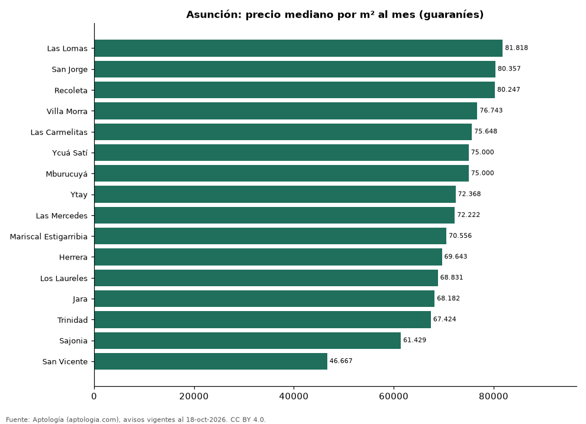

# Barrios más caros y más baratos de Asunción para alquilar departamento: ranking por m² (octubre 2026)

**En Asunción, el barrio con el m² más caro para alquilar departamento es Las Lomas (81.818,2 guaraníes (USD 14,3)/m² al mes) y el más barato San Vicente (46.666,7 guaraníes (USD 8,2)/m² al mes), 1,8 veces menos.** Comparamos 16 barrios con al menos 30 avisos con área.

*Resumen: analizamos 1.397 departamentos en alquiler con área declarada en 16 barrios de Asunción.*

**Actualizado:** 18 de octubre de 2026 (datos del 18 de octubre de 2026) · **Próxima actualización:** mensual.

## Resumen

| Indicador | Valor |
|---|---|
| Más caro por m² | Las Lomas: 81.818,2 guaraníes (USD 14,3) |
| Más barato por m² | San Vicente: 46.666,7 guaraníes (USD 8,2) |
| Diferencia | 1,8 veces |
| Barrios | 16 |

## Ranking de barrios por precio del m²

| Barrio | Por m² (mediana) | Canon (mediana) | Área mediana (m²) | Avisos con área |
|---|---|---|---|---|
| Las Lomas | 81.818,2 guaraníes (USD 14,3) | 5.900.000 guaraníes (USD 1.034) | 77 | 123 |
| San Jorge | 80.357,1 guaraníes (USD 14,1) | 5.100.000 guaraníes (USD 894) | 80 | 33 |
| Recoleta | 80.246,9 guaraníes (USD 14,1) | 5.000.000 guaraníes (USD 876) | 70 | 113 |
| Villa Morra | 76.742,8 guaraníes (USD 13,5) | 5.800.000 guaraníes (USD 1.017) | 82 | 178 |
| Las Carmelitas | 75.647,8 guaraníes (USD 13,3) | 5.900.000 guaraníes (USD 1.034) | 77 | 60 |
| Ycuá Satí | 75.000,0 guaraníes (USD 13,1) | 6.500.000 guaraníes (USD 1.139) | 89 | 99 |
| Mburucuyá | 75.000,0 guaraníes (USD 13,1) | 6.250.000 guaraníes (USD 1.095) | 80 | 149 |
| Ytay | 72.368,4 guaraníes (USD 12,7) | 4.500.000 guaraníes (USD 789) | 60 | 39 |
| Las Mercedes | 72.222,2 guaraníes (USD 12,7) | 5.300.000 guaraníes (USD 929) | 83 | 181 |
| Mariscal Estigarribia | 70.555,6 guaraníes (USD 12,4) | 6.350.000 guaraníes (USD 1.113) | 93 | 43 |
| Herrera | 69.642,9 guaraníes (USD 12,2) | 5.500.000 guaraníes (USD 964) | 78 | 117 |
| Los Laureles | 68.831,2 guaraníes (USD 12,1) | 5.300.000 guaraníes (USD 929) | 81 | 87 |
| Jara | 68.181,8 guaraníes (USD 12,0) | 4.500.000 guaraníes (USD 789) | 70 | 78 |
| Trinidad | 67.424,2 guaraníes (USD 11,8) | 4.750.000 guaraníes (USD 833) | 75 | 30 |
| Sajonia | 61.428,6 guaraníes (USD 10,8) | 3.500.000 guaraníes (USD 613) | 64 | 37 |
| San Vicente | 46.666,7 guaraníes (USD 8,2) | 3.500.000 guaraníes (USD 613) | 70 | 30 |

Medianas; solo barrios con 30 avisos o más con área declarada.

## Preguntas frecuentes

**¿Cuál es el barrio más caro de Asunción para alquilar?**
Las Lomas, con 81.818,2 guaraníes (USD 14,3) por m² al mes en la mediana (octubre de 2026).

**¿Y el más barato?**
San Vicente, con 46.666,7 guaraníes (USD 8,2) por m² al mes.

## Metodología

- **Fuente:** exportes nocturnos de la base de datos de Aptología (aptologia.com) del 18 de octubre de 2026: avisos vigentes de vivienda en portales inmobiliarios de 13 países, recogidos por Aptología y vistos en línea entre el 11 y el 18 de octubre de 2026. Corte: 18 de octubre de 2026.
- **Depuración:** se eliminan duplicados exactos (misma ciudad, zona, tipo, precio, moneda, área, habitaciones y baños) y los precios fuera del percentil 1–99 de cada país, operación, moneda y tipo; el precio por m² usa solo avisos con área declarada entre 12 y 2.000 m² y también se recorta al P1–P99.
- **Qué se mide:** precios pedidos (publicados), no precios de cierre. En arriendo, el canon mensual sin administración, gastos comunes ni condominio.
- **Muestra mínima:** cada cifra publicada se apoya en al menos 30 avisos; las celdas con menos se omiten.
- **Monedas:** nunca se mezclan avisos de monedas distintas sin convertirlos. Conversión a dólares con la tasa de mercado de ExchangeRate-API (open.er-api.com, actualización del 18 Oct 2026): 1 USD = 3.182,80 COP, 1 USD = 18,47 M.N, 1 USD = 5,09 BRL, 1 USD = 3,44 PEN, 1 USD = 982,44 CLP, 1 USD = 1.514,57 ARS, 1 USD = 40,20 UYU, 1 USD = 5.705,37 PYG, 1 USD = 61,27 DOP, 1 USD = 0,89 EUR, 1 USD = 11,72 BOB; la UF chilena a 41.178,64 CLP (mindicador,cl. 18-oct-2026). Los avisos publicados en dólares se usan tal cual.
- **Monedas:** en cada ciudad y operación se usa solo la moneda mayoritaria de los avisos (los avisos en otra moneda se excluyen) y la mediana se convierte a dólares con la tasa citada; nunca se promedian avisos de monedas distintas.
- **Limitaciones:** la cobertura depende de los portales que recorre Aptología en cada país y es mayor en las ciudades grandes y en los segmentos medio-alto y alto; el área es la que declara el aviso, sin verificar; los nombres de zona vienen de los portales.
- **Privacidad:** solo se publican agregados; no se publica ningún dato personal, enlace a avisos ni nombre de anunciante.
- **Datos abiertos:** [datos.csv](datos.csv), licencia CC BY 4.0.

## Cómo citar

Pinzón Pineda, D. M. (2026). *Barrios más caros y más baratos de Asunción para alquilar departamento: ranking por m² (octubre 2026)*. Aptología (aptologia.com). https://github.com/elbroker/aptologia-datos/tree/main/estudios/barrios-mas-caros-y-baratos-asuncion-alquiler-m2-2026. Datos: datos.csv, licencia CC BY 4.0.
