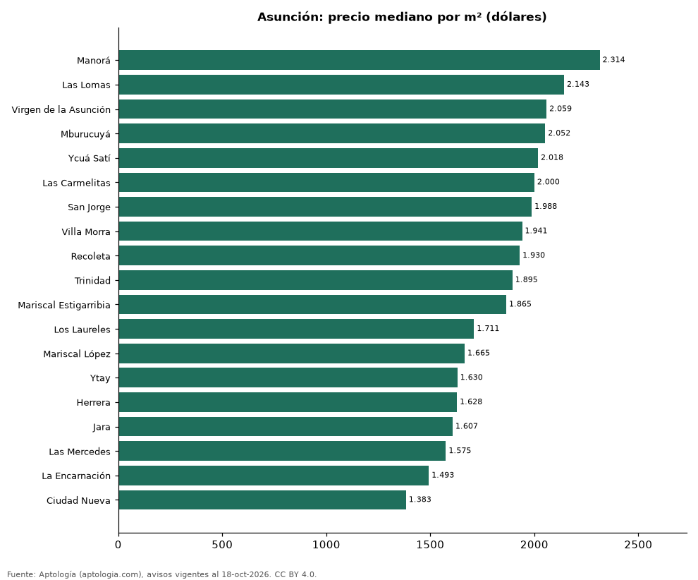

# Barrios más caros y más baratos de Asunción para comprar departamento: ranking por m² (octubre 2026)

**En Asunción, el barrio con el m² más caro para comprar departamento es Manorá (USD 2.314/m²) y el más barato Ciudad Nueva (USD 1.383/m²), 1,7 veces menos.** Comparamos 19 barrios con al menos 30 avisos con área.

*Resumen: analizamos 3.280 departamentos en venta con área declarada en 19 barrios de Asunción.*

**Actualizado:** 18 de octubre de 2026 (datos del 18 de octubre de 2026) · **Próxima actualización:** mensual.

## Resumen

| Indicador | Valor |
|---|---|
| Más caro por m² | Manorá: USD 2.314 |
| Más barato por m² | Ciudad Nueva: USD 1.383 |
| Diferencia | 1,7 veces |
| Barrios | 19 |

## Ranking de barrios por precio del m²

| Barrio | Por m² (mediana) | Precio (mediana) | Área mediana (m²) | Avisos con área |
|---|---|---|---|---|
| Manorá | USD 2.314 | USD 190.000 | 87 | 88 |
| Las Lomas | USD 2.143 | USD 143.469 | 77 | 539 |
| Virgen de la Asunción | USD 2.059 | USD 230.500 | 113 | 36 |
| Mburucuyá | USD 2.052 | USD 194.750 | 113 | 266 |
| Ycuá Satí | USD 2.018 | USD 150.000 | 80 | 303 |
| Las Carmelitas | USD 2.000 | USD 157.500 | 87 | 167 |
| San Jorge | USD 1.988 | USD 131.000 | 92 | 78 |
| Villa Morra | USD 1.941 | USD 137.500 | 77 | 411 |
| Recoleta | USD 1.930 | USD 125.000 | 69 | 407 |
| Trinidad | USD 1.895 | USD 170.500 | 94 | 110 |
| Mariscal Estigarribia | USD 1.865 | USD 167.058 | 86 | 56 |
| Los Laureles | USD 1.711 | USD 127.000 | 73 | 71 |
| Mariscal López | USD 1.665 | USD 159.020 | 88 | 40 |
| Ytay | USD 1.630 | USD 80.089 | 49 | 79 |
| Herrera | USD 1.628 | USD 130.000 | 82 | 141 |
| Jara | USD 1.607 | USD 124.000 | 81 | 141 |
| Las Mercedes | USD 1.575 | USD 146.600 | 98 | 281 |
| La Encarnación | USD 1.493 | USD 105.000 | 101 | 32 |
| Ciudad Nueva | USD 1.383 | USD 148.000 | 103 | 34 |

Medianas; solo barrios con 30 avisos o más con área declarada.

## Preguntas frecuentes

**¿Cuál es el barrio más caro de Asunción para comprar?**
Manorá, con USD 2.314 por m² en la mediana (octubre de 2026).

**¿Y el más barato?**
Ciudad Nueva, con USD 1.383 por m².

## Metodología

- **Fuente:** exportes nocturnos de la base de datos de Aptología (aptologia.com) del 18 de octubre de 2026: avisos vigentes de vivienda en portales inmobiliarios de 13 países, recogidos por Aptología y vistos en línea entre el 11 y el 18 de octubre de 2026. Corte: 18 de octubre de 2026.
- **Depuración:** se eliminan duplicados exactos (misma ciudad, zona, tipo, precio, moneda, área, habitaciones y baños) y los precios fuera del percentil 1–99 de cada país, operación, moneda y tipo; el precio por m² usa solo avisos con área declarada entre 12 y 2.000 m² y también se recorta al P1–P99.
- **Qué se mide:** precios pedidos (publicados), no precios de cierre. En arriendo, el canon mensual sin administración, gastos comunes ni condominio.
- **Muestra mínima:** cada cifra publicada se apoya en al menos 30 avisos; las celdas con menos se omiten.
- **Monedas:** nunca se mezclan avisos de monedas distintas sin convertirlos. Conversión a dólares con la tasa de mercado de ExchangeRate-API (open.er-api.com, actualización del 18 Oct 2026): 1 USD = 3.182,80 COP, 1 USD = 18,47 M.N, 1 USD = 5,09 BRL, 1 USD = 3,44 PEN, 1 USD = 982,44 CLP, 1 USD = 1.514,57 ARS, 1 USD = 40,20 UYU, 1 USD = 5.705,37 PYG, 1 USD = 61,27 DOP, 1 USD = 0,89 EUR, 1 USD = 11,72 BOB; la UF chilena a 41.178,64 CLP (mindicador,cl. 18-oct-2026). Los avisos publicados en dólares se usan tal cual.
- **Monedas:** en cada ciudad y operación se usa solo la moneda mayoritaria de los avisos (los avisos en otra moneda se excluyen) y la mediana se convierte a dólares con la tasa citada; nunca se promedian avisos de monedas distintas.
- **Limitaciones:** la cobertura depende de los portales que recorre Aptología en cada país y es mayor en las ciudades grandes y en los segmentos medio-alto y alto; el área es la que declara el aviso, sin verificar; los nombres de zona vienen de los portales.
- **Privacidad:** solo se publican agregados; no se publica ningún dato personal, enlace a avisos ni nombre de anunciante.
- **Datos abiertos:** [datos.csv](datos.csv), licencia CC BY 4.0.

## Cómo citar

Pinzón Pineda, D. M. (2026). *Barrios más caros y más baratos de Asunción para comprar departamento: ranking por m² (octubre 2026)*. Aptología (aptologia.com). https://github.com/elbroker/aptologia-datos/tree/main/estudios/barrios-mas-caros-y-baratos-asuncion-venta-m2-2026. Datos: datos.csv, licencia CC BY 4.0.
