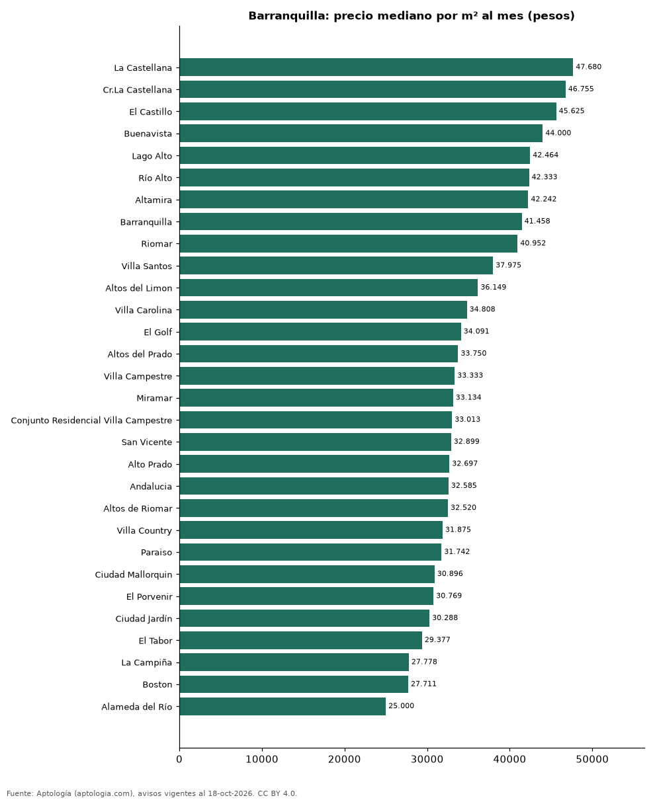

# Barrios más caros y más baratos de Barranquilla para arrendar apartamento: ranking por m² (octubre 2026)

**En Barranquilla, el barrio con el m² más caro para arrendar apartamento es La Castellana (47.680 pesos/m² al mes) y el más barato El Prado (23.345 pesos/m² al mes), 2,0 veces menos.** Comparamos 31 barrios con al menos 30 avisos con área.

*Resumen: analizamos 2.973 apartamentos en arriendo con área declarada en 31 barrios de Barranquilla.*

**Actualizado:** 18 de octubre de 2026 (datos del 18 de octubre de 2026) · **Próxima actualización:** mensual.

## Resumen

| Indicador | Valor |
|---|---|
| Más caro por m² | La Castellana: 47.680 pesos |
| Más barato por m² | El Prado: 23.345 pesos |
| Diferencia | 2,0 veces |
| Barrios | 31 |

## Ranking de barrios por precio del m²

| Barrio | Por m² (mediana) | Canon (mediana) | Área mediana (m²) | Avisos con área |
|---|---|---|---|---|
| La Castellana | 47.680 pesos | 5.000.000 pesos | 86 | 56 |
| Cr.La Castellana | 46.755 pesos | 4.978.000 pesos | 80 | 46 |
| El Castillo | 45.625 pesos | 4.700.000 pesos | 117 | 67 |
| Buenavista | 44.000 pesos | 5.500.000 pesos | 122 | 84 |
| Lago Alto | 42.464 pesos | 3.900.000 pesos | 92 | 38 |
| Río Alto | 42.333 pesos | 3.500.000 pesos | 84 | 92 |
| Altamira | 42.242 pesos | 2.800.000 pesos | 70 | 32 |
| Barranquilla | 41.458 pesos | 4.375.000 pesos | 110 | 48 |
| Riomar | 40.952 pesos | 4.200.000 pesos | 108 | 198 |
| Villa Santos | 37.975 pesos | 3.200.000 pesos | 82 | 195 |
| Altos del Limon | 36.149 pesos | 3.450.000 pesos | 94 | 67 |
| Villa Carolina | 34.808 pesos | 2.700.000 pesos | 78 | 74 |
| El Golf | 34.091 pesos | 4.900.000 pesos | 163 | 43 |
| Altos del Prado | 33.750 pesos | 4.000.000 pesos | 127 | 195 |
| Villa Campestre | 33.333 pesos | 3.116.000 pesos | 96 | 110 |
| Miramar | 33.134 pesos | 2.200.000 pesos | 63 | 185 |
| Conjunto Residencial Villa Campestre | 33.013 pesos | 2.380.350 pesos | 68 | 46 |
| San Vicente | 32.899 pesos | 2.500.000 pesos | 70 | 84 |
| Alto Prado | 32.697 pesos | 3.870.000 pesos | 136 | 160 |
| Andalucia | 32.585 pesos | 2.615.000 pesos | 87 | 50 |
| Altos de Riomar | 32.520 pesos | 3.800.000 pesos | 110 | 201 |
| Villa Country | 31.875 pesos | 3.600.000 pesos | 120 | 77 |
| Paraiso | 31.742 pesos | 2.300.000 pesos | 66 | 90 |
| Ciudad Mallorquin | 30.896 pesos | 1.750.000 pesos | 57 | 142 |
| El Porvenir | 30.769 pesos | 1.800.000 pesos | 64 | 65 |
| Ciudad Jardín | 30.288 pesos | 2.362.750 pesos | 94 | 92 |
| El Tabor | 29.377 pesos | 2.944.500 pesos | 90 | 56 |
| La Campiña | 27.778 pesos | 2.650.000 pesos | 97 | 39 |
| Boston | 27.711 pesos | 1.900.000 pesos | 72 | 47 |
| Alameda del Río | 25.000 pesos | 1.392.500 pesos | 56 | 252 |
| El Prado | 23.345 pesos | 1.800.000 pesos | 75 | 42 |

Medianas; solo barrios con 30 avisos o más con área declarada.

## Preguntas frecuentes

**¿Cuál es el barrio más caro de Barranquilla para arrendar?**
La Castellana, con 47.680 pesos por m² al mes en la mediana (octubre de 2026).

**¿Y el más barato?**
El Prado, con 23.345 pesos por m² al mes.

## Metodología

- **Fuente:** exportes nocturnos de la base de datos de Aptología (aptologia.com) del 18 de octubre de 2026: avisos vigentes de vivienda en portales inmobiliarios de 13 países, recogidos por Aptología y vistos en línea entre el 11 y el 18 de octubre de 2026. Corte: 18 de octubre de 2026.
- **Depuración:** se eliminan duplicados exactos (misma ciudad, zona, tipo, precio, moneda, área, habitaciones y baños) y los precios fuera del percentil 1–99 de cada país, operación, moneda y tipo; el precio por m² usa solo avisos con área declarada entre 12 y 2.000 m² y también se recorta al P1–P99.
- **Qué se mide:** precios pedidos (publicados), no precios de cierre. En arriendo, el canon mensual sin administración, gastos comunes ni condominio.
- **Muestra mínima:** cada cifra publicada se apoya en al menos 30 avisos; las celdas con menos se omiten.
- **Colombia:** Precios en pesos colombianos, sin conversión de moneda.
- **Limitaciones:** la cobertura depende de los portales que recorre Aptología en cada país y es mayor en las ciudades grandes y en los segmentos medio-alto y alto; el área es la que declara el aviso, sin verificar; los nombres de zona vienen de los portales.
- **Privacidad:** solo se publican agregados; no se publica ningún dato personal, enlace a avisos ni nombre de anunciante.
- **Datos abiertos:** [datos.csv](datos.csv), licencia CC BY 4.0.

## Cómo citar

Pinzón Pineda, D. M. (2026). *Barrios más caros y más baratos de Barranquilla para arrendar apartamento: ranking por m² (octubre 2026)*. Aptología (aptologia.com). https://github.com/elbroker/aptologia-datos/tree/main/estudios/barrios-mas-caros-y-baratos-barranquilla-arriendo-m2-2026. Datos: datos.csv, licencia CC BY 4.0.
