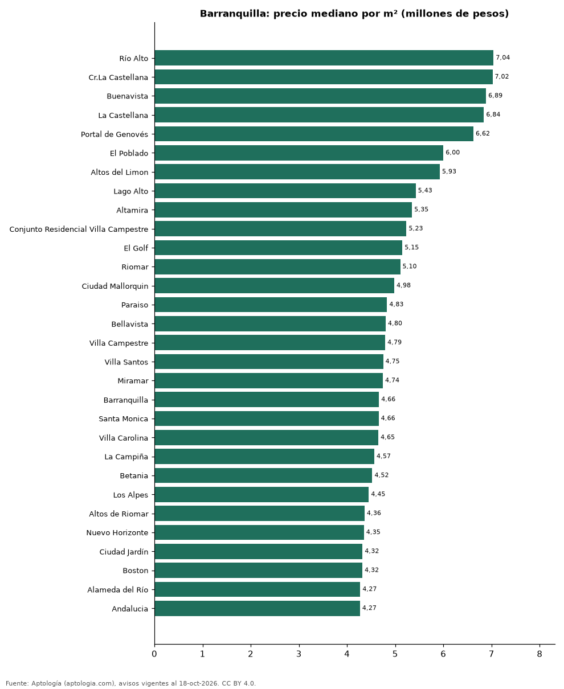

# Barrios más caros y más baratos de Barranquilla para comprar apartamento: ranking por m² (octubre 2026)

**En Barranquilla, el barrio con el m² más caro para comprar apartamento es Río Alto (7,04 millones de pesos/m²) y el más barato Puerta Dorada (3,22 millones de pesos/m²), 2,2 veces menos.** Comparamos 44 barrios con al menos 30 avisos con área.

*Resumen: analizamos 6.486 apartamentos en venta con área declarada en 44 barrios de Barranquilla.*

**Actualizado:** 18 de octubre de 2026 (datos del 18 de octubre de 2026) · **Próxima actualización:** mensual.

## Resumen

| Indicador | Valor |
|---|---|
| Más caro por m² | Río Alto: 7,04 millones de pesos |
| Más barato por m² | Puerta Dorada: 3,22 millones de pesos |
| Diferencia | 2,2 veces |
| Barrios | 44 |

## Ranking de barrios por precio del m²

| Barrio | Por m² (mediana) | Precio (mediana) | Área mediana (m²) | Avisos con área |
|---|---|---|---|---|
| Río Alto | 7,04 millones de pesos | 560 millones de pesos | 84 | 134 |
| Cr.La Castellana | 7,02 millones de pesos | 923 millones de pesos | 126 | 50 |
| Buenavista | 6,89 millones de pesos | 950 millones de pesos | 141 | 222 |
| La Castellana | 6,84 millones de pesos | 795 millones de pesos | 117 | 67 |
| Portal de Genovés | 6,62 millones de pesos | 692 millones de pesos | 98 | 62 |
| El Poblado | 6,00 millones de pesos | 469 millones de pesos | 87 | 75 |
| Altos del Limon | 5,93 millones de pesos | 680 millones de pesos | 116 | 99 |
| Lago Alto | 5,43 millones de pesos | 660 millones de pesos | 135 | 81 |
| Altamira | 5,35 millones de pesos | 395 millones de pesos | 86 | 39 |
| Conjunto Residencial Villa Campestre | 5,23 millones de pesos | 550 millones de pesos | 99 | 72 |
| El Golf | 5,15 millones de pesos | 1.351 millones de pesos | 250 | 150 |
| Riomar | 5,10 millones de pesos | 640 millones de pesos | 130 | 340 |
| Ciudad Mallorquin | 4,98 millones de pesos | 277 millones de pesos | 57 | 121 |
| Paraiso | 4,83 millones de pesos | 320 millones de pesos | 70 | 175 |
| Bellavista | 4,80 millones de pesos | 420 millones de pesos | 90 | 61 |
| Villa Campestre | 4,79 millones de pesos | 515 millones de pesos | 104 | 173 |
| Villa Santos | 4,75 millones de pesos | 477 millones de pesos | 110 | 379 |
| Miramar | 4,74 millones de pesos | 352 millones de pesos | 76 | 344 |
| Barranquilla | 4,66 millones de pesos | 580 millones de pesos | 120 | 83 |
| Santa Monica | 4,66 millones de pesos | 530 millones de pesos | 115 | 39 |
| Villa Carolina | 4,65 millones de pesos | 380 millones de pesos | 77 | 134 |
| La Campiña | 4,57 millones de pesos | 418 millones de pesos | 104 | 76 |
| Betania | 4,52 millones de pesos | 350 millones de pesos | 78 | 53 |
| Los Alpes | 4,45 millones de pesos | 480 millones de pesos | 111 | 54 |
| Altos de Riomar | 4,36 millones de pesos | 615 millones de pesos | 137 | 513 |
| Nuevo Horizonte | 4,35 millones de pesos | 372 millones de pesos | 90 | 76 |
| Ciudad Jardín | 4,32 millones de pesos | 409 millones de pesos | 98 | 288 |
| Boston | 4,32 millones de pesos | 350 millones de pesos | 84 | 132 |
| Alameda del Río | 4,27 millones de pesos | 230 millones de pesos | 57 | 356 |
| Andalucia | 4,27 millones de pesos | 420 millones de pesos | 109 | 110 |
| San Vicente | 4,23 millones de pesos | 444 millones de pesos | 120 | 112 |
| Granadillo | 4,15 millones de pesos | 390 millones de pesos | 101 | 61 |
| Villa Country | 4,14 millones de pesos | 550 millones de pesos | 143 | 165 |
| Las Delicias | 4,03 millones de pesos | 357 millones de pesos | 90 | 68 |
| Alameda | 3,93 millones de pesos | 217 millones de pesos | 57 | 85 |
| La Concepción | 3,88 millones de pesos | 310 millones de pesos | 79 | 64 |
| Altos del Prado | 3,85 millones de pesos | 700 millones de pesos | 177 | 461 |
| Alto Prado | 3,82 millones de pesos | 680 millones de pesos | 180 | 421 |
| El Porvenir | 3,70 millones de pesos | 378 millones de pesos | 100 | 75 |
| El Tabor | 3,68 millones de pesos | 395 millones de pesos | 108 | 83 |
| El Recreo | 3,60 millones de pesos | 280 millones de pesos | 79 | 71 |
| Los Andes | 3,33 millones de pesos | 250 millones de pesos | 74 | 31 |
| El Prado | 3,26 millones de pesos | 380 millones de pesos | 120 | 176 |
| Puerta Dorada | 3,22 millones de pesos | 190 millones de pesos | 58 | 55 |

Medianas; solo barrios con 30 avisos o más con área declarada.

## Preguntas frecuentes

**¿Cuál es el barrio más caro de Barranquilla para comprar?**
Río Alto, con 7,04 millones de pesos por m² en la mediana (octubre de 2026).

**¿Y el más barato?**
Puerta Dorada, con 3,22 millones de pesos por m².

## Metodología

- **Fuente:** exportes nocturnos de la base de datos de Aptología (aptologia.com) del 18 de octubre de 2026: avisos vigentes de vivienda en portales inmobiliarios de 13 países, recogidos por Aptología y vistos en línea entre el 11 y el 18 de octubre de 2026. Corte: 18 de octubre de 2026.
- **Depuración:** se eliminan duplicados exactos (misma ciudad, zona, tipo, precio, moneda, área, habitaciones y baños) y los precios fuera del percentil 1–99 de cada país, operación, moneda y tipo; el precio por m² usa solo avisos con área declarada entre 12 y 2.000 m² y también se recorta al P1–P99.
- **Qué se mide:** precios pedidos (publicados), no precios de cierre. En arriendo, el canon mensual sin administración, gastos comunes ni condominio.
- **Muestra mínima:** cada cifra publicada se apoya en al menos 30 avisos; las celdas con menos se omiten.
- **Colombia:** Precios en pesos colombianos, sin conversión de moneda.
- **Limitaciones:** la cobertura depende de los portales que recorre Aptología en cada país y es mayor en las ciudades grandes y en los segmentos medio-alto y alto; el área es la que declara el aviso, sin verificar; los nombres de zona vienen de los portales.
- **Privacidad:** solo se publican agregados; no se publica ningún dato personal, enlace a avisos ni nombre de anunciante.
- **Datos abiertos:** [datos.csv](datos.csv), licencia CC BY 4.0.

## Cómo citar

Pinzón Pineda, D. M. (2026). *Barrios más caros y más baratos de Barranquilla para comprar apartamento: ranking por m² (octubre 2026)*. Aptología (aptologia.com). https://github.com/elbroker/aptologia-datos/tree/main/estudios/barrios-mas-caros-y-baratos-barranquilla-venta-m2-2026. Datos: datos.csv, licencia CC BY 4.0.
