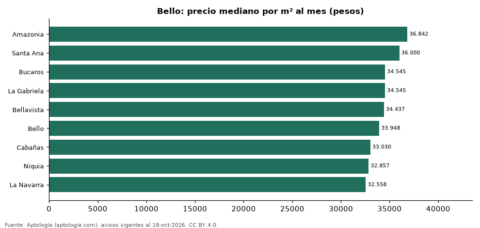

# Barrios más caros y más baratos de Bello para arrendar apartamento: ranking por m² (octubre 2026)

**En Bello, el barrio con el m² más caro para arrendar apartamento es Amazonia (36.842 pesos/m² al mes) y el más barato La Navarra (32.558 pesos/m² al mes), 1,1 veces menos.** Comparamos 9 barrios con al menos 30 avisos con área.

*Resumen: analizamos 573 apartamentos en arriendo con área declarada en 9 barrios de Bello.*

**Actualizado:** 18 de octubre de 2026 (datos del 18 de octubre de 2026) · **Próxima actualización:** mensual.

## Resumen

| Indicador | Valor |
|---|---|
| Más caro por m² | Amazonia: 36.842 pesos |
| Más barato por m² | La Navarra: 32.558 pesos |
| Diferencia | 1,1 veces |
| Barrios | 9 |

## Ranking de barrios por precio del m²

| Barrio | Por m² (mediana) | Canon (mediana) | Área mediana (m²) | Avisos con área |
|---|---|---|---|---|
| Amazonia | 36.842 pesos | 2.400.000 pesos | 70 | 55 |
| Santa Ana | 36.000 pesos | 2.250.000 pesos | 62 | 105 |
| Bucaros | 34.545 pesos | 1.925.000 pesos | 55 | 76 |
| La Gabriela | 34.545 pesos | 1.900.000 pesos | 55 | 41 |
| Bellavista | 34.437 pesos | 2.000.000 pesos | 61 | 32 |
| Bello | 33.948 pesos | 2.000.000 pesos | 60 | 62 |
| Cabañas | 33.030 pesos | 2.290.000 pesos | 71 | 50 |
| Niquia | 32.857 pesos | 2.000.000 pesos | 64 | 107 |
| La Navarra | 32.558 pesos | 1.800.000 pesos | 55 | 45 |

Medianas; solo barrios con 30 avisos o más con área declarada.

## Preguntas frecuentes

**¿Cuál es el barrio más caro de Bello para arrendar?**
Amazonia, con 36.842 pesos por m² al mes en la mediana (octubre de 2026).

**¿Y el más barato?**
La Navarra, con 32.558 pesos por m² al mes.

## Metodología

- **Fuente:** exportes nocturnos de la base de datos de Aptología (aptologia.com) del 18 de octubre de 2026: avisos vigentes de vivienda en portales inmobiliarios de 13 países, recogidos por Aptología y vistos en línea entre el 11 y el 18 de octubre de 2026. Corte: 18 de octubre de 2026.
- **Depuración:** se eliminan duplicados exactos (misma ciudad, zona, tipo, precio, moneda, área, habitaciones y baños) y los precios fuera del percentil 1–99 de cada país, operación, moneda y tipo; el precio por m² usa solo avisos con área declarada entre 12 y 2.000 m² y también se recorta al P1–P99.
- **Qué se mide:** precios pedidos (publicados), no precios de cierre. En arriendo, el canon mensual sin administración, gastos comunes ni condominio.
- **Muestra mínima:** cada cifra publicada se apoya en al menos 30 avisos; las celdas con menos se omiten.
- **Colombia:** Precios en pesos colombianos, sin conversión de moneda.
- **Limitaciones:** la cobertura depende de los portales que recorre Aptología en cada país y es mayor en las ciudades grandes y en los segmentos medio-alto y alto; el área es la que declara el aviso, sin verificar; los nombres de zona vienen de los portales.
- **Privacidad:** solo se publican agregados; no se publica ningún dato personal, enlace a avisos ni nombre de anunciante.
- **Datos abiertos:** [datos.csv](datos.csv), licencia CC BY 4.0.

## Cómo citar

Pinzón Pineda, D. M. (2026). *Barrios más caros y más baratos de Bello para arrendar apartamento: ranking por m² (octubre 2026)*. Aptología (aptologia.com). https://github.com/elbroker/aptologia-datos/tree/main/estudios/barrios-mas-caros-y-baratos-bello-arriendo-m2-2026. Datos: datos.csv, licencia CC BY 4.0.
