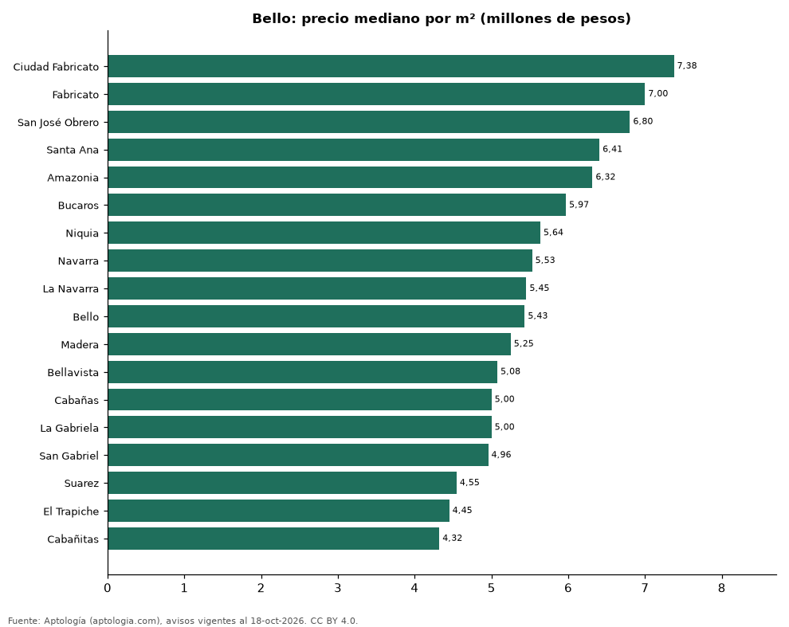

# Barrios más caros y más baratos de Bello para comprar apartamento: ranking por m² (octubre 2026)

**En Bello, el barrio con el m² más caro para comprar apartamento es Ciudad Fabricato (7,38 millones de pesos/m²) y el más barato Cabañitas (4,32 millones de pesos/m²), 1,7 veces menos.** Comparamos 18 barrios con al menos 30 avisos con área.

*Resumen: analizamos 1.459 apartamentos en venta con área declarada en 18 barrios de Bello.*

**Actualizado:** 18 de octubre de 2026 (datos del 18 de octubre de 2026) · **Próxima actualización:** mensual.

## Resumen

| Indicador | Valor |
|---|---|
| Más caro por m² | Ciudad Fabricato: 7,38 millones de pesos |
| Más barato por m² | Cabañitas: 4,32 millones de pesos |
| Diferencia | 1,7 veces |
| Barrios | 18 |

## Ranking de barrios por precio del m²

| Barrio | Por m² (mediana) | Precio (mediana) | Área mediana (m²) | Avisos con área |
|---|---|---|---|---|
| Ciudad Fabricato | 7,38 millones de pesos | 495 millones de pesos | 66 | 40 |
| Fabricato | 7,00 millones de pesos | 461 millones de pesos | 66 | 75 |
| San José Obrero | 6,80 millones de pesos | 468 millones de pesos | 71 | 39 |
| Santa Ana | 6,41 millones de pesos | 390 millones de pesos | 62 | 195 |
| Amazonia | 6,32 millones de pesos | 390 millones de pesos | 60 | 71 |
| Bucaros | 5,97 millones de pesos | 332 millones de pesos | 55 | 68 |
| Niquia | 5,64 millones de pesos | 340 millones de pesos | 62 | 292 |
| Navarra | 5,53 millones de pesos | 328 millones de pesos | 56 | 72 |
| La Navarra | 5,45 millones de pesos | 325 millones de pesos | 62 | 69 |
| Bello | 5,43 millones de pesos | 356 millones de pesos | 62 | 90 |
| Madera | 5,25 millones de pesos | 315 millones de pesos | 59 | 83 |
| Bellavista | 5,08 millones de pesos | 290 millones de pesos | 59 | 39 |
| Cabañas | 5,00 millones de pesos | 400 millones de pesos | 78 | 113 |
| La Gabriela | 5,00 millones de pesos | 285 millones de pesos | 57 | 53 |
| San Gabriel | 4,96 millones de pesos | 270 millones de pesos | 54 | 42 |
| Suarez | 4,55 millones de pesos | 350 millones de pesos | 68 | 31 |
| El Trapiche | 4,45 millones de pesos | 266 millones de pesos | 59 | 48 |
| Cabañitas | 4,32 millones de pesos | 390 millones de pesos | 83 | 39 |

Medianas; solo barrios con 30 avisos o más con área declarada.

## Preguntas frecuentes

**¿Cuál es el barrio más caro de Bello para comprar?**
Ciudad Fabricato, con 7,38 millones de pesos por m² en la mediana (octubre de 2026).

**¿Y el más barato?**
Cabañitas, con 4,32 millones de pesos por m².

## Metodología

- **Fuente:** exportes nocturnos de la base de datos de Aptología (aptologia.com) del 18 de octubre de 2026: avisos vigentes de vivienda en portales inmobiliarios de 13 países, recogidos por Aptología y vistos en línea entre el 11 y el 18 de octubre de 2026. Corte: 18 de octubre de 2026.
- **Depuración:** se eliminan duplicados exactos (misma ciudad, zona, tipo, precio, moneda, área, habitaciones y baños) y los precios fuera del percentil 1–99 de cada país, operación, moneda y tipo; el precio por m² usa solo avisos con área declarada entre 12 y 2.000 m² y también se recorta al P1–P99.
- **Qué se mide:** precios pedidos (publicados), no precios de cierre. En arriendo, el canon mensual sin administración, gastos comunes ni condominio.
- **Muestra mínima:** cada cifra publicada se apoya en al menos 30 avisos; las celdas con menos se omiten.
- **Colombia:** Precios en pesos colombianos, sin conversión de moneda.
- **Limitaciones:** la cobertura depende de los portales que recorre Aptología en cada país y es mayor en las ciudades grandes y en los segmentos medio-alto y alto; el área es la que declara el aviso, sin verificar; los nombres de zona vienen de los portales.
- **Privacidad:** solo se publican agregados; no se publica ningún dato personal, enlace a avisos ni nombre de anunciante.
- **Datos abiertos:** [datos.csv](datos.csv), licencia CC BY 4.0.

## Cómo citar

Pinzón Pineda, D. M. (2026). *Barrios más caros y más baratos de Bello para comprar apartamento: ranking por m² (octubre 2026)*. Aptología (aptologia.com). https://github.com/elbroker/aptologia-datos/tree/main/estudios/barrios-mas-caros-y-baratos-bello-venta-m2-2026. Datos: datos.csv, licencia CC BY 4.0.
