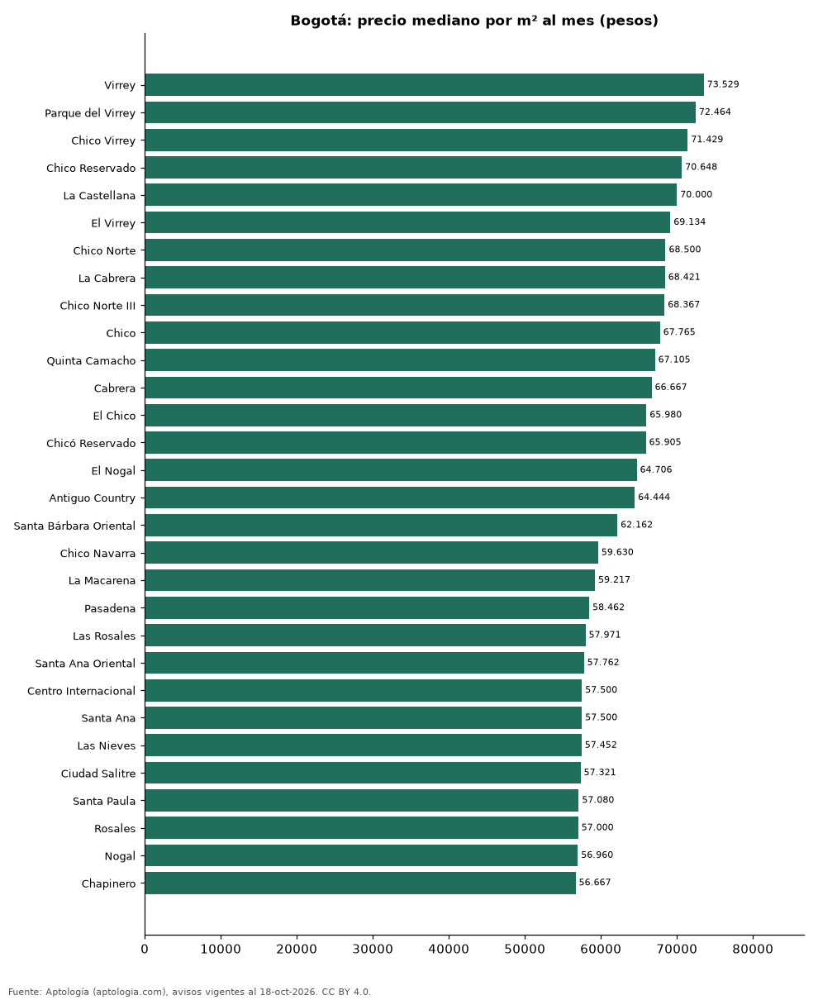

# Barrios más caros y más baratos de Bogotá para arrendar apartamento: ranking por m² (octubre 2026)

**En Bogotá, el barrio con el m² más caro para arrendar apartamento es Virrey (73.529 pesos/m² al mes) y el más barato Engativá (30.000 pesos/m² al mes), 2,5 veces menos.** Comparamos 75 barrios con al menos 30 avisos con área.

*Resumen: analizamos 7.238 apartamentos en arriendo con área declarada en 75 barrios de Bogotá.*

**Actualizado:** 18 de octubre de 2026 (datos del 18 de octubre de 2026) · **Próxima actualización:** mensual.

## Resumen

| Indicador | Valor |
|---|---|
| Más caro por m² | Virrey: 73.529 pesos |
| Más barato por m² | Engativá: 30.000 pesos |
| Diferencia | 2,5 veces |
| Barrios | 75 |

## Ranking de barrios por precio del m²

| Barrio | Por m² (mediana) | Canon (mediana) | Área mediana (m²) | Avisos con área |
|---|---|---|---|---|
| Virrey | 73.529 pesos | 8.500.000 pesos | 115 | 49 |
| Parque del Virrey | 72.464 pesos | 7.800.000 pesos | 102 | 43 |
| Chico Virrey | 71.429 pesos | 8.000.000 pesos | 111 | 33 |
| Chico Reservado | 70.648 pesos | 10.600.000 pesos | 155 | 208 |
| La Castellana | 70.000 pesos | 2.300.000 pesos | 42 | 37 |
| El Virrey | 69.134 pesos | 7.800.000 pesos | 111 | 105 |
| Chico Norte | 68.500 pesos | 6.500.000 pesos | 96 | 504 |
| La Cabrera | 68.421 pesos | 12.400.000 pesos | 167 | 231 |
| Chico Norte III | 68.367 pesos | 4.700.000 pesos | 76 | 37 |
| Chico | 67.765 pesos | 7.050.000 pesos | 104 | 296 |
| Quinta Camacho | 67.105 pesos | 3.622.000 pesos | 64 | 31 |
| Cabrera | 66.667 pesos | 13.900.000 pesos | 202 | 85 |
| El Chico | 65.980 pesos | 7.128.500 pesos | 118 | 98 |
| Chicó Reservado | 65.905 pesos | 9.850.000 pesos | 160 | 46 |
| El Nogal | 64.706 pesos | 9.000.000 pesos | 150 | 117 |
| Antiguo Country | 64.444 pesos | 5.000.000 pesos | 85 | 85 |
| Santa Bárbara Oriental | 62.162 pesos | 4.200.000 pesos | 78 | 61 |
| Chico Navarra | 59.630 pesos | 5.900.000 pesos | 100 | 108 |
| La Macarena | 59.217 pesos | 3.038.600 pesos | 50 | 48 |
| Pasadena | 58.462 pesos | 3.106.200 pesos | 63 | 59 |
| Las Rosales | 57.971 pesos | 11.500.000 pesos | 200 | 53 |
| Santa Ana Oriental | 57.762 pesos | 14.000.000 pesos | 230 | 53 |
| Centro Internacional | 57.500 pesos | 2.800.000 pesos | 53 | 109 |
| Santa Ana | 57.500 pesos | 11.000.000 pesos | 198 | 39 |
| Las Nieves | 57.452 pesos | 1.925.000 pesos | 36 | 70 |
| Ciudad Salitre | 57.321 pesos | 3.690.000 pesos | 65 | 116 |
| Santa Paula | 57.080 pesos | 5.000.000 pesos | 96 | 132 |
| Rosales | 57.000 pesos | 10.500.000 pesos | 182 | 105 |
| Nogal | 56.960 pesos | 8.500.000 pesos | 180 | 45 |
| Chapinero | 56.667 pesos | 2.880.000 pesos | 50 | 305 |
| Los Rosales | 56.307 pesos | 10.250.000 pesos | 185 | 326 |
| Chicó Navarra | 56.250 pesos | 6.000.000 pesos | 121 | 81 |
| San Patricio | 55.385 pesos | 5.200.000 pesos | 95 | 153 |
| Chapinero Alto | 55.279 pesos | 3.325.000 pesos | 58 | 162 |
| Santa Bárbara Occidental | 55.180 pesos | 4.450.000 pesos | 82 | 112 |
| Barrios Unidos | 55.000 pesos | 2.000.000 pesos | 35 | 83 |
| Santa Bibiana | 54.098 pesos | 5.500.000 pesos | 102 | 57 |
| La Carolina | 53.719 pesos | 9.000.000 pesos | 164 | 127 |
| Santa Bárbara Alta | 53.250 pesos | 14.000.000 pesos | 228 | 63 |
| Altos de Bella Suiza | 52.500 pesos | 5.700.000 pesos | 109 | 33 |
| Chapinero Central | 52.222 pesos | 2.100.000 pesos | 39 | 77 |
| Bella Suiza | 52.083 pesos | 4.000.000 pesos | 87 | 125 |
| La Calleja | 51.954 pesos | 4.804.250 pesos | 86 | 70 |
| Rincon del Chico | 51.429 pesos | 5.000.000 pesos | 89 | 39 |
| Santa Bárbara | 50.273 pesos | 4.800.000 pesos | 100 | 353 |
| La Candelaria | 50.167 pesos | 2.000.000 pesos | 39 | 38 |
| Teusaquillo | 50.000 pesos | 2.250.000 pesos | 42 | 66 |
| El Refugio | 50.000 pesos | 11.000.000 pesos | 214 | 89 |
| Quinta Paredes | 49.187 pesos | 2.900.000 pesos | 60 | 46 |
| Usaquen | 49.180 pesos | 6.000.000 pesos | 119 | 35 |
| Lisboa | 48.620 pesos | 3.400.000 pesos | 67 | 32 |
| Santa Bárbara Central | 47.858 pesos | 5.000.000 pesos | 100 | 124 |
| Chico Alto | 47.788 pesos | 13.350.000 pesos | 263 | 30 |
| Montevideo | 47.753 pesos | 2.025.000 pesos | 42 | 48 |
| Bosque Medina | 47.591 pesos | 12.000.000 pesos | 260 | 37 |
| Nicolas de Federman | 47.513 pesos | 3.200.000 pesos | 79 | 52 |
| San José de Bavaria | 47.321 pesos | 1.990.000 pesos | 42 | 56 |
| La Felicidad | 46.154 pesos | 2.800.000 pesos | 62 | 85 |
| Prado Veraniego | 45.592 pesos | 2.100.000 pesos | 56 | 34 |
| Modelia | 44.706 pesos | 2.300.000 pesos | 56 | 45 |
| Colina Campestre | 43.786 pesos | 2.900.000 pesos | 72 | 164 |
| Mazuren | 43.077 pesos | 2.750.000 pesos | 65 | 41 |
| Cedritos | 42.361 pesos | 2.700.000 pesos | 68 | 334 |
| Alameda | 42.099 pesos | 2.864.000 pesos | 70 | 42 |
| Hayuelos | 38.889 pesos | 1.700.000 pesos | 44 | 43 |
| Lagos de Torca | 38.197 pesos | 1.700.000 pesos | 45 | 110 |
| Torca | 38.069 pesos | 1.750.000 pesos | 46 | 30 |
| El Redil | 36.968 pesos | 1.450.000 pesos | 40 | 72 |
| Santa Teresa | 36.228 pesos | 2.425.000 pesos | 70 | 32 |
| Normandia | 35.993 pesos | 2.700.000 pesos | 70 | 36 |
| Mirandela | 35.913 pesos | 1.800.000 pesos | 45 | 40 |
| Castilla | 34.833 pesos | 1.600.000 pesos | 46 | 60 |
| Fontibon | 33.794 pesos | 1.500.000 pesos | 46 | 146 |
| Madelena | 30.952 pesos | 1.316.200 pesos | 42 | 43 |
| Engativá | 30.000 pesos | 1.650.000 pesos | 54 | 59 |

Medianas; solo barrios con 30 avisos o más con área declarada.

## Preguntas frecuentes

**¿Cuál es el barrio más caro de Bogotá para arrendar?**
Virrey, con 73.529 pesos por m² al mes en la mediana (octubre de 2026).

**¿Y el más barato?**
Engativá, con 30.000 pesos por m² al mes.

## Metodología

- **Fuente:** exportes nocturnos de la base de datos de Aptología (aptologia.com) del 18 de octubre de 2026: avisos vigentes de vivienda en portales inmobiliarios de 13 países, recogidos por Aptología y vistos en línea entre el 11 y el 18 de octubre de 2026. Corte: 18 de octubre de 2026.
- **Depuración:** se eliminan duplicados exactos (misma ciudad, zona, tipo, precio, moneda, área, habitaciones y baños) y los precios fuera del percentil 1–99 de cada país, operación, moneda y tipo; el precio por m² usa solo avisos con área declarada entre 12 y 2.000 m² y también se recorta al P1–P99.
- **Qué se mide:** precios pedidos (publicados), no precios de cierre. En arriendo, el canon mensual sin administración, gastos comunes ni condominio.
- **Muestra mínima:** cada cifra publicada se apoya en al menos 30 avisos; las celdas con menos se omiten.
- **Colombia:** Precios en pesos colombianos, sin conversión de moneda.
- **Limitaciones:** la cobertura depende de los portales que recorre Aptología en cada país y es mayor en las ciudades grandes y en los segmentos medio-alto y alto; el área es la que declara el aviso, sin verificar; los nombres de zona vienen de los portales.
- **Privacidad:** solo se publican agregados; no se publica ningún dato personal, enlace a avisos ni nombre de anunciante.
- **Datos abiertos:** [datos.csv](datos.csv), licencia CC BY 4.0.

## Cómo citar

Pinzón Pineda, D. M. (2026). *Barrios más caros y más baratos de Bogotá para arrendar apartamento: ranking por m² (octubre 2026)*. Aptología (aptologia.com). https://github.com/elbroker/aptologia-datos/tree/main/estudios/barrios-mas-caros-y-baratos-bogota-arriendo-m2-2026. Datos: datos.csv, licencia CC BY 4.0.
