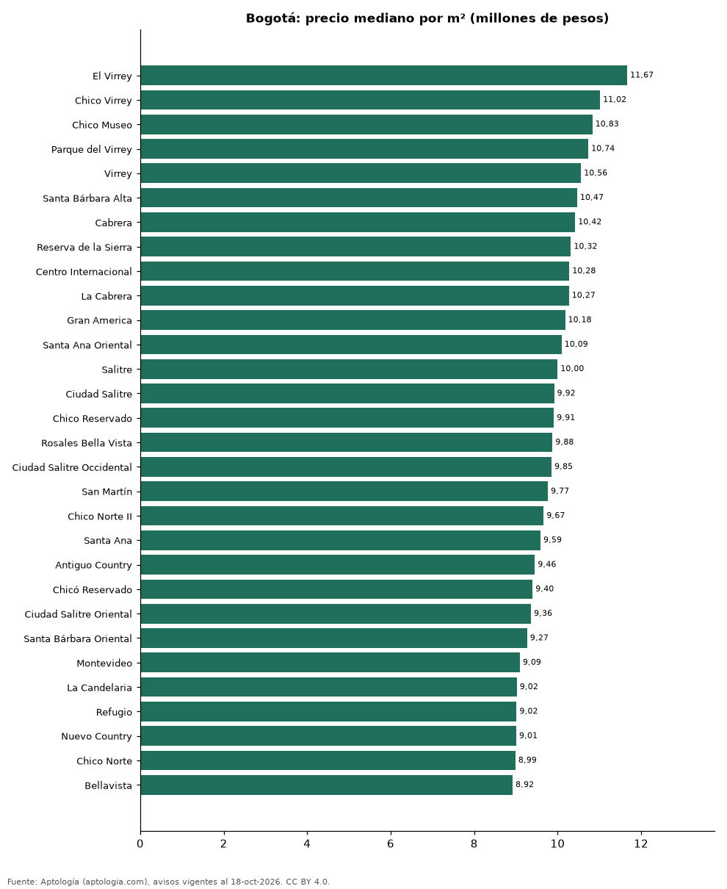

# Barrios más caros y más baratos de Bogotá para comprar apartamento: ranking por m² (octubre 2026)

**En Bogotá, el barrio con el m² más caro para comprar apartamento es El Virrey (11,67 millones de pesos/m²) y el más barato Tierra Buena (4,00 millones de pesos/m²), 2,9 veces menos.** Comparamos 175 barrios con al menos 30 avisos con área.

*Resumen: analizamos 21.948 apartamentos en venta con área declarada en 175 barrios de Bogotá.*

**Actualizado:** 18 de octubre de 2026 (datos del 18 de octubre de 2026) · **Próxima actualización:** mensual.

## Resumen

| Indicador | Valor |
|---|---|
| Más caro por m² | El Virrey: 11,67 millones de pesos |
| Más barato por m² | Tierra Buena: 4,00 millones de pesos |
| Diferencia | 2,9 veces |
| Barrios | 175 |

## Ranking de barrios por precio del m²

| Barrio | Por m² (mediana) | Precio (mediana) | Área mediana (m²) | Avisos con área |
|---|---|---|---|---|
| El Virrey | 11,67 millones de pesos | 1.485 millones de pesos | 120 | 91 |
| Chico Virrey | 11,02 millones de pesos | 1.315 millones de pesos | 149 | 36 |
| Chico Museo | 10,83 millones de pesos | 2.380 millones de pesos | 217 | 63 |
| Parque del Virrey | 10,74 millones de pesos | 950 millones de pesos | 110 | 38 |
| Virrey | 10,56 millones de pesos | 1.500 millones de pesos | 158 | 66 |
| Santa Bárbara Alta | 10,47 millones de pesos | 2.643 millones de pesos | 241 | 144 |
| Cabrera | 10,42 millones de pesos | 2.600 millones de pesos | 250 | 170 |
| Reserva de la Sierra | 10,32 millones de pesos | 1.950 millones de pesos | 182 | 36 |
| Centro Internacional | 10,28 millones de pesos | 599 millones de pesos | 57 | 93 |
| La Cabrera | 10,27 millones de pesos | 2.600 millones de pesos | 249 | 281 |
| Gran America | 10,18 millones de pesos | 540 millones de pesos | 67 | 33 |
| Santa Ana Oriental | 10,09 millones de pesos | 2.375 millones de pesos | 220 | 82 |
| Salitre | 10,00 millones de pesos | 976 millones de pesos | 92 | 40 |
| Ciudad Salitre | 9,92 millones de pesos | 970 millones de pesos | 98 | 151 |
| Chico Reservado | 9,91 millones de pesos | 1.695 millones de pesos | 175 | 327 |
| Rosales Bella Vista | 9,88 millones de pesos | 2.550 millones de pesos | 274 | 35 |
| Ciudad Salitre Occidental | 9,85 millones de pesos | 1.053 millones de pesos | 104 | 83 |
| San Martín | 9,77 millones de pesos | 476 millones de pesos | 46 | 30 |
| Chico Norte II | 9,67 millones de pesos | 965 millones de pesos | 116 | 52 |
| Santa Ana | 9,59 millones de pesos | 1.575 millones de pesos | 170 | 94 |
| Antiguo Country | 9,46 millones de pesos | 901 millones de pesos | 95 | 84 |
| Chicó Reservado | 9,40 millones de pesos | 1.750 millones de pesos | 189 | 71 |
| Ciudad Salitre Oriental | 9,36 millones de pesos | 935 millones de pesos | 100 | 60 |
| Santa Bárbara Oriental | 9,27 millones de pesos | 860 millones de pesos | 111 | 130 |
| Montevideo | 9,09 millones de pesos | 574 millones de pesos | 59 | 66 |
| La Candelaria | 9,02 millones de pesos | 509 millones de pesos | 52 | 65 |
| Refugio | 9,02 millones de pesos | 1.800 millones de pesos | 205 | 85 |
| Nuevo Country | 9,01 millones de pesos | 630 millones de pesos | 80 | 43 |
| Chico Norte | 8,99 millones de pesos | 1.100 millones de pesos | 140 | 820 |
| Bellavista | 8,92 millones de pesos | 1.875 millones de pesos | 234 | 42 |
| El Retiro | 8,90 millones de pesos | 1.900 millones de pesos | 212 | 47 |
| El Nogal | 8,90 millones de pesos | 1.900 millones de pesos | 227 | 175 |
| El Refugio | 8,89 millones de pesos | 2.100 millones de pesos | 248 | 205 |
| Bosques del Marques | 8,88 millones de pesos | 2.900 millones de pesos | 306 | 62 |
| Chico | 8,87 millones de pesos | 1.250 millones de pesos | 160 | 613 |
| El Chico | 8,86 millones de pesos | 1.470 millones de pesos | 176 | 184 |
| Santa Ana Occidental | 8,81 millones de pesos | 960 millones de pesos | 130 | 67 |
| Nogal | 8,76 millones de pesos | 1.790 millones de pesos | 207 | 83 |
| Chapinero Alto | 8,76 millones de pesos | 655 millones de pesos | 84 | 298 |
| Bosques de la Cañada | 8,75 millones de pesos | 1.590 millones de pesos | 183 | 34 |
| Rosales | 8,74 millones de pesos | 1.800 millones de pesos | 210 | 440 |
| Los Rosales | 8,62 millones de pesos | 1.800 millones de pesos | 215 | 800 |
| Las Nieves | 8,60 millones de pesos | 430 millones de pesos | 59 | 114 |
| Ciudad Salitre Occidente | 8,57 millones de pesos | 750 millones de pesos | 90 | 35 |
| Las Rosales | 8,55 millones de pesos | 1.650 millones de pesos | 220 | 94 |
| Quinta Paredes | 8,48 millones de pesos | 650 millones de pesos | 78 | 129 |
| Montearroyo | 8,48 millones de pesos | 2.700 millones de pesos | 340 | 94 |
| Santa Paula | 8,47 millones de pesos | 995 millones de pesos | 130 | 385 |
| Chico Norte III | 8,45 millones de pesos | 960 millones de pesos | 140 | 107 |
| Teusaquillo | 8,44 millones de pesos | 534 millones de pesos | 70 | 128 |
| San José de Bavaria | 8,42 millones de pesos | 645 millones de pesos | 69 | 67 |
| La Felicidad | 8,40 millones de pesos | 680 millones de pesos | 75 | 126 |
| Alejandria | 8,38 millones de pesos | 1.100 millones de pesos | 128 | 91 |
| Lagos de Cordoba | 8,37 millones de pesos | 1.140 millones de pesos | 130 | 80 |
| Chico San Patricio | 8,35 millones de pesos | 1.050 millones de pesos | 132 | 71 |
| Sierras del Moral | 8,30 millones de pesos | 1.800 millones de pesos | 220 | 74 |
| Chapinero | 8,25 millones de pesos | 620 millones de pesos | 85 | 465 |
| Chapinero Central | 8,22 millones de pesos | 365 millones de pesos | 44 | 104 |
| Chico Alto | 8,21 millones de pesos | 1.935 millones de pesos | 256 | 164 |
| Los Rosales Emaus | 8,12 millones de pesos | 1.640 millones de pesos | 200 | 54 |
| Barrios Unidos | 8,12 millones de pesos | 540 millones de pesos | 76 | 95 |
| Santa Bibiana | 8,11 millones de pesos | 1.150 millones de pesos | 147 | 182 |
| Belalcazar | 8,08 millones de pesos | 590 millones de pesos | 76 | 43 |
| La Castellana | 8,03 millones de pesos | 632 millones de pesos | 82 | 98 |
| Usaquen | 7,94 millones de pesos | 841 millones de pesos | 120 | 191 |
| San Patricio | 7,93 millones de pesos | 1.100 millones de pesos | 140 | 495 |
| Bosque Medina | 7,93 millones de pesos | 1.980 millones de pesos | 250 | 171 |
| La Macarena | 7,88 millones de pesos | 600 millones de pesos | 69 | 35 |
| Chicó Navarra | 7,86 millones de pesos | 1.200 millones de pesos | 158 | 191 |
| Chico Navarra | 7,85 millones de pesos | 1.200 millones de pesos | 156 | 425 |
| Pasadena | 7,77 millones de pesos | 765 millones de pesos | 101 | 204 |
| Nueva Autopista | 7,76 millones de pesos | 788 millones de pesos | 110 | 44 |
| Colinas de Suba | 7,67 millones de pesos | 1.787 millones de pesos | 250 | 42 |
| Puente Aranda | 7,67 millones de pesos | 300 millones de pesos | 41 | 33 |
| Mazuren Colina | 7,67 millones de pesos | 690 millones de pesos | 90 | 37 |
| Norte | 7,67 millones de pesos | 1.275 millones de pesos | 168 | 178 |
| Country Club | 7,61 millones de pesos | 1.250 millones de pesos | 176 | 30 |
| Chicó Alto | 7,59 millones de pesos | 1.600 millones de pesos | 228 | 64 |
| Bella Suiza | 7,58 millones de pesos | 840 millones de pesos | 116 | 389 |
| Chico Santa Bárbara | 7,52 millones de pesos | 900 millones de pesos | 140 | 31 |
| La Calleja | 7,50 millones de pesos | 1.153 millones de pesos | 150 | 295 |
| Ricaurte | 7,40 millones de pesos | 252 millones de pesos | 35 | 39 |
| El Liston | 7,40 millones de pesos | 260 millones de pesos | 35 | 31 |
| Santa Bárbara Occidental | 7,35 millones de pesos | 1.050 millones de pesos | 150 | 350 |
| Bosque de Pinos | 7,35 millones de pesos | 1.550 millones de pesos | 215 | 99 |
| La Carolina | 7,34 millones de pesos | 1.400 millones de pesos | 193 | 325 |
| Modelia | 7,27 millones de pesos | 550 millones de pesos | 74 | 117 |
| Belmira | 7,27 millones de pesos | 650 millones de pesos | 90 | 95 |
| Sotileza | 7,26 millones de pesos | 1.500 millones de pesos | 200 | 71 |
| El Batán | 7,21 millones de pesos | 633 millones de pesos | 94 | 46 |
| Santa Bárbara | 7,14 millones de pesos | 985 millones de pesos | 147 | 1.115 |
| Altos de Bella Suiza | 7,14 millones de pesos | 930 millones de pesos | 129 | 69 |
| Cerros de Suba | 7,12 millones de pesos | 1.650 millones de pesos | 223 | 161 |
| Los Andes | 7,12 millones de pesos | 634 millones de pesos | 79 | 41 |
| Lindaraja | 7,10 millones de pesos | 1.430 millones de pesos | 193 | 39 |
| Club de los Lagartos | 7,09 millones de pesos | 1.200 millones de pesos | 155 | 31 |
| Ciudad Alsacia | 7,08 millones de pesos | 486 millones de pesos | 62 | 34 |
| Colina Campestre | 7,06 millones de pesos | 850 millones de pesos | 121 | 693 |
| Lisboa | 7,05 millones de pesos | 750 millones de pesos | 94 | 95 |
| Recodo del Country | 7,04 millones de pesos | 1.200 millones de pesos | 151 | 51 |
| El Vergel | 7,00 millones de pesos | 280 millones de pesos | 50 | 35 |
| Nicolas de Federman | 7,00 millones de pesos | 750 millones de pesos | 115 | 187 |
| Pontevedra | 6,99 millones de pesos | 672 millones de pesos | 96 | 78 |
| Santa Teresa | 6,97 millones de pesos | 460 millones de pesos | 68 | 69 |
| Molinos Norte | 6,94 millones de pesos | 980 millones de pesos | 139 | 51 |
| Cantalejo | 6,94 millones de pesos | 461 millones de pesos | 68 | 50 |
| Marsella | 6,93 millones de pesos | 514 millones de pesos | 73 | 42 |
| Contador | 6,93 millones de pesos | 720 millones de pesos | 108 | 32 |
| El Redil | 6,91 millones de pesos | 330 millones de pesos | 53 | 73 |
| Lagos de Torca | 6,89 millones de pesos | 350 millones de pesos | 56 | 177 |
| Gratamira | 6,88 millones de pesos | 960 millones de pesos | 153 | 97 |
| Rincon del Chico | 6,86 millones de pesos | 820 millones de pesos | 115 | 141 |
| Los Cedros | 6,86 millones de pesos | 500 millones de pesos | 82 | 49 |
| Prado Veraniego | 6,85 millones de pesos | 405 millones de pesos | 57 | 64 |
| San José de Usaquen | 6,82 millones de pesos | 280 millones de pesos | 50 | 39 |
| Santa Bárbara Central | 6,82 millones de pesos | 900 millones de pesos | 140 | 483 |
| Tibana | 6,82 millones de pesos | 250 millones de pesos | 38 | 38 |
| Portales del Norte | 6,79 millones de pesos | 520 millones de pesos | 78 | 34 |
| Santa Fe | 6,79 millones de pesos | 349 millones de pesos | 56 | 31 |
| Hayuelos | 6,79 millones de pesos | 470 millones de pesos | 68 | 113 |
| Mazuren | 6,76 millones de pesos | 580 millones de pesos | 82 | 112 |
| Barrancas Norte | 6,74 millones de pesos | 355 millones de pesos | 62 | 49 |
| Quinta Camacho | 6,71 millones de pesos | 775 millones de pesos | 134 | 46 |
| Cedritos | 6,71 millones de pesos | 568 millones de pesos | 86 | 901 |
| Multicentro | 6,71 millones de pesos | 1.200 millones de pesos | 175 | 61 |
| El Contador | 6,70 millones de pesos | 670 millones de pesos | 96 | 95 |
| Los Lagartos | 6,68 millones de pesos | 1.200 millones de pesos | 156 | 44 |
| La Colina Campestre | 6,68 millones de pesos | 784 millones de pesos | 109 | 46 |
| San Luis | 6,67 millones de pesos | 450 millones de pesos | 64 | 33 |
| Alameda | 6,56 millones de pesos | 582 millones de pesos | 80 | 62 |
| Galerias | 6,55 millones de pesos | 450 millones de pesos | 69 | 57 |
| Alhambra | 6,54 millones de pesos | 600 millones de pesos | 90 | 70 |
| Niza Norte | 6,47 millones de pesos | 605 millones de pesos | 98 | 30 |
| Puente Largo | 6,45 millones de pesos | 700 millones de pesos | 112 | 115 |
| El Batan | 6,42 millones de pesos | 680 millones de pesos | 106 | 69 |
| Cerros de Niza | 6,40 millones de pesos | 1.600 millones de pesos | 227 | 40 |
| La Alhambra | 6,40 millones de pesos | 618 millones de pesos | 96 | 35 |
| Polo Club | 6,38 millones de pesos | 578 millones de pesos | 90 | 48 |
| Niza Suba | 6,38 millones de pesos | 1.450 millones de pesos | 222 | 37 |
| Normandia | 6,30 millones de pesos | 479 millones de pesos | 70 | 73 |
| Suba | 6,29 millones de pesos | 335 millones de pesos | 63 | 131 |
| Villa Alsacia | 6,28 millones de pesos | 292 millones de pesos | 56 | 32 |
| Niza | 6,25 millones de pesos | 735 millones de pesos | 116 | 102 |
| Batan | 6,23 millones de pesos | 700 millones de pesos | 108 | 61 |
| Las Villas | 6,07 millones de pesos | 540 millones de pesos | 96 | 35 |
| Victoria Norte | 6,07 millones de pesos | 430 millones de pesos | 70 | 51 |
| Restrepo | 6,05 millones de pesos | 325 millones de pesos | 60 | 38 |
| Nueva Castilla | 5,98 millones de pesos | 320 millones de pesos | 54 | 53 |
| Britalia | 5,94 millones de pesos | 410 millones de pesos | 68 | 60 |
| Gran Granada | 5,94 millones de pesos | 392 millones de pesos | 70 | 150 |
| Castilla | 5,90 millones de pesos | 320 millones de pesos | 59 | 163 |
| Fontibon | 5,86 millones de pesos | 270 millones de pesos | 49 | 329 |
| San Antonio Norte | 5,73 millones de pesos | 290 millones de pesos | 51 | 91 |
| San Cristóbal Norte | 5,62 millones de pesos | 312 millones de pesos | 56 | 38 |
| Tibabita | 5,59 millones de pesos | 348 millones de pesos | 63 | 41 |
| Engativá | 5,59 millones de pesos | 350 millones de pesos | 63 | 183 |
| Toberin | 5,57 millones de pesos | 285 millones de pesos | 54 | 45 |
| Verbenal | 5,56 millones de pesos | 321 millones de pesos | 56 | 32 |
| La Soledad | 5,50 millones de pesos | 590 millones de pesos | 100 | 63 |
| Tintala | 5,49 millones de pesos | 245 millones de pesos | 54 | 55 |
| Kennedy | 5,45 millones de pesos | 250 millones de pesos | 52 | 31 |
| Cedro Golf | 5,44 millones de pesos | 550 millones de pesos | 96 | 86 |
| Las Brisas | 5,38 millones de pesos | 222 millones de pesos | 42 | 34 |
| Mirandela | 5,36 millones de pesos | 399 millones de pesos | 80 | 55 |
| El Tintal | 5,12 millones de pesos | 228 millones de pesos | 48 | 94 |
| Madelena | 5,11 millones de pesos | 235 millones de pesos | 47 | 120 |
| Noroccidente | 5,00 millones de pesos | 350 millones de pesos | 86 | 33 |
| La Estancia | 5,00 millones de pesos | 223 millones de pesos | 47 | 30 |
| Verbenal San Antonio | 4,96 millones de pesos | 260 millones de pesos | 54 | 31 |
| Las Margaritas | 4,76 millones de pesos | 228 millones de pesos | 51 | 31 |
| Villas de Granada | 4,70 millones de pesos | 308 millones de pesos | 64 | 32 |
| Ismael Perdomo | 4,47 millones de pesos | 230 millones de pesos | 56 | 36 |
| Bosa | 4,44 millones de pesos | 210 millones de pesos | 46 | 35 |
| El Porvenir | 4,16 millones de pesos | 195 millones de pesos | 46 | 30 |
| Tierra Buena | 4,00 millones de pesos | 190 millones de pesos | 50 | 35 |

Medianas; solo barrios con 30 avisos o más con área declarada.

## Preguntas frecuentes

**¿Cuál es el barrio más caro de Bogotá para comprar?**
El Virrey, con 11,67 millones de pesos por m² en la mediana (octubre de 2026).

**¿Y el más barato?**
Tierra Buena, con 4,00 millones de pesos por m².

## Metodología

- **Fuente:** exportes nocturnos de la base de datos de Aptología (aptologia.com) del 18 de octubre de 2026: avisos vigentes de vivienda en portales inmobiliarios de 13 países, recogidos por Aptología y vistos en línea entre el 11 y el 18 de octubre de 2026. Corte: 18 de octubre de 2026.
- **Depuración:** se eliminan duplicados exactos (misma ciudad, zona, tipo, precio, moneda, área, habitaciones y baños) y los precios fuera del percentil 1–99 de cada país, operación, moneda y tipo; el precio por m² usa solo avisos con área declarada entre 12 y 2.000 m² y también se recorta al P1–P99.
- **Qué se mide:** precios pedidos (publicados), no precios de cierre. En arriendo, el canon mensual sin administración, gastos comunes ni condominio.
- **Muestra mínima:** cada cifra publicada se apoya en al menos 30 avisos; las celdas con menos se omiten.
- **Colombia:** Precios en pesos colombianos, sin conversión de moneda.
- **Limitaciones:** la cobertura depende de los portales que recorre Aptología en cada país y es mayor en las ciudades grandes y en los segmentos medio-alto y alto; el área es la que declara el aviso, sin verificar; los nombres de zona vienen de los portales.
- **Privacidad:** solo se publican agregados; no se publica ningún dato personal, enlace a avisos ni nombre de anunciante.
- **Datos abiertos:** [datos.csv](datos.csv), licencia CC BY 4.0.

## Cómo citar

Pinzón Pineda, D. M. (2026). *Barrios más caros y más baratos de Bogotá para comprar apartamento: ranking por m² (octubre 2026)*. Aptología (aptologia.com). https://github.com/elbroker/aptologia-datos/tree/main/estudios/barrios-mas-caros-y-baratos-bogota-venta-m2-2026. Datos: datos.csv, licencia CC BY 4.0.
