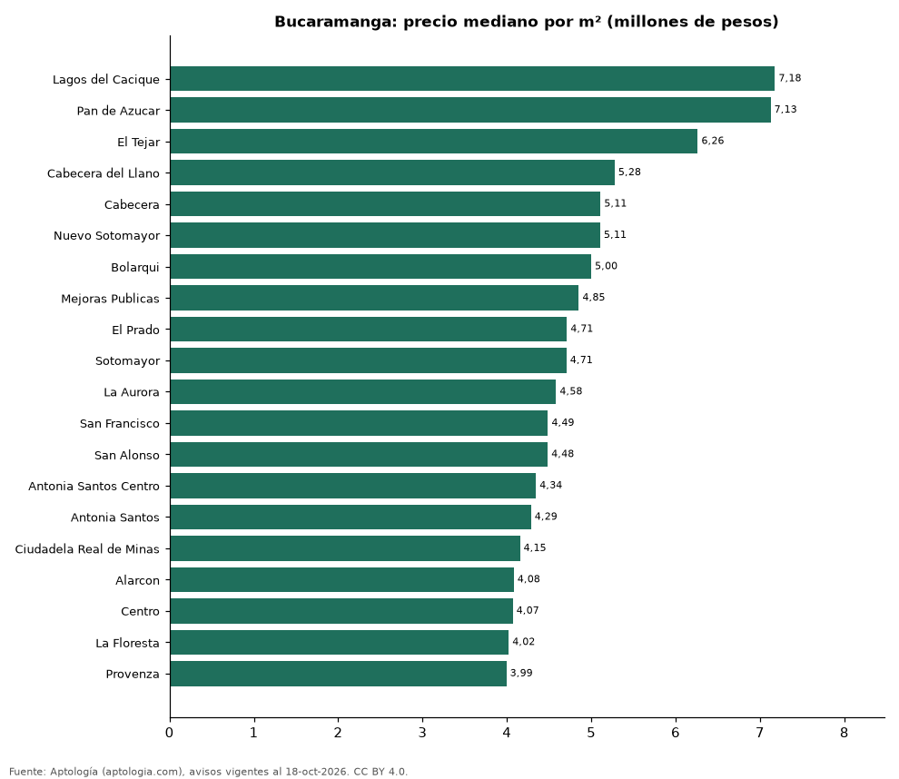

# Barrios más caros y más baratos de Bucaramanga para comprar apartamento: ranking por m² (octubre 2026)

**En Bucaramanga, el barrio con el m² más caro para comprar apartamento es Lagos del Cacique (7,18 millones de pesos/m²) y el más barato Provenza (3,99 millones de pesos/m²), 1,8 veces menos.** Comparamos 20 barrios con al menos 30 avisos con área.

*Resumen: analizamos 1.565 apartamentos en venta con área declarada en 20 barrios de Bucaramanga.*

**Actualizado:** 18 de octubre de 2026 (datos del 18 de octubre de 2026) · **Próxima actualización:** mensual.

## Resumen

| Indicador | Valor |
|---|---|
| Más caro por m² | Lagos del Cacique: 7,18 millones de pesos |
| Más barato por m² | Provenza: 3,99 millones de pesos |
| Diferencia | 1,8 veces |
| Barrios | 20 |

## Ranking de barrios por precio del m²

| Barrio | Por m² (mediana) | Precio (mediana) | Área mediana (m²) | Avisos con área |
|---|---|---|---|---|
| Lagos del Cacique | 7,18 millones de pesos | 935 millones de pesos | 120 | 30 |
| Pan de Azucar | 7,13 millones de pesos | 660 millones de pesos | 100 | 39 |
| El Tejar | 6,26 millones de pesos | 650 millones de pesos | 99 | 79 |
| Cabecera del Llano | 5,28 millones de pesos | 750 millones de pesos | 152 | 353 |
| Cabecera | 5,11 millones de pesos | 840 millones de pesos | 172 | 31 |
| Nuevo Sotomayor | 5,11 millones de pesos | 480 millones de pesos | 98 | 63 |
| Bolarqui | 5,00 millones de pesos | 589 millones de pesos | 129 | 36 |
| Mejoras Publicas | 4,85 millones de pesos | 480 millones de pesos | 91 | 94 |
| El Prado | 4,71 millones de pesos | 435 millones de pesos | 96 | 53 |
| Sotomayor | 4,71 millones de pesos | 600 millones de pesos | 113 | 213 |
| La Aurora | 4,58 millones de pesos | 475 millones de pesos | 94 | 61 |
| San Francisco | 4,49 millones de pesos | 315 millones de pesos | 69 | 99 |
| San Alonso | 4,48 millones de pesos | 410 millones de pesos | 88 | 65 |
| Antonia Santos Centro | 4,34 millones de pesos | 335 millones de pesos | 80 | 63 |
| Antonia Santos | 4,29 millones de pesos | 330 millones de pesos | 76 | 41 |
| Ciudadela Real de Minas | 4,15 millones de pesos | 425 millones de pesos | 100 | 64 |
| Alarcon | 4,08 millones de pesos | 290 millones de pesos | 72 | 34 |
| Centro | 4,07 millones de pesos | 320 millones de pesos | 72 | 41 |
| La Floresta | 4,02 millones de pesos | 450 millones de pesos | 110 | 48 |
| Provenza | 3,99 millones de pesos | 352 millones de pesos | 82 | 58 |

Medianas; solo barrios con 30 avisos o más con área declarada.

## Preguntas frecuentes

**¿Cuál es el barrio más caro de Bucaramanga para comprar?**
Lagos del Cacique, con 7,18 millones de pesos por m² en la mediana (octubre de 2026).

**¿Y el más barato?**
Provenza, con 3,99 millones de pesos por m².

## Metodología

- **Fuente:** exportes nocturnos de la base de datos de Aptología (aptologia.com) del 18 de octubre de 2026: avisos vigentes de vivienda en portales inmobiliarios de 13 países, recogidos por Aptología y vistos en línea entre el 11 y el 18 de octubre de 2026. Corte: 18 de octubre de 2026.
- **Depuración:** se eliminan duplicados exactos (misma ciudad, zona, tipo, precio, moneda, área, habitaciones y baños) y los precios fuera del percentil 1–99 de cada país, operación, moneda y tipo; el precio por m² usa solo avisos con área declarada entre 12 y 2.000 m² y también se recorta al P1–P99.
- **Qué se mide:** precios pedidos (publicados), no precios de cierre. En arriendo, el canon mensual sin administración, gastos comunes ni condominio.
- **Muestra mínima:** cada cifra publicada se apoya en al menos 30 avisos; las celdas con menos se omiten.
- **Colombia:** Precios en pesos colombianos, sin conversión de moneda.
- **Limitaciones:** la cobertura depende de los portales que recorre Aptología en cada país y es mayor en las ciudades grandes y en los segmentos medio-alto y alto; el área es la que declara el aviso, sin verificar; los nombres de zona vienen de los portales.
- **Privacidad:** solo se publican agregados; no se publica ningún dato personal, enlace a avisos ni nombre de anunciante.
- **Datos abiertos:** [datos.csv](datos.csv), licencia CC BY 4.0.

## Cómo citar

Pinzón Pineda, D. M. (2026). *Barrios más caros y más baratos de Bucaramanga para comprar apartamento: ranking por m² (octubre 2026)*. Aptología (aptologia.com). https://github.com/elbroker/aptologia-datos/tree/main/estudios/barrios-mas-caros-y-baratos-bucaramanga-venta-m2-2026. Datos: datos.csv, licencia CC BY 4.0.
