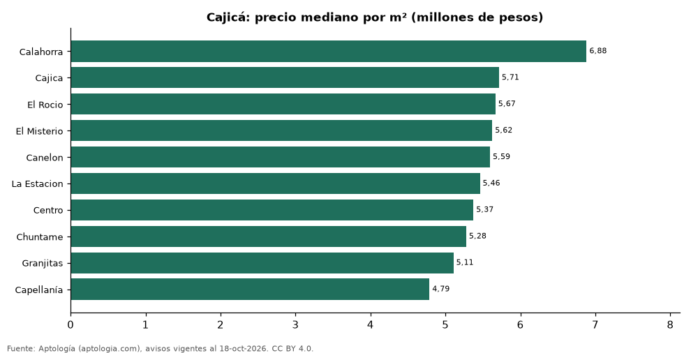

# Barrios más caros y más baratos de Cajicá para comprar apartamento: ranking por m² (octubre 2026)

**En Cajicá, el barrio con el m² más caro para comprar apartamento es Calahorra (6,88 millones de pesos/m²) y el más barato Capellanía (4,79 millones de pesos/m²), 1,4 veces menos.** Comparamos 10 barrios con al menos 30 avisos con área.

*Resumen: analizamos 856 apartamentos en venta con área declarada en 10 barrios de Cajicá.*

**Actualizado:** 18 de octubre de 2026 (datos del 18 de octubre de 2026) · **Próxima actualización:** mensual.

## Resumen

| Indicador | Valor |
|---|---|
| Más caro por m² | Calahorra: 6,88 millones de pesos |
| Más barato por m² | Capellanía: 4,79 millones de pesos |
| Diferencia | 1,4 veces |
| Barrios | 10 |

## Ranking de barrios por precio del m²

| Barrio | Por m² (mediana) | Precio (mediana) | Área mediana (m²) | Avisos con área |
|---|---|---|---|---|
| Calahorra | 6,88 millones de pesos | 540 millones de pesos | 78 | 99 |
| Cajica | 5,71 millones de pesos | 398 millones de pesos | 71 | 186 |
| El Rocio | 5,67 millones de pesos | 360 millones de pesos | 65 | 36 |
| El Misterio | 5,62 millones de pesos | 338 millones de pesos | 58 | 58 |
| Canelon | 5,59 millones de pesos | 385 millones de pesos | 72 | 70 |
| La Estacion | 5,46 millones de pesos | 440 millones de pesos | 78 | 83 |
| Centro | 5,37 millones de pesos | 370 millones de pesos | 72 | 129 |
| Chuntame | 5,28 millones de pesos | 329 millones de pesos | 60 | 123 |
| Granjitas | 5,11 millones de pesos | 300 millones de pesos | 50 | 39 |
| Capellanía | 4,79 millones de pesos | 260 millones de pesos | 56 | 33 |

Medianas; solo barrios con 30 avisos o más con área declarada.

## Preguntas frecuentes

**¿Cuál es el barrio más caro de Cajicá para comprar?**
Calahorra, con 6,88 millones de pesos por m² en la mediana (octubre de 2026).

**¿Y el más barato?**
Capellanía, con 4,79 millones de pesos por m².

## Metodología

- **Fuente:** exportes nocturnos de la base de datos de Aptología (aptologia.com) del 18 de octubre de 2026: avisos vigentes de vivienda en portales inmobiliarios de 13 países, recogidos por Aptología y vistos en línea entre el 11 y el 18 de octubre de 2026. Corte: 18 de octubre de 2026.
- **Depuración:** se eliminan duplicados exactos (misma ciudad, zona, tipo, precio, moneda, área, habitaciones y baños) y los precios fuera del percentil 1–99 de cada país, operación, moneda y tipo; el precio por m² usa solo avisos con área declarada entre 12 y 2.000 m² y también se recorta al P1–P99.
- **Qué se mide:** precios pedidos (publicados), no precios de cierre. En arriendo, el canon mensual sin administración, gastos comunes ni condominio.
- **Muestra mínima:** cada cifra publicada se apoya en al menos 30 avisos; las celdas con menos se omiten.
- **Colombia:** Precios en pesos colombianos, sin conversión de moneda.
- **Limitaciones:** la cobertura depende de los portales que recorre Aptología en cada país y es mayor en las ciudades grandes y en los segmentos medio-alto y alto; el área es la que declara el aviso, sin verificar; los nombres de zona vienen de los portales.
- **Privacidad:** solo se publican agregados; no se publica ningún dato personal, enlace a avisos ni nombre de anunciante.
- **Datos abiertos:** [datos.csv](datos.csv), licencia CC BY 4.0.

## Cómo citar

Pinzón Pineda, D. M. (2026). *Barrios más caros y más baratos de Cajicá para comprar apartamento: ranking por m² (octubre 2026)*. Aptología (aptologia.com). https://github.com/elbroker/aptologia-datos/tree/main/estudios/barrios-mas-caros-y-baratos-cajica-venta-m2-2026. Datos: datos.csv, licencia CC BY 4.0.
