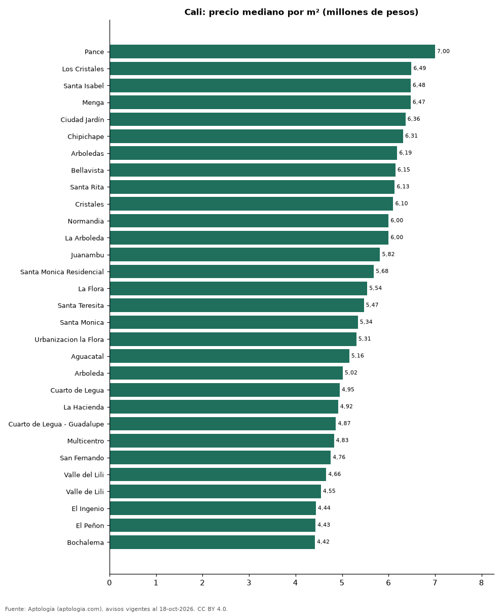

# Barrios más caros y más baratos de Cali para comprar apartamento: ranking por m² (octubre 2026)

**En Cali, el barrio con el m² más caro para comprar apartamento es Pance (7,00 millones de pesos/m²) y el más barato Torres de Comfandi (3,10 millones de pesos/m²), 2,3 veces menos.** Comparamos 66 barrios con al menos 30 avisos con área.

*Resumen: analizamos 7.370 apartamentos en venta con área declarada en 66 barrios de Cali.*

**Actualizado:** 18 de octubre de 2026 (datos del 18 de octubre de 2026) · **Próxima actualización:** mensual.

## Resumen

| Indicador | Valor |
|---|---|
| Más caro por m² | Pance: 7,00 millones de pesos |
| Más barato por m² | Torres de Comfandi: 3,10 millones de pesos |
| Diferencia | 2,3 veces |
| Barrios | 66 |

## Ranking de barrios por precio del m²

| Barrio | Por m² (mediana) | Precio (mediana) | Área mediana (m²) | Avisos con área |
|---|---|---|---|---|
| Pance | 7,00 millones de pesos | 950 millones de pesos | 135 | 483 |
| Los Cristales | 6,49 millones de pesos | 785 millones de pesos | 123 | 46 |
| Santa Isabel | 6,48 millones de pesos | 644 millones de pesos | 98 | 92 |
| Menga | 6,47 millones de pesos | 900 millones de pesos | 130 | 92 |
| Ciudad Jardín | 6,36 millones de pesos | 820 millones de pesos | 136 | 397 |
| Chipichape | 6,31 millones de pesos | 550 millones de pesos | 110 | 63 |
| Arboledas | 6,19 millones de pesos | 995 millones de pesos | 180 | 71 |
| Bellavista | 6,15 millones de pesos | 850 millones de pesos | 136 | 223 |
| Santa Rita | 6,13 millones de pesos | 1.350 millones de pesos | 226 | 80 |
| Cristales | 6,10 millones de pesos | 750 millones de pesos | 126 | 194 |
| Normandia | 6,00 millones de pesos | 1.500 millones de pesos | 228 | 229 |
| La Arboleda | 6,00 millones de pesos | 910 millones de pesos | 183 | 79 |
| Juanambu | 5,82 millones de pesos | 830 millones de pesos | 160 | 100 |
| Santa Monica Residencial | 5,68 millones de pesos | 990 millones de pesos | 164 | 38 |
| La Flora | 5,54 millones de pesos | 520 millones de pesos | 98 | 138 |
| Santa Teresita | 5,47 millones de pesos | 950 millones de pesos | 180 | 364 |
| Santa Monica | 5,34 millones de pesos | 950 millones de pesos | 177 | 129 |
| Urbanizacion la Flora | 5,31 millones de pesos | 472 millones de pesos | 90 | 74 |
| Aguacatal | 5,16 millones de pesos | 910 millones de pesos | 178 | 125 |
| Arboleda | 5,02 millones de pesos | 896 millones de pesos | 184 | 40 |
| Cuarto de Legua | 4,95 millones de pesos | 500 millones de pesos | 106 | 44 |
| La Hacienda | 4,92 millones de pesos | 408 millones de pesos | 88 | 102 |
| Cuarto de Legua - Guadalupe | 4,87 millones de pesos | 534 millones de pesos | 110 | 44 |
| Multicentro | 4,83 millones de pesos | 480 millones de pesos | 88 | 35 |
| San Fernando | 4,76 millones de pesos | 585 millones de pesos | 104 | 31 |
| Valle del Lili | 4,66 millones de pesos | 350 millones de pesos | 75 | 797 |
| Valle de Lili | 4,55 millones de pesos | 358 millones de pesos | 78 | 164 |
| El Ingenio | 4,44 millones de pesos | 475 millones de pesos | 104 | 200 |
| El Peñon | 4,43 millones de pesos | 725 millones de pesos | 147 | 46 |
| Bochalema | 4,42 millones de pesos | 281 millones de pesos | 66 | 556 |
| Ciudad Melendez | 4,35 millones de pesos | 266 millones de pesos | 64 | 262 |
| La Selva | 4,34 millones de pesos | 290 millones de pesos | 60 | 55 |
| Prados del Norte | 4,34 millones de pesos | 364 millones de pesos | 74 | 88 |
| Quintas de Don Simón | 4,33 millones de pesos | 400 millones de pesos | 92 | 75 |
| San Fernando Viejo | 4,25 millones de pesos | 485 millones de pesos | 108 | 30 |
| San Pedro | 4,24 millones de pesos | 450 millones de pesos | 96 | 34 |
| Cachipay | 4,17 millones de pesos | 250 millones de pesos | 60 | 94 |
| Villa Fátima | 4,17 millones de pesos | 239 millones de pesos | 59 | 41 |
| Hacienda Kachipay | 4,15 millones de pesos | 252 millones de pesos | 61 | 61 |
| Caney | 4,08 millones de pesos | 278 millones de pesos | 65 | 124 |
| Brisas de los Alamos | 4,07 millones de pesos | 220 millones de pesos | 57 | 61 |
| Ciudad Capri | 4,07 millones de pesos | 375 millones de pesos | 95 | 47 |
| Miraflores | 4,06 millones de pesos | 450 millones de pesos | 115 | 37 |
| Kachipay | 4,06 millones de pesos | 248 millones de pesos | 60 | 65 |
| Los Cambulos | 4,04 millones de pesos | 400 millones de pesos | 89 | 32 |
| Ciudad 2000 | 4,03 millones de pesos | 221 millones de pesos | 55 | 40 |
| Ciudad Pacífica | 4,02 millones de pesos | 240 millones de pesos | 60 | 141 |
| Ciudad Pacifica | 4,00 millones de pesos | 239 millones de pesos | 62 | 89 |
| Santa Anita | 3,98 millones de pesos | 325 millones de pesos | 82 | 76 |
| El Caney | 3,98 millones de pesos | 240 millones de pesos | 65 | 37 |
| Nueva Tequendama | 3,95 millones de pesos | 420 millones de pesos | 102 | 32 |
| Vegas de Comfandi | 3,92 millones de pesos | 240 millones de pesos | 56 | 41 |
| El Limonar | 3,92 millones de pesos | 290 millones de pesos | 77 | 63 |
| Primero de Mayo | 3,91 millones de pesos | 260 millones de pesos | 65 | 51 |
| Las Vegas de Comfandi | 3,89 millones de pesos | 235 millones de pesos | 55 | 46 |
| Granada | 3,86 millones de pesos | 580 millones de pesos | 139 | 71 |
| Camino Real | 3,81 millones de pesos | 280 millones de pesos | 76 | 41 |
| El Refugio | 3,77 millones de pesos | 290 millones de pesos | 72 | 75 |
| Tequendama | 3,75 millones de pesos | 480 millones de pesos | 115 | 32 |
| Colseguros Andes | 3,75 millones de pesos | 246 millones de pesos | 64 | 32 |
| Cañaverales | 3,68 millones de pesos | 217 millones de pesos | 60 | 50 |
| Centenario | 3,66 millones de pesos | 550 millones de pesos | 152 | 57 |
| Ciudad Guabinas | 3,64 millones de pesos | 182 millones de pesos | 50 | 38 |
| Melendez | 3,62 millones de pesos | 240 millones de pesos | 63 | 54 |
| Versalles | 3,31 millones de pesos | 455 millones de pesos | 145 | 85 |
| Torres de Comfandi | 3,10 millones de pesos | 175 millones de pesos | 55 | 37 |

Medianas; solo barrios con 30 avisos o más con área declarada.

## Preguntas frecuentes

**¿Cuál es el barrio más caro de Cali para comprar?**
Pance, con 7,00 millones de pesos por m² en la mediana (octubre de 2026).

**¿Y el más barato?**
Torres de Comfandi, con 3,10 millones de pesos por m².

## Metodología

- **Fuente:** exportes nocturnos de la base de datos de Aptología (aptologia.com) del 18 de octubre de 2026: avisos vigentes de vivienda en portales inmobiliarios de 13 países, recogidos por Aptología y vistos en línea entre el 11 y el 18 de octubre de 2026. Corte: 18 de octubre de 2026.
- **Depuración:** se eliminan duplicados exactos (misma ciudad, zona, tipo, precio, moneda, área, habitaciones y baños) y los precios fuera del percentil 1–99 de cada país, operación, moneda y tipo; el precio por m² usa solo avisos con área declarada entre 12 y 2.000 m² y también se recorta al P1–P99.
- **Qué se mide:** precios pedidos (publicados), no precios de cierre. En arriendo, el canon mensual sin administración, gastos comunes ni condominio.
- **Muestra mínima:** cada cifra publicada se apoya en al menos 30 avisos; las celdas con menos se omiten.
- **Colombia:** Precios en pesos colombianos, sin conversión de moneda.
- **Limitaciones:** la cobertura depende de los portales que recorre Aptología en cada país y es mayor en las ciudades grandes y en los segmentos medio-alto y alto; el área es la que declara el aviso, sin verificar; los nombres de zona vienen de los portales.
- **Privacidad:** solo se publican agregados; no se publica ningún dato personal, enlace a avisos ni nombre de anunciante.
- **Datos abiertos:** [datos.csv](datos.csv), licencia CC BY 4.0.

## Cómo citar

Pinzón Pineda, D. M. (2026). *Barrios más caros y más baratos de Cali para comprar apartamento: ranking por m² (octubre 2026)*. Aptología (aptologia.com). https://github.com/elbroker/aptologia-datos/tree/main/estudios/barrios-mas-caros-y-baratos-cali-venta-m2-2026. Datos: datos.csv, licencia CC BY 4.0.
