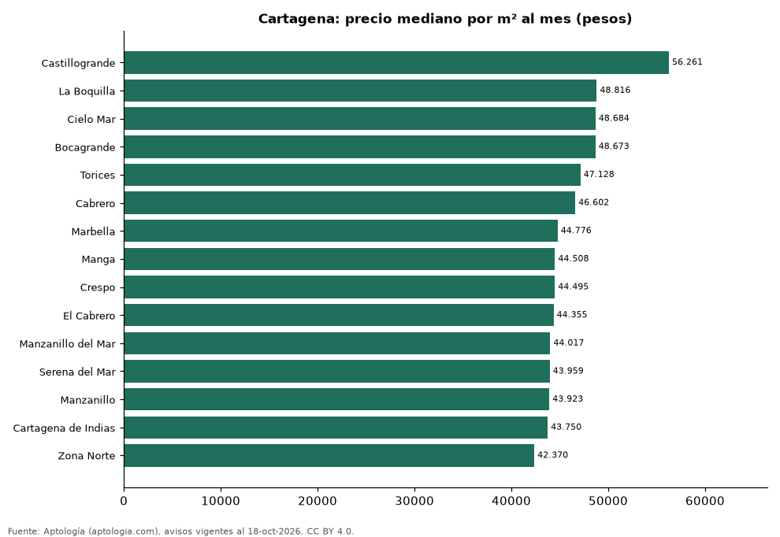

# Barrios más caros y más baratos de Cartagena para arrendar apartamento: ranking por m² (octubre 2026)

**En Cartagena, el barrio con el m² más caro para arrendar apartamento es Castillogrande (56.261 pesos/m² al mes) y el más barato Zona Norte (42.370 pesos/m² al mes), 1,3 veces menos.** Comparamos 15 barrios con al menos 30 avisos con área.

*Resumen: analizamos 1.541 apartamentos en arriendo con área declarada en 15 barrios de Cartagena.*

**Actualizado:** 18 de octubre de 2026 (datos del 18 de octubre de 2026) · **Próxima actualización:** mensual.

## Resumen

| Indicador | Valor |
|---|---|
| Más caro por m² | Castillogrande: 56.261 pesos |
| Más barato por m² | Zona Norte: 42.370 pesos |
| Diferencia | 1,3 veces |
| Barrios | 15 |

## Ranking de barrios por precio del m²

| Barrio | Por m² (mediana) | Canon (mediana) | Área mediana (m²) | Avisos con área |
|---|---|---|---|---|
| Castillogrande | 56.261 pesos | 7.500.000 pesos | 142 | 76 |
| La Boquilla | 48.816 pesos | 4.500.000 pesos | 94 | 152 |
| Cielo Mar | 48.684 pesos | 4.800.000 pesos | 88 | 48 |
| Bocagrande | 48.673 pesos | 5.000.000 pesos | 110 | 185 |
| Torices | 47.128 pesos | 2.600.000 pesos | 56 | 52 |
| Cabrero | 46.602 pesos | 4.300.000 pesos | 100 | 37 |
| Marbella | 44.776 pesos | 3.800.000 pesos | 90 | 99 |
| Manga | 44.508 pesos | 5.000.000 pesos | 115 | 160 |
| Crespo | 44.495 pesos | 4.000.000 pesos | 90 | 112 |
| El Cabrero | 44.355 pesos | 4.000.000 pesos | 102 | 75 |
| Manzanillo del Mar | 44.017 pesos | 2.700.000 pesos | 59 | 56 |
| Serena del Mar | 43.959 pesos | 3.120.000 pesos | 72 | 354 |
| Manzanillo | 43.923 pesos | 2.825.000 pesos | 63 | 64 |
| Cartagena de Indias | 43.750 pesos | 3.500.000 pesos | 77 | 35 |
| Zona Norte | 42.370 pesos | 3.790.506 pesos | 85 | 36 |

Medianas; solo barrios con 30 avisos o más con área declarada.

## Preguntas frecuentes

**¿Cuál es el barrio más caro de Cartagena para arrendar?**
Castillogrande, con 56.261 pesos por m² al mes en la mediana (octubre de 2026).

**¿Y el más barato?**
Zona Norte, con 42.370 pesos por m² al mes.

## Metodología

- **Fuente:** exportes nocturnos de la base de datos de Aptología (aptologia.com) del 18 de octubre de 2026: avisos vigentes de vivienda en portales inmobiliarios de 13 países, recogidos por Aptología y vistos en línea entre el 11 y el 18 de octubre de 2026. Corte: 18 de octubre de 2026.
- **Depuración:** se eliminan duplicados exactos (misma ciudad, zona, tipo, precio, moneda, área, habitaciones y baños) y los precios fuera del percentil 1–99 de cada país, operación, moneda y tipo; el precio por m² usa solo avisos con área declarada entre 12 y 2.000 m² y también se recorta al P1–P99.
- **Qué se mide:** precios pedidos (publicados), no precios de cierre. En arriendo, el canon mensual sin administración, gastos comunes ni condominio.
- **Muestra mínima:** cada cifra publicada se apoya en al menos 30 avisos; las celdas con menos se omiten.
- **Colombia:** Precios en pesos colombianos, sin conversión de moneda.
- **Limitaciones:** la cobertura depende de los portales que recorre Aptología en cada país y es mayor en las ciudades grandes y en los segmentos medio-alto y alto; el área es la que declara el aviso, sin verificar; los nombres de zona vienen de los portales.
- **Privacidad:** solo se publican agregados; no se publica ningún dato personal, enlace a avisos ni nombre de anunciante.
- **Datos abiertos:** [datos.csv](datos.csv), licencia CC BY 4.0.

## Cómo citar

Pinzón Pineda, D. M. (2026). *Barrios más caros y más baratos de Cartagena para arrendar apartamento: ranking por m² (octubre 2026)*. Aptología (aptologia.com). https://github.com/elbroker/aptologia-datos/tree/main/estudios/barrios-mas-caros-y-baratos-cartagena-arriendo-m2-2026. Datos: datos.csv, licencia CC BY 4.0.
