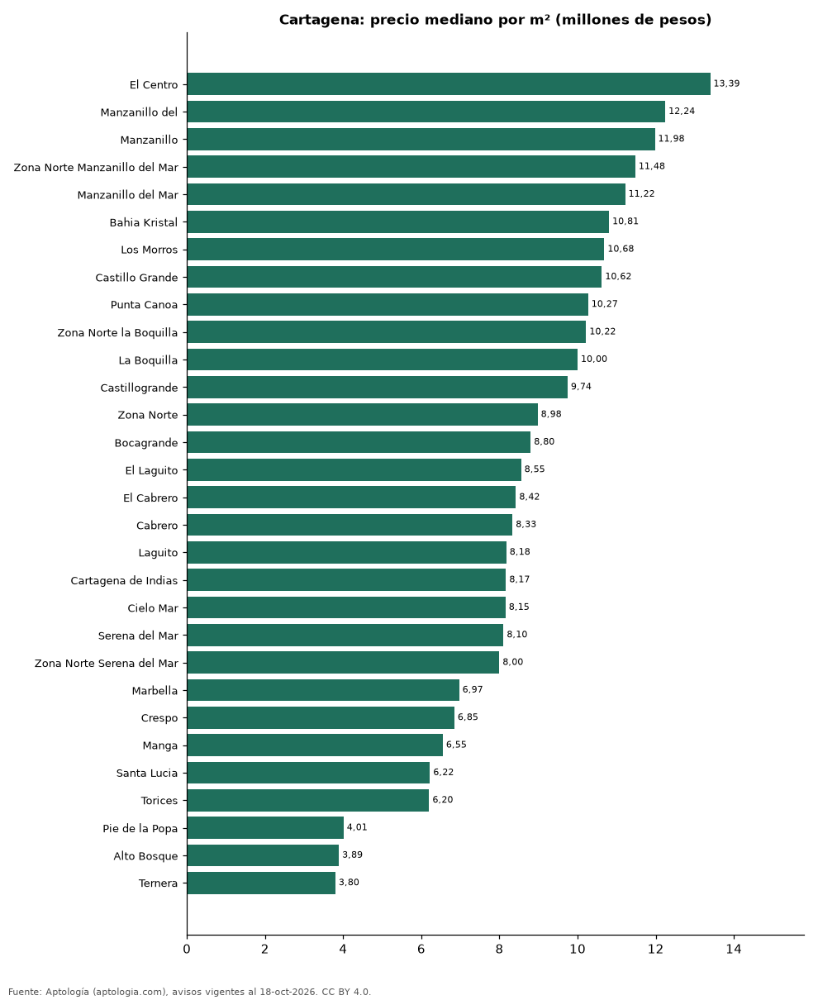

# Barrios más caros y más baratos de Cartagena para comprar apartamento: ranking por m² (octubre 2026)

**En Cartagena, el barrio con el m² más caro para comprar apartamento es El Centro (13,39 millones de pesos/m²) y el más barato Ternera (3,80 millones de pesos/m²), 3,5 veces menos.** Comparamos 30 barrios con al menos 30 avisos con área.

*Resumen: analizamos 4.566 apartamentos en venta con área declarada en 30 barrios de Cartagena.*

**Actualizado:** 18 de octubre de 2026 (datos del 18 de octubre de 2026) · **Próxima actualización:** mensual.

## Resumen

| Indicador | Valor |
|---|---|
| Más caro por m² | El Centro: 13,39 millones de pesos |
| Más barato por m² | Ternera: 3,80 millones de pesos |
| Diferencia | 3,5 veces |
| Barrios | 30 |

## Ranking de barrios por precio del m²

| Barrio | Por m² (mediana) | Precio (mediana) | Área mediana (m²) | Avisos con área |
|---|---|---|---|---|
| El Centro | 13,39 millones de pesos | 1.165 millones de pesos | 82 | 33 |
| Manzanillo del | 12,24 millones de pesos | 1.050 millones de pesos | 87 | 31 |
| Manzanillo | 11,98 millones de pesos | 1.025 millones de pesos | 83 | 124 |
| Zona Norte Manzanillo del Mar | 11,48 millones de pesos | 1.150 millones de pesos | 101 | 32 |
| Manzanillo del Mar | 11,22 millones de pesos | 1.020 millones de pesos | 83 | 69 |
| Bahia Kristal | 10,81 millones de pesos | 726 millones de pesos | 70 | 34 |
| Los Morros | 10,68 millones de pesos | 1.020 millones de pesos | 105 | 31 |
| Castillo Grande | 10,62 millones de pesos | 1.250 millones de pesos | 145 | 44 |
| Punta Canoa | 10,27 millones de pesos | 1.750 millones de pesos | 178 | 30 |
| Zona Norte la Boquilla | 10,22 millones de pesos | 1.275 millones de pesos | 115 | 32 |
| La Boquilla | 10,00 millones de pesos | 1.050 millones de pesos | 106 | 384 |
| Castillogrande | 9,74 millones de pesos | 1.400 millones de pesos | 155 | 265 |
| Zona Norte | 8,98 millones de pesos | 825 millones de pesos | 104 | 122 |
| Bocagrande | 8,80 millones de pesos | 1.000 millones de pesos | 125 | 686 |
| El Laguito | 8,55 millones de pesos | 729 millones de pesos | 84 | 267 |
| El Cabrero | 8,42 millones de pesos | 820 millones de pesos | 100 | 117 |
| Cabrero | 8,33 millones de pesos | 892 millones de pesos | 110 | 50 |
| Laguito | 8,18 millones de pesos | 774 millones de pesos | 99 | 32 |
| Cartagena de Indias | 8,17 millones de pesos | 800 millones de pesos | 102 | 288 |
| Cielo Mar | 8,15 millones de pesos | 822 millones de pesos | 100 | 148 |
| Serena del Mar | 8,10 millones de pesos | 625 millones de pesos | 77 | 517 |
| Zona Norte Serena del Mar | 8,00 millones de pesos | 600 millones de pesos | 78 | 62 |
| Marbella | 6,97 millones de pesos | 680 millones de pesos | 100 | 176 |
| Crespo | 6,85 millones de pesos | 697 millones de pesos | 105 | 280 |
| Manga | 6,55 millones de pesos | 740 millones de pesos | 118 | 393 |
| Santa Lucia | 6,22 millones de pesos | 620 millones de pesos | 96 | 32 |
| Torices | 6,20 millones de pesos | 335 millones de pesos | 56 | 110 |
| Pie de la Popa | 4,01 millones de pesos | 370 millones de pesos | 92 | 102 |
| Alto Bosque | 3,89 millones de pesos | 320 millones de pesos | 88 | 35 |
| Ternera | 3,80 millones de pesos | 270 millones de pesos | 60 | 40 |

Medianas; solo barrios con 30 avisos o más con área declarada.

## Preguntas frecuentes

**¿Cuál es el barrio más caro de Cartagena para comprar?**
El Centro, con 13,39 millones de pesos por m² en la mediana (octubre de 2026).

**¿Y el más barato?**
Ternera, con 3,80 millones de pesos por m².

## Metodología

- **Fuente:** exportes nocturnos de la base de datos de Aptología (aptologia.com) del 18 de octubre de 2026: avisos vigentes de vivienda en portales inmobiliarios de 13 países, recogidos por Aptología y vistos en línea entre el 11 y el 18 de octubre de 2026. Corte: 18 de octubre de 2026.
- **Depuración:** se eliminan duplicados exactos (misma ciudad, zona, tipo, precio, moneda, área, habitaciones y baños) y los precios fuera del percentil 1–99 de cada país, operación, moneda y tipo; el precio por m² usa solo avisos con área declarada entre 12 y 2.000 m² y también se recorta al P1–P99.
- **Qué se mide:** precios pedidos (publicados), no precios de cierre. En arriendo, el canon mensual sin administración, gastos comunes ni condominio.
- **Muestra mínima:** cada cifra publicada se apoya en al menos 30 avisos; las celdas con menos se omiten.
- **Colombia:** Precios en pesos colombianos, sin conversión de moneda.
- **Limitaciones:** la cobertura depende de los portales que recorre Aptología en cada país y es mayor en las ciudades grandes y en los segmentos medio-alto y alto; el área es la que declara el aviso, sin verificar; los nombres de zona vienen de los portales.
- **Privacidad:** solo se publican agregados; no se publica ningún dato personal, enlace a avisos ni nombre de anunciante.
- **Datos abiertos:** [datos.csv](datos.csv), licencia CC BY 4.0.

## Cómo citar

Pinzón Pineda, D. M. (2026). *Barrios más caros y más baratos de Cartagena para comprar apartamento: ranking por m² (octubre 2026)*. Aptología (aptologia.com). https://github.com/elbroker/aptologia-datos/tree/main/estudios/barrios-mas-caros-y-baratos-cartagena-venta-m2-2026. Datos: datos.csv, licencia CC BY 4.0.
