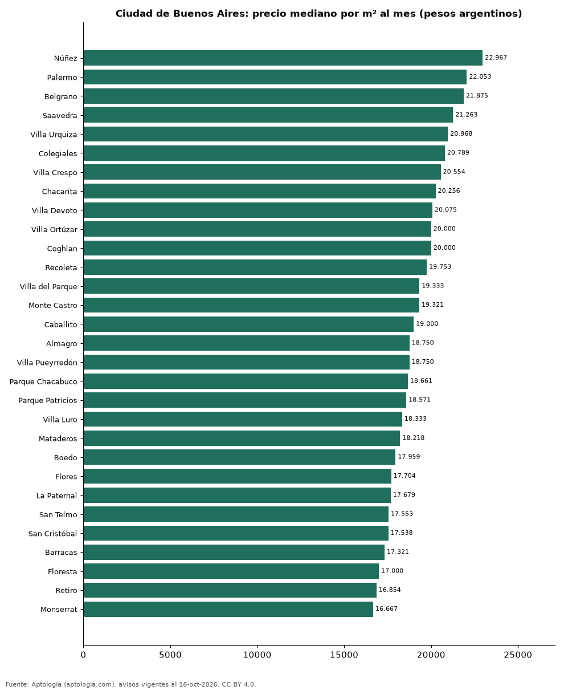

# Barrios más caros y más baratos de Ciudad de Buenos Aires para alquilar departamento: ranking por m² (octubre 2026)

**En Ciudad de Buenos Aires, el barrio con el m² más caro para alquilar departamento es Núñez (22.967,0 pesos argentinos (USD 15,2)/m² al mes) y el más barato Villa Lugano (14.124,1 pesos argentinos (USD 9,3)/m² al mes), 1,6 veces menos.** Comparamos 35 barrios con al menos 30 avisos con área.

*Resumen: analizamos 2.838 departamentos en alquiler con área declarada en 35 barrios de Ciudad de Buenos Aires.*

**Actualizado:** 18 de octubre de 2026 (datos del 18 de octubre de 2026) · **Próxima actualización:** mensual.

## Resumen

| Indicador | Valor |
|---|---|
| Más caro por m² | Núñez: 22.967,0 pesos argentinos (USD 15,2) |
| Más barato por m² | Villa Lugano: 14.124,1 pesos argentinos (USD 9,3) |
| Diferencia | 1,6 veces |
| Barrios | 35 |

## Ranking de barrios por precio del m²

| Barrio | Por m² (mediana) | Canon (mediana) | Área mediana (m²) | Avisos con área |
|---|---|---|---|---|
| Núñez | 22.967,0 pesos argentinos (USD 15,2) | 1.125.000 pesos argentinos (USD 743) | 50 | 74 |
| Palermo | 22.052,6 pesos argentinos (USD 14,6) | 1.089.000 pesos argentinos (USD 719) | 48 | 258 |
| Belgrano | 21.875,0 pesos argentinos (USD 14,4) | 1.150.000 pesos argentinos (USD 759) | 50 | 159 |
| Saavedra | 21.263,3 pesos argentinos (USD 14,0) | 1.000.000 pesos argentinos (USD 660) | 45 | 56 |
| Villa Urquiza | 20.967,7 pesos argentinos (USD 13,8) | 1.100.000 pesos argentinos (USD 726) | 50 | 103 |
| Colegiales | 20.789,5 pesos argentinos (USD 13,7) | 900.000 pesos argentinos (USD 594) | 43 | 75 |
| Villa Crespo | 20.553,6 pesos argentinos (USD 13,6) | 1.000.000 pesos argentinos (USD 660) | 47 | 88 |
| Chacarita | 20.256,4 pesos argentinos (USD 13,4) | 750.000 pesos argentinos (USD 495) | 38 | 40 |
| Villa Devoto | 20.074,6 pesos argentinos (USD 13,3) | 900.000 pesos argentinos (USD 594) | 48 | 94 |
| Villa Ortúzar | 20.000,0 pesos argentinos (USD 13,2) | 900.000 pesos argentinos (USD 594) | 43 | 34 |
| Coghlan | 20.000,0 pesos argentinos (USD 13,2) | 880.000 pesos argentinos (USD 581) | 47 | 34 |
| Recoleta | 19.753,1 pesos argentinos (USD 13,0) | 1.000.000 pesos argentinos (USD 660) | 50 | 179 |
| Villa del Parque | 19.333,3 pesos argentinos (USD 12,8) | 850.000 pesos argentinos (USD 561) | 49 | 89 |
| Monte Castro | 19.321,3 pesos argentinos (USD 12,8) | 800.000 pesos argentinos (USD 528) | 42 | 40 |
| Caballito | 19.000,0 pesos argentinos (USD 12,5) | 1.200.000 pesos argentinos (USD 792) | 60 | 135 |
| Almagro | 18.750,0 pesos argentinos (USD 12,4) | 982.500 pesos argentinos (USD 649) | 52 | 120 |
| Villa Pueyrredón | 18.750,0 pesos argentinos (USD 12,4) | 800.000 pesos argentinos (USD 528) | 42 | 59 |
| Parque Chacabuco | 18.660,7 pesos argentinos (USD 12,3) | 840.000 pesos argentinos (USD 555) | 46 | 56 |
| Parque Patricios | 18.571,4 pesos argentinos (USD 12,3) | 750.000 pesos argentinos (USD 495) | 39 | 35 |
| Villa Luro | 18.333,3 pesos argentinos (USD 12,1) | 780.000 pesos argentinos (USD 515) | 43 | 65 |
| Mataderos | 18.218,4 pesos argentinos (USD 12,0) | 800.000 pesos argentinos (USD 528) | 44 | 54 |
| Boedo | 17.959,2 pesos argentinos (USD 11,9) | 780.000 pesos argentinos (USD 515) | 43 | 69 |
| Flores | 17.704,3 pesos argentinos (USD 11,7) | 890.000 pesos argentinos (USD 588) | 52 | 124 |
| La Paternal | 17.678,6 pesos argentinos (USD 11,7) | 785.000 pesos argentinos (USD 518) | 44 | 36 |
| San Telmo | 17.553,2 pesos argentinos (USD 11,6) | 850.000 pesos argentinos (USD 561) | 50 | 59 |
| San Cristóbal | 17.537,9 pesos argentinos (USD 11,6) | 715.000 pesos argentinos (USD 472) | 40 | 70 |
| Barracas | 17.321,4 pesos argentinos (USD 11,4) | 910.000 pesos argentinos (USD 601) | 50 | 58 |
| Floresta | 17.000,0 pesos argentinos (USD 11,2) | 700.000 pesos argentinos (USD 462) | 44 | 71 |
| Retiro | 16.853,9 pesos argentinos (USD 11,1) | 850.000 pesos argentinos (USD 561) | 44 | 51 |
| Monserrat | 16.666,7 pesos argentinos (USD 11,0) | 790.000 pesos argentinos (USD 522) | 45 | 61 |
| Liniers | 16.666,7 pesos argentinos (USD 11,0) | 740.000 pesos argentinos (USD 489) | 45 | 64 |
| Balvanera | 16.628,8 pesos argentinos (USD 11,0) | 800.000 pesos argentinos (USD 528) | 48 | 152 |
| La Boca | 16.095,2 pesos argentinos (USD 10,6) | 725.000 pesos argentinos (USD 479) | 46 | 30 |
| San Nicolás | 16.000,0 pesos argentinos (USD 10,6) | 750.000 pesos argentinos (USD 495) | 46 | 88 |
| Villa Lugano | 14.124,1 pesos argentinos (USD 9,3) | 680.000 pesos argentinos (USD 449) | 50 | 58 |

Medianas; solo barrios con 30 avisos o más con área declarada.

## Preguntas frecuentes

**¿Cuál es el barrio más caro de Ciudad de Buenos Aires para alquilar?**
Núñez, con 22.967,0 pesos argentinos (USD 15,2) por m² al mes en la mediana (octubre de 2026).

**¿Y el más barato?**
Villa Lugano, con 14.124,1 pesos argentinos (USD 9,3) por m² al mes.

## Metodología

- **Fuente:** exportes nocturnos de la base de datos de Aptología (aptologia.com) del 18 de octubre de 2026: avisos vigentes de vivienda en portales inmobiliarios de 13 países, recogidos por Aptología y vistos en línea entre el 11 y el 18 de octubre de 2026. Corte: 18 de octubre de 2026.
- **Depuración:** se eliminan duplicados exactos (misma ciudad, zona, tipo, precio, moneda, área, habitaciones y baños) y los precios fuera del percentil 1–99 de cada país, operación, moneda y tipo; el precio por m² usa solo avisos con área declarada entre 12 y 2.000 m² y también se recorta al P1–P99.
- **Qué se mide:** precios pedidos (publicados), no precios de cierre. En arriendo, el canon mensual sin administración, gastos comunes ni condominio.
- **Muestra mínima:** cada cifra publicada se apoya en al menos 30 avisos; las celdas con menos se omiten.
- **Monedas:** nunca se mezclan avisos de monedas distintas sin convertirlos. Conversión a dólares con la tasa de mercado de ExchangeRate-API (open.er-api.com, actualización del 18 Oct 2026): 1 USD = 3.182,80 COP, 1 USD = 18,47 M.N, 1 USD = 5,09 BRL, 1 USD = 3,44 PEN, 1 USD = 982,44 CLP, 1 USD = 1.514,57 ARS, 1 USD = 40,20 UYU, 1 USD = 5.705,37 PYG, 1 USD = 61,27 DOP, 1 USD = 0,89 EUR, 1 USD = 11,72 BOB; la UF chilena a 41.178,64 CLP (mindicador,cl. 18-oct-2026). Los avisos publicados en dólares se usan tal cual.
- **Monedas:** en cada ciudad y operación se usa solo la moneda mayoritaria de los avisos (los avisos en otra moneda se excluyen) y la mediana se convierte a dólares con la tasa citada; nunca se promedian avisos de monedas distintas.
- **Limitaciones:** la cobertura depende de los portales que recorre Aptología en cada país y es mayor en las ciudades grandes y en los segmentos medio-alto y alto; el área es la que declara el aviso, sin verificar; los nombres de zona vienen de los portales.
- **Privacidad:** solo se publican agregados; no se publica ningún dato personal, enlace a avisos ni nombre de anunciante.
- **Datos abiertos:** [datos.csv](datos.csv), licencia CC BY 4.0.

## Cómo citar

Pinzón Pineda, D. M. (2026). *Barrios más caros y más baratos de Ciudad de Buenos Aires para alquilar departamento: ranking por m² (octubre 2026)*. Aptología (aptologia.com). https://github.com/elbroker/aptologia-datos/tree/main/estudios/barrios-mas-caros-y-baratos-ciudad-de-buenos-aires-alquiler-m2-2026. Datos: datos.csv, licencia CC BY 4.0.
