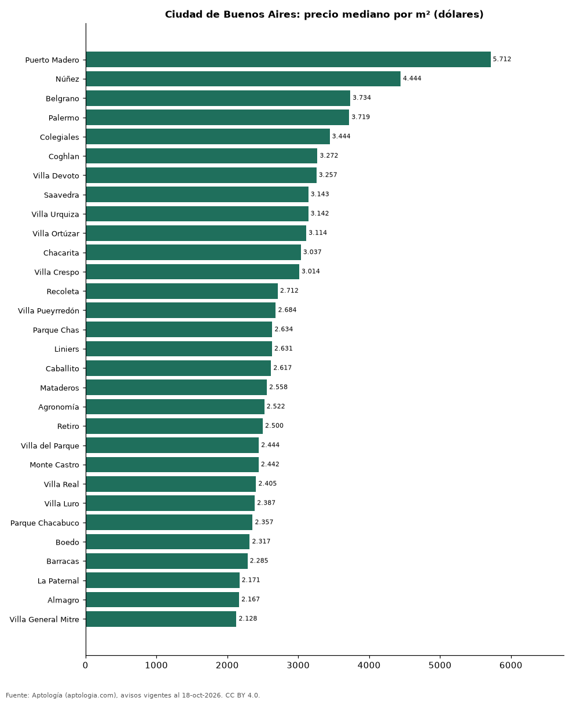

# Barrios más caros y más baratos de Ciudad de Buenos Aires para comprar departamento: ranking por m² (octubre 2026)

**En Ciudad de Buenos Aires, el barrio con el m² más caro para comprar departamento es Puerto Madero (USD 5.712/m²) y el más barato Nueva Pompeya (USD 1.189/m²), 4,8 veces menos.** Comparamos 46 barrios con al menos 30 avisos con área.

*Resumen: analizamos 8.068 departamentos en venta con área declarada en 46 barrios de Ciudad de Buenos Aires.*

**Actualizado:** 18 de octubre de 2026 (datos del 18 de octubre de 2026) · **Próxima actualización:** mensual.

## Resumen

| Indicador | Valor |
|---|---|
| Más caro por m² | Puerto Madero: USD 5.712 |
| Más barato por m² | Nueva Pompeya: USD 1.189 |
| Diferencia | 4,8 veces |
| Barrios | 46 |

## Ranking de barrios por precio del m²

| Barrio | Por m² (mediana) | Precio (mediana) | Área mediana (m²) | Avisos con área |
|---|---|---|---|---|
| Puerto Madero | USD 5.712 | USD 496.500 | 104 | 114 |
| Núñez | USD 4.444 | USD 455.000 | 111 | 123 |
| Belgrano | USD 3.734 | USD 308.709 | 81 | 653 |
| Palermo | USD 3.719 | USD 269.500 | 77 | 1.021 |
| Colegiales | USD 3.444 | USD 269.000 | 81 | 153 |
| Coghlan | USD 3.272 | USD 222.500 | 67 | 146 |
| Villa Devoto | USD 3.257 | USD 269.999 | 82 | 169 |
| Saavedra | USD 3.143 | USD 183.000 | 63 | 127 |
| Villa Urquiza | USD 3.142 | USD 238.000 | 89 | 154 |
| Villa Ortúzar | USD 3.114 | USD 189.000 | 62 | 137 |
| Chacarita | USD 3.037 | USD 171.566 | 61 | 128 |
| Villa Crespo | USD 3.014 | USD 181.712 | 73 | 154 |
| Recoleta | USD 2.712 | USD 255.000 | 93 | 341 |
| Villa Pueyrredón | USD 2.684 | USD 158.500 | 62 | 142 |
| Parque Chas | USD 2.634 | USD 153.500 | 56 | 102 |
| Liniers | USD 2.631 | USD 130.500 | 60 | 156 |
| Caballito | USD 2.617 | USD 230.000 | 108 | 72 |
| Mataderos | USD 2.558 | USD 144.900 | 65 | 141 |
| Agronomía | USD 2.522 | USD 125.000 | 51 | 85 |
| Retiro | USD 2.500 | USD 282.500 | 114 | 198 |
| Villa del Parque | USD 2.444 | USD 158.000 | 67 | 148 |
| Monte Castro | USD 2.442 | USD 135.000 | 61 | 129 |
| Villa Real | USD 2.405 | USD 110.000 | 51 | 51 |
| Villa Luro | USD 2.387 | USD 128.000 | 60 | 145 |
| Parque Chacabuco | USD 2.357 | USD 136.320 | 65 | 155 |
| Boedo | USD 2.317 | USD 135.000 | 60 | 149 |
| Barracas | USD 2.285 | USD 149.650 | 67 | 152 |
| La Paternal | USD 2.171 | USD 115.000 | 53 | 136 |
| Almagro | USD 2.167 | USD 160.000 | 75 | 167 |
| Villa General Mitre | USD 2.128 | USD 115.000 | 55 | 35 |
| Villa Santa Rita | USD 2.126 | USD 110.000 | 53 | 113 |
| Flores | USD 2.115 | USD 149.000 | 77 | 195 |
| San Telmo | USD 1.894 | USD 140.000 | 70 | 161 |
| Vélez Sarsfield | USD 1.873 | USD 90.000 | 46 | 84 |
| Versalles | USD 1.864 | USD 110.000 | 56 | 77 |
| San Cristóbal | USD 1.857 | USD 110.000 | 59 | 159 |
| Parque Patricios | USD 1.783 | USD 95.000 | 54 | 141 |
| Parque Avellaneda | USD 1.706 | USD 87.500 | 53 | 106 |
| Floresta | USD 1.705 | USD 102.450 | 59 | 159 |
| Balvanera | USD 1.701 | USD 110.000 | 65 | 471 |
| Monserrat | USD 1.625 | USD 125.000 | 70 | 192 |
| San Nicolás | USD 1.618 | USD 119.500 | 74 | 200 |
| La Boca | USD 1.472 | USD 85.000 | 56 | 124 |
| Constitución | USD 1.360 | USD 79.000 | 60 | 143 |
| Villa Lugano | USD 1.213 | USD 74.900 | 58 | 113 |
| Nueva Pompeya | USD 1.189 | USD 64.900 | 59 | 47 |

Medianas; solo barrios con 30 avisos o más con área declarada.

## Preguntas frecuentes

**¿Cuál es el barrio más caro de Ciudad de Buenos Aires para comprar?**
Puerto Madero, con USD 5.712 por m² en la mediana (octubre de 2026).

**¿Y el más barato?**
Nueva Pompeya, con USD 1.189 por m².

## Metodología

- **Fuente:** exportes nocturnos de la base de datos de Aptología (aptologia.com) del 18 de octubre de 2026: avisos vigentes de vivienda en portales inmobiliarios de 13 países, recogidos por Aptología y vistos en línea entre el 11 y el 18 de octubre de 2026. Corte: 18 de octubre de 2026.
- **Depuración:** se eliminan duplicados exactos (misma ciudad, zona, tipo, precio, moneda, área, habitaciones y baños) y los precios fuera del percentil 1–99 de cada país, operación, moneda y tipo; el precio por m² usa solo avisos con área declarada entre 12 y 2.000 m² y también se recorta al P1–P99.
- **Qué se mide:** precios pedidos (publicados), no precios de cierre. En arriendo, el canon mensual sin administración, gastos comunes ni condominio.
- **Muestra mínima:** cada cifra publicada se apoya en al menos 30 avisos; las celdas con menos se omiten.
- **Monedas:** nunca se mezclan avisos de monedas distintas sin convertirlos. Conversión a dólares con la tasa de mercado de ExchangeRate-API (open.er-api.com, actualización del 18 Oct 2026): 1 USD = 3.182,80 COP, 1 USD = 18,47 M.N, 1 USD = 5,09 BRL, 1 USD = 3,44 PEN, 1 USD = 982,44 CLP, 1 USD = 1.514,57 ARS, 1 USD = 40,20 UYU, 1 USD = 5.705,37 PYG, 1 USD = 61,27 DOP, 1 USD = 0,89 EUR, 1 USD = 11,72 BOB; la UF chilena a 41.178,64 CLP (mindicador,cl. 18-oct-2026). Los avisos publicados en dólares se usan tal cual.
- **Monedas:** en cada ciudad y operación se usa solo la moneda mayoritaria de los avisos (los avisos en otra moneda se excluyen) y la mediana se convierte a dólares con la tasa citada; nunca se promedian avisos de monedas distintas.
- **Limitaciones:** la cobertura depende de los portales que recorre Aptología en cada país y es mayor en las ciudades grandes y en los segmentos medio-alto y alto; el área es la que declara el aviso, sin verificar; los nombres de zona vienen de los portales.
- **Privacidad:** solo se publican agregados; no se publica ningún dato personal, enlace a avisos ni nombre de anunciante.
- **Datos abiertos:** [datos.csv](datos.csv), licencia CC BY 4.0.

## Cómo citar

Pinzón Pineda, D. M. (2026). *Barrios más caros y más baratos de Ciudad de Buenos Aires para comprar departamento: ranking por m² (octubre 2026)*. Aptología (aptologia.com). https://github.com/elbroker/aptologia-datos/tree/main/estudios/barrios-mas-caros-y-baratos-ciudad-de-buenos-aires-venta-m2-2026. Datos: datos.csv, licencia CC BY 4.0.
