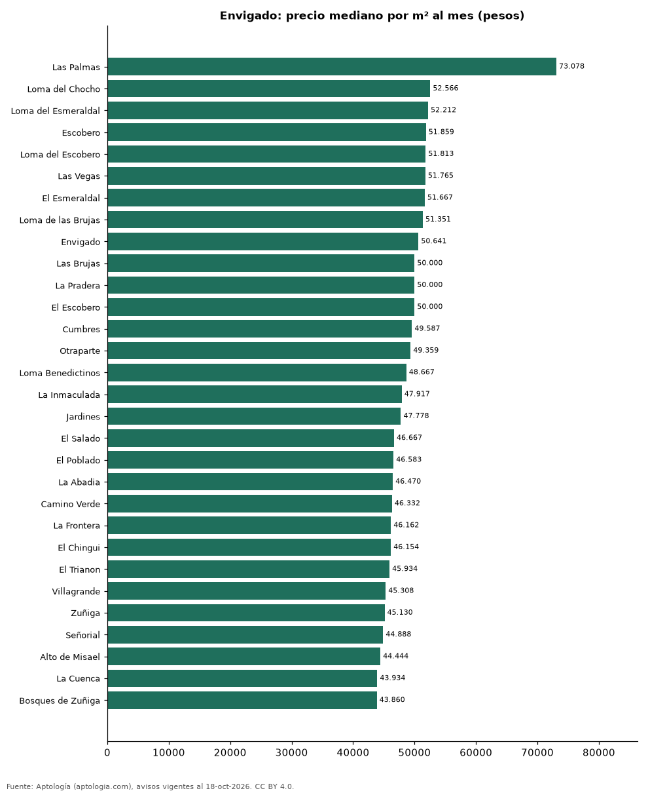

# Barrios más caros y más baratos de Envigado para arrendar apartamento: ranking por m² (octubre 2026)

**En Envigado, el barrio con el m² más caro para arrendar apartamento es Las Palmas (73.078 pesos/m² al mes) y el más barato Zona Centro (36.735 pesos/m² al mes), 2,0 veces menos.** Comparamos 40 barrios con al menos 30 avisos con área.

*Resumen: analizamos 6.348 apartamentos en arriendo con área declarada en 40 barrios de Envigado.*

**Actualizado:** 18 de octubre de 2026 (datos del 18 de octubre de 2026) · **Próxima actualización:** mensual.

## Resumen

| Indicador | Valor |
|---|---|
| Más caro por m² | Las Palmas: 73.078 pesos |
| Más barato por m² | Zona Centro: 36.735 pesos |
| Diferencia | 2,0 veces |
| Barrios | 40 |

## Ranking de barrios por precio del m²

| Barrio | Por m² (mediana) | Canon (mediana) | Área mediana (m²) | Avisos con área |
|---|---|---|---|---|
| Las Palmas | 73.078 pesos | 6.650.000 pesos | 90 | 46 |
| Loma del Chocho | 52.566 pesos | 4.650.000 pesos | 88 | 216 |
| Loma del Esmeraldal | 52.212 pesos | 4.550.000 pesos | 90 | 409 |
| Escobero | 51.859 pesos | 4.475.000 pesos | 88 | 194 |
| Loma del Escobero | 51.813 pesos | 4.600.000 pesos | 90 | 348 |
| Las Vegas | 51.765 pesos | 4.200.000 pesos | 82 | 167 |
| El Esmeraldal | 51.667 pesos | 4.500.000 pesos | 85 | 161 |
| Loma de las Brujas | 51.351 pesos | 5.500.000 pesos | 106 | 339 |
| Envigado | 50.641 pesos | 4.650.000 pesos | 94 | 1.249 |
| Las Brujas | 50.000 pesos | 5.500.000 pesos | 116 | 103 |
| La Pradera | 50.000 pesos | 4.500.000 pesos | 92 | 86 |
| El Escobero | 50.000 pesos | 4.500.000 pesos | 87 | 39 |
| Cumbres | 49.587 pesos | 4.500.000 pesos | 92 | 467 |
| Otraparte | 49.359 pesos | 4.350.000 pesos | 90 | 217 |
| Loma Benedictinos | 48.667 pesos | 5.000.000 pesos | 102 | 223 |
| La Inmaculada | 47.917 pesos | 4.500.000 pesos | 99 | 43 |
| Jardines | 47.778 pesos | 4.800.000 pesos | 98 | 72 |
| El Salado | 46.667 pesos | 3.550.000 pesos | 74 | 41 |
| El Poblado | 46.583 pesos | 4.950.000 pesos | 108 | 78 |
| La Abadia | 46.470 pesos | 4.300.000 pesos | 90 | 132 |
| Camino Verde | 46.332 pesos | 3.650.000 pesos | 80 | 336 |
| La Frontera | 46.162 pesos | 5.150.000 pesos | 112 | 48 |
| El Chingui | 46.154 pesos | 3.500.000 pesos | 74 | 87 |
| El Trianon | 45.934 pesos | 3.450.000 pesos | 74 | 90 |
| Villagrande | 45.308 pesos | 4.250.000 pesos | 93 | 54 |
| Zuñiga | 45.130 pesos | 4.950.000 pesos | 110 | 218 |
| Señorial | 44.888 pesos | 3.200.000 pesos | 71 | 90 |
| Alto de Misael | 44.444 pesos | 4.000.000 pesos | 90 | 35 |
| La Cuenca | 43.934 pesos | 3.050.000 pesos | 70 | 78 |
| Bosques de Zuñiga | 43.860 pesos | 5.000.000 pesos | 117 | 41 |
| Mesa | 43.182 pesos | 4.200.000 pesos | 100 | 157 |
| Loma del Barro | 42.967 pesos | 3.000.000 pesos | 70 | 58 |
| Los Almendros | 42.552 pesos | 3.100.000 pesos | 70 | 36 |
| Las Antillas | 42.308 pesos | 3.200.000 pesos | 75 | 91 |
| La Paz | 40.805 pesos | 3.350.000 pesos | 80 | 39 |
| El Portal | 40.270 pesos | 4.300.000 pesos | 110 | 86 |
| La Mina | 40.000 pesos | 2.550.000 pesos | 67 | 55 |
| El Dorado | 39.286 pesos | 2.800.000 pesos | 75 | 47 |
| Alcalá | 37.500 pesos | 3.000.000 pesos | 90 | 41 |
| Zona Centro | 36.735 pesos | 3.500.000 pesos | 95 | 31 |

Medianas; solo barrios con 30 avisos o más con área declarada.

## Preguntas frecuentes

**¿Cuál es el barrio más caro de Envigado para arrendar?**
Las Palmas, con 73.078 pesos por m² al mes en la mediana (octubre de 2026).

**¿Y el más barato?**
Zona Centro, con 36.735 pesos por m² al mes.

## Metodología

- **Fuente:** exportes nocturnos de la base de datos de Aptología (aptologia.com) del 18 de octubre de 2026: avisos vigentes de vivienda en portales inmobiliarios de 13 países, recogidos por Aptología y vistos en línea entre el 11 y el 18 de octubre de 2026. Corte: 18 de octubre de 2026.
- **Depuración:** se eliminan duplicados exactos (misma ciudad, zona, tipo, precio, moneda, área, habitaciones y baños) y los precios fuera del percentil 1–99 de cada país, operación, moneda y tipo; el precio por m² usa solo avisos con área declarada entre 12 y 2.000 m² y también se recorta al P1–P99.
- **Qué se mide:** precios pedidos (publicados), no precios de cierre. En arriendo, el canon mensual sin administración, gastos comunes ni condominio.
- **Muestra mínima:** cada cifra publicada se apoya en al menos 30 avisos; las celdas con menos se omiten.
- **Colombia:** Precios en pesos colombianos, sin conversión de moneda.
- **Limitaciones:** la cobertura depende de los portales que recorre Aptología en cada país y es mayor en las ciudades grandes y en los segmentos medio-alto y alto; el área es la que declara el aviso, sin verificar; los nombres de zona vienen de los portales.
- **Privacidad:** solo se publican agregados; no se publica ningún dato personal, enlace a avisos ni nombre de anunciante.
- **Datos abiertos:** [datos.csv](datos.csv), licencia CC BY 4.0.

## Cómo citar

Pinzón Pineda, D. M. (2026). *Barrios más caros y más baratos de Envigado para arrendar apartamento: ranking por m² (octubre 2026)*. Aptología (aptologia.com). https://github.com/elbroker/aptologia-datos/tree/main/estudios/barrios-mas-caros-y-baratos-envigado-arriendo-m2-2026. Datos: datos.csv, licencia CC BY 4.0.
