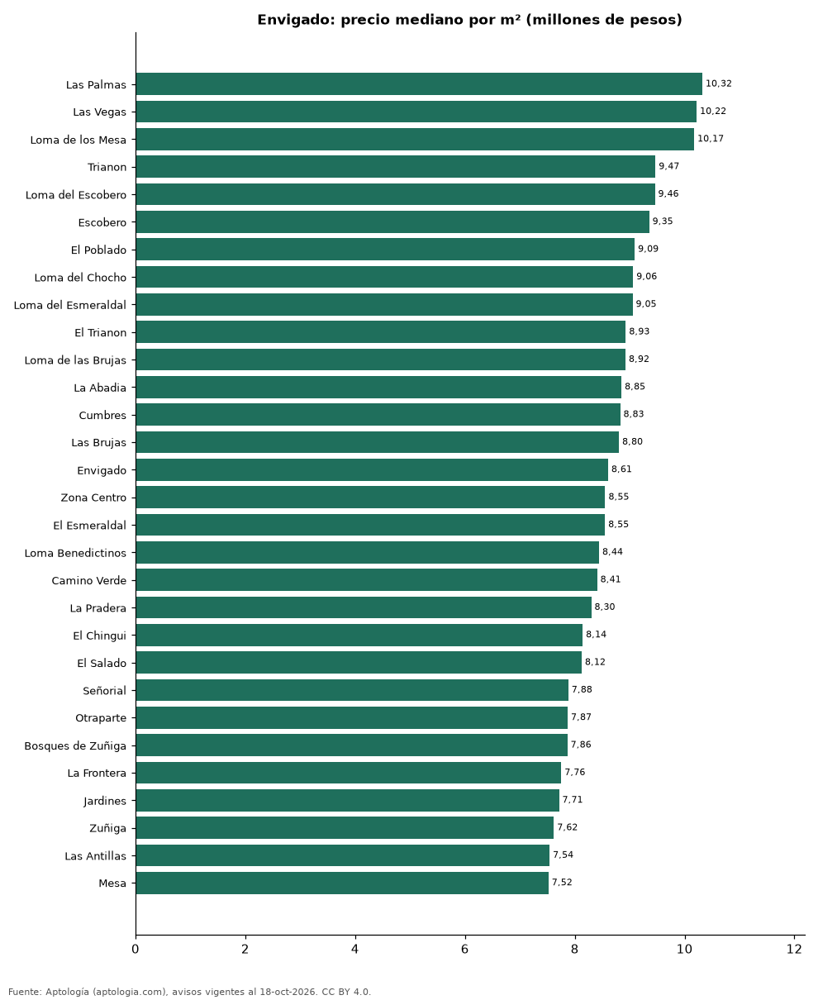

# Barrios más caros y más baratos de Envigado para comprar apartamento: ranking por m² (octubre 2026)

**En Envigado, el barrio con el m² más caro para comprar apartamento es Las Palmas (10,32 millones de pesos/m²) y el más barato Alcalá (5,33 millones de pesos/m²), 1,9 veces menos.** Comparamos 38 barrios con al menos 30 avisos con área.

*Resumen: analizamos 4.639 apartamentos en venta con área declarada en 38 barrios de Envigado.*

**Actualizado:** 18 de octubre de 2026 (datos del 18 de octubre de 2026) · **Próxima actualización:** mensual.

## Resumen

| Indicador | Valor |
|---|---|
| Más caro por m² | Las Palmas: 10,32 millones de pesos |
| Más barato por m² | Alcalá: 5,33 millones de pesos |
| Diferencia | 1,9 veces |
| Barrios | 38 |

## Ranking de barrios por precio del m²

| Barrio | Por m² (mediana) | Precio (mediana) | Área mediana (m²) | Avisos con área |
|---|---|---|---|---|
| Las Palmas | 10,32 millones de pesos | 1.150 millones de pesos | 100 | 47 |
| Las Vegas | 10,22 millones de pesos | 765 millones de pesos | 76 | 126 |
| Loma de los Mesa | 10,17 millones de pesos | 1.050 millones de pesos | 101 | 65 |
| Trianon | 9,47 millones de pesos | 665 millones de pesos | 83 | 33 |
| Loma del Escobero | 9,46 millones de pesos | 890 millones de pesos | 100 | 193 |
| Escobero | 9,35 millones de pesos | 950 millones de pesos | 100 | 144 |
| El Poblado | 9,09 millones de pesos | 1.090 millones de pesos | 135 | 39 |
| Loma del Chocho | 9,06 millones de pesos | 950 millones de pesos | 103 | 157 |
| Loma del Esmeraldal | 9,05 millones de pesos | 930 millones de pesos | 100 | 253 |
| El Trianon | 8,93 millones de pesos | 650 millones de pesos | 77 | 116 |
| Loma de las Brujas | 8,92 millones de pesos | 1.150 millones de pesos | 121 | 385 |
| La Abadia | 8,85 millones de pesos | 785 millones de pesos | 92 | 70 |
| Cumbres | 8,83 millones de pesos | 912 millones de pesos | 103 | 292 |
| Las Brujas | 8,80 millones de pesos | 1.005 millones de pesos | 120 | 76 |
| Envigado | 8,61 millones de pesos | 997 millones de pesos | 114 | 418 |
| Zona Centro | 8,55 millones de pesos | 770 millones de pesos | 96 | 92 |
| El Esmeraldal | 8,55 millones de pesos | 836 millones de pesos | 100 | 136 |
| Loma Benedictinos | 8,44 millones de pesos | 1.150 millones de pesos | 140 | 113 |
| Camino Verde | 8,41 millones de pesos | 665 millones de pesos | 84 | 333 |
| La Pradera | 8,30 millones de pesos | 850 millones de pesos | 104 | 51 |
| El Chingui | 8,14 millones de pesos | 630 millones de pesos | 80 | 117 |
| El Salado | 8,12 millones de pesos | 655 millones de pesos | 76 | 48 |
| Señorial | 7,88 millones de pesos | 595 millones de pesos | 77 | 103 |
| Otraparte | 7,87 millones de pesos | 890 millones de pesos | 116 | 107 |
| Bosques de Zuñiga | 7,86 millones de pesos | 1.050 millones de pesos | 128 | 50 |
| La Frontera | 7,76 millones de pesos | 1.060 millones de pesos | 125 | 50 |
| Jardines | 7,71 millones de pesos | 825 millones de pesos | 110 | 36 |
| Zuñiga | 7,62 millones de pesos | 900 millones de pesos | 122 | 197 |
| Las Antillas | 7,54 millones de pesos | 535 millones de pesos | 70 | 121 |
| Mesa | 7,52 millones de pesos | 775 millones de pesos | 100 | 142 |
| La Cuenca | 7,47 millones de pesos | 520 millones de pesos | 67 | 86 |
| El Portal | 7,42 millones de pesos | 780 millones de pesos | 110 | 109 |
| La Paz | 6,94 millones de pesos | 545 millones de pesos | 81 | 59 |
| Loma del Barro | 6,89 millones de pesos | 505 millones de pesos | 70 | 73 |
| La Magnolia | 6,65 millones de pesos | 652 millones de pesos | 109 | 44 |
| El Dorado | 6,11 millones de pesos | 525 millones de pesos | 84 | 62 |
| La Mina | 5,74 millones de pesos | 361 millones de pesos | 61 | 64 |
| Alcalá | 5,33 millones de pesos | 560 millones de pesos | 96 | 32 |

Medianas; solo barrios con 30 avisos o más con área declarada.

## Preguntas frecuentes

**¿Cuál es el barrio más caro de Envigado para comprar?**
Las Palmas, con 10,32 millones de pesos por m² en la mediana (octubre de 2026).

**¿Y el más barato?**
Alcalá, con 5,33 millones de pesos por m².

## Metodología

- **Fuente:** exportes nocturnos de la base de datos de Aptología (aptologia.com) del 18 de octubre de 2026: avisos vigentes de vivienda en portales inmobiliarios de 13 países, recogidos por Aptología y vistos en línea entre el 11 y el 18 de octubre de 2026. Corte: 18 de octubre de 2026.
- **Depuración:** se eliminan duplicados exactos (misma ciudad, zona, tipo, precio, moneda, área, habitaciones y baños) y los precios fuera del percentil 1–99 de cada país, operación, moneda y tipo; el precio por m² usa solo avisos con área declarada entre 12 y 2.000 m² y también se recorta al P1–P99.
- **Qué se mide:** precios pedidos (publicados), no precios de cierre. En arriendo, el canon mensual sin administración, gastos comunes ni condominio.
- **Muestra mínima:** cada cifra publicada se apoya en al menos 30 avisos; las celdas con menos se omiten.
- **Colombia:** Precios en pesos colombianos, sin conversión de moneda.
- **Limitaciones:** la cobertura depende de los portales que recorre Aptología en cada país y es mayor en las ciudades grandes y en los segmentos medio-alto y alto; el área es la que declara el aviso, sin verificar; los nombres de zona vienen de los portales.
- **Privacidad:** solo se publican agregados; no se publica ningún dato personal, enlace a avisos ni nombre de anunciante.
- **Datos abiertos:** [datos.csv](datos.csv), licencia CC BY 4.0.

## Cómo citar

Pinzón Pineda, D. M. (2026). *Barrios más caros y más baratos de Envigado para comprar apartamento: ranking por m² (octubre 2026)*. Aptología (aptologia.com). https://github.com/elbroker/aptologia-datos/tree/main/estudios/barrios-mas-caros-y-baratos-envigado-venta-m2-2026. Datos: datos.csv, licencia CC BY 4.0.
