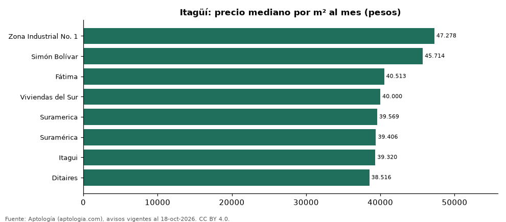

# Barrios más caros y más baratos de Itagüí para arrendar apartamento: ranking por m² (octubre 2026)

**En Itagüí, el barrio con el m² más caro para arrendar apartamento es Zona Industrial No. 1 (47.278 pesos/m² al mes) y el más barato Ditaires (38.516 pesos/m² al mes), 1,2 veces menos.** Comparamos 8 barrios con al menos 30 avisos con área.

*Resumen: analizamos 505 apartamentos en arriendo con área declarada en 8 barrios de Itagüí.*

**Actualizado:** 18 de octubre de 2026 (datos del 18 de octubre de 2026) · **Próxima actualización:** mensual.

## Resumen

| Indicador | Valor |
|---|---|
| Más caro por m² | Zona Industrial No. 1: 47.278 pesos |
| Más barato por m² | Ditaires: 38.516 pesos |
| Diferencia | 1,2 veces |
| Barrios | 8 |

## Ranking de barrios por precio del m²

| Barrio | Por m² (mediana) | Canon (mediana) | Área mediana (m²) | Avisos con área |
|---|---|---|---|---|
| Zona Industrial No. 1 | 47.278 pesos | 3.200.000 pesos | 68 | 32 |
| Simón Bolívar | 45.714 pesos | 3.100.000 pesos | 70 | 37 |
| Fátima | 40.513 pesos | 2.800.000 pesos | 67 | 48 |
| Viviendas del Sur | 40.000 pesos | 2.500.000 pesos | 66 | 70 |
| Suramerica | 39.569 pesos | 3.150.000 pesos | 80 | 44 |
| Suramérica | 39.406 pesos | 2.950.000 pesos | 75 | 118 |
| Itagui | 39.320 pesos | 2.700.000 pesos | 68 | 62 |
| Ditaires | 38.516 pesos | 2.600.000 pesos | 68 | 94 |

Medianas; solo barrios con 30 avisos o más con área declarada.

## Preguntas frecuentes

**¿Cuál es el barrio más caro de Itagüí para arrendar?**
Zona Industrial No. 1, con 47.278 pesos por m² al mes en la mediana (octubre de 2026).

**¿Y el más barato?**
Ditaires, con 38.516 pesos por m² al mes.

## Metodología

- **Fuente:** exportes nocturnos de la base de datos de Aptología (aptologia.com) del 18 de octubre de 2026: avisos vigentes de vivienda en portales inmobiliarios de 13 países, recogidos por Aptología y vistos en línea entre el 11 y el 18 de octubre de 2026. Corte: 18 de octubre de 2026.
- **Depuración:** se eliminan duplicados exactos (misma ciudad, zona, tipo, precio, moneda, área, habitaciones y baños) y los precios fuera del percentil 1–99 de cada país, operación, moneda y tipo; el precio por m² usa solo avisos con área declarada entre 12 y 2.000 m² y también se recorta al P1–P99.
- **Qué se mide:** precios pedidos (publicados), no precios de cierre. En arriendo, el canon mensual sin administración, gastos comunes ni condominio.
- **Muestra mínima:** cada cifra publicada se apoya en al menos 30 avisos; las celdas con menos se omiten.
- **Colombia:** Precios en pesos colombianos, sin conversión de moneda.
- **Limitaciones:** la cobertura depende de los portales que recorre Aptología en cada país y es mayor en las ciudades grandes y en los segmentos medio-alto y alto; el área es la que declara el aviso, sin verificar; los nombres de zona vienen de los portales.
- **Privacidad:** solo se publican agregados; no se publica ningún dato personal, enlace a avisos ni nombre de anunciante.
- **Datos abiertos:** [datos.csv](datos.csv), licencia CC BY 4.0.

## Cómo citar

Pinzón Pineda, D. M. (2026). *Barrios más caros y más baratos de Itagüí para arrendar apartamento: ranking por m² (octubre 2026)*. Aptología (aptologia.com). https://github.com/elbroker/aptologia-datos/tree/main/estudios/barrios-mas-caros-y-baratos-itagui-arriendo-m2-2026. Datos: datos.csv, licencia CC BY 4.0.
