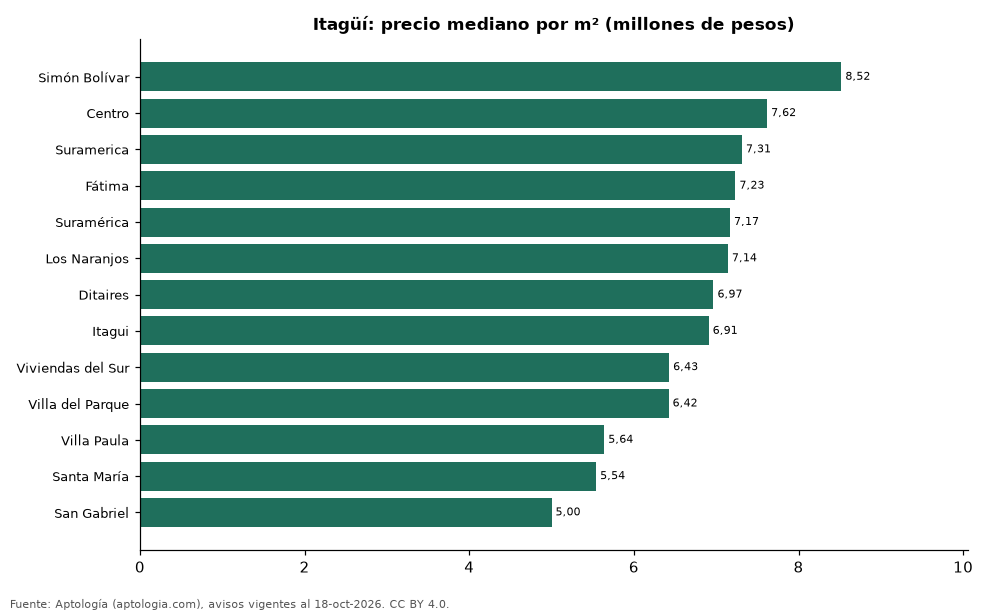

# Barrios más caros y más baratos de Itagüí para comprar apartamento: ranking por m² (octubre 2026)

**En Itagüí, el barrio con el m² más caro para comprar apartamento es Simón Bolívar (8,52 millones de pesos/m²) y el más barato San Gabriel (5,00 millones de pesos/m²), 1,7 veces menos.** Comparamos 13 barrios con al menos 30 avisos con área.

*Resumen: analizamos 1.305 apartamentos en venta con área declarada en 13 barrios de Itagüí.*

**Actualizado:** 18 de octubre de 2026 (datos del 18 de octubre de 2026) · **Próxima actualización:** mensual.

## Resumen

| Indicador | Valor |
|---|---|
| Más caro por m² | Simón Bolívar: 8,52 millones de pesos |
| Más barato por m² | San Gabriel: 5,00 millones de pesos |
| Diferencia | 1,7 veces |
| Barrios | 13 |

## Ranking de barrios por precio del m²

| Barrio | Por m² (mediana) | Precio (mediana) | Área mediana (m²) | Avisos con área |
|---|---|---|---|---|
| Simón Bolívar | 8,52 millones de pesos | 550 millones de pesos | 66 | 46 |
| Centro | 7,62 millones de pesos | 477 millones de pesos | 63 | 47 |
| Suramerica | 7,31 millones de pesos | 550 millones de pesos | 77 | 261 |
| Fátima | 7,23 millones de pesos | 468 millones de pesos | 63 | 84 |
| Suramérica | 7,17 millones de pesos | 573 millones de pesos | 84 | 194 |
| Los Naranjos | 7,14 millones de pesos | 450 millones de pesos | 64 | 33 |
| Ditaires | 6,97 millones de pesos | 470 millones de pesos | 68 | 231 |
| Itagui | 6,91 millones de pesos | 480 millones de pesos | 68 | 111 |
| Viviendas del Sur | 6,43 millones de pesos | 430 millones de pesos | 64 | 135 |
| Villa del Parque | 6,42 millones de pesos | 430 millones de pesos | 64 | 30 |
| Villa Paula | 5,64 millones de pesos | 458 millones de pesos | 67 | 30 |
| Santa María | 5,54 millones de pesos | 368 millones de pesos | 65 | 64 |
| San Gabriel | 5,00 millones de pesos | 295 millones de pesos | 55 | 39 |

Medianas; solo barrios con 30 avisos o más con área declarada.

## Preguntas frecuentes

**¿Cuál es el barrio más caro de Itagüí para comprar?**
Simón Bolívar, con 8,52 millones de pesos por m² en la mediana (octubre de 2026).

**¿Y el más barato?**
San Gabriel, con 5,00 millones de pesos por m².

## Metodología

- **Fuente:** exportes nocturnos de la base de datos de Aptología (aptologia.com) del 18 de octubre de 2026: avisos vigentes de vivienda en portales inmobiliarios de 13 países, recogidos por Aptología y vistos en línea entre el 11 y el 18 de octubre de 2026. Corte: 18 de octubre de 2026.
- **Depuración:** se eliminan duplicados exactos (misma ciudad, zona, tipo, precio, moneda, área, habitaciones y baños) y los precios fuera del percentil 1–99 de cada país, operación, moneda y tipo; el precio por m² usa solo avisos con área declarada entre 12 y 2.000 m² y también se recorta al P1–P99.
- **Qué se mide:** precios pedidos (publicados), no precios de cierre. En arriendo, el canon mensual sin administración, gastos comunes ni condominio.
- **Muestra mínima:** cada cifra publicada se apoya en al menos 30 avisos; las celdas con menos se omiten.
- **Colombia:** Precios en pesos colombianos, sin conversión de moneda.
- **Limitaciones:** la cobertura depende de los portales que recorre Aptología en cada país y es mayor en las ciudades grandes y en los segmentos medio-alto y alto; el área es la que declara el aviso, sin verificar; los nombres de zona vienen de los portales.
- **Privacidad:** solo se publican agregados; no se publica ningún dato personal, enlace a avisos ni nombre de anunciante.
- **Datos abiertos:** [datos.csv](datos.csv), licencia CC BY 4.0.

## Cómo citar

Pinzón Pineda, D. M. (2026). *Barrios más caros y más baratos de Itagüí para comprar apartamento: ranking por m² (octubre 2026)*. Aptología (aptologia.com). https://github.com/elbroker/aptologia-datos/tree/main/estudios/barrios-mas-caros-y-baratos-itagui-venta-m2-2026. Datos: datos.csv, licencia CC BY 4.0.
